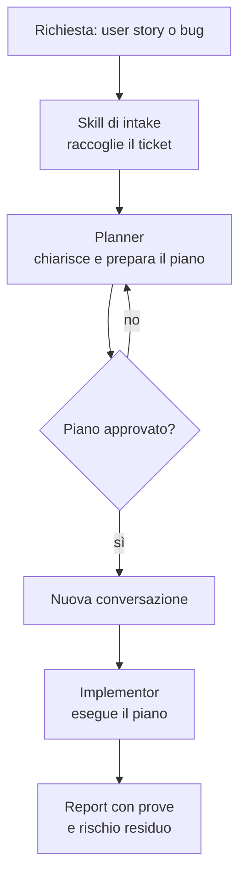

[Corso](../README.md) › [Principi](README.md) › **1. Autorità delimitata**

# 1. Autorità delimitata

> **In breve:** ogni ruolo ha un mandato scritto: che cosa può decidere, che cosa non può toccare, che cosa consegna e a chi. Quando cambia l'autorità, cambia il ruolo.

[Slide](../slides/01-autorita-delimitata.md) · [Caso guida](../caso-guida.md)

## Il problema

Un solo agente interpreta il requisito, sceglie il design, modifica il codice e dichiara il lavoro concluso. Nessuno vede il momento in cui una scelta è stata presa. Se il requisito era ambiguo, l'agente l'ha completato da solo: il risultato sembra preciso, ma contiene una decisione che nessuno ha autorizzato.

## Il principio

Un ruolo non è un titolo: è un contratto. Stabilisce:

- **il mandato**: quale problema risolve;
- **i limiti**: che cosa non può fare;
- **la consegna**: che cosa produce e per chi.

Serve un ruolo separato quando cambiano l'autorità, gli strumenti, il tipo di output o la persona che deve approvare.

## Nel sistema di riferimento

Il percorso principale separa chi pianifica da chi implementa:

| Ruolo | Può | Non può |
| --- | --- | --- |
| [Planner](../role-maps/agents/planner.md) | Analizzare la richiesta, fare domande, preparare un piano e farlo approvare | Modificare il codice dell'applicazione |
| [Implementor](../role-maps/agents/implementor.md) | Eseguire un piano approvato, compilare, verificare e riferire | Allargare lo scope oltre il piano |

**Prima del piano viene la richiesta.** Una story scritta male lascia aperte decisioni importanti. Tre skill aiutano a renderle visibili:

- [Plan User Story From Id](../role-maps/skills/plan-user-story-from-id.md) recupera la story dal tracker tramite il suo ID;
- [Plan Bug From Id](../role-maps/skills/plan-bug-from-id.md) fa lo stesso per un bug e fa scegliere a una persona la causa da pianificare;
- [User Story Analysis](../role-maps/skills/user-story-analysis.md) trova lacune, ambiguità e assunzioni, e le trasforma in domande.

Nessuna di queste skill decide al posto dello stakeholder. Anche il Planner non colma i vuoti inventando: quando una lacuna blocca il piano, fa una domanda. Una buona domanda dice **quale decisione del piano dipende dalla risposta**. “Come deve rispondere l'API se la motivazione contiene solo spazi?” è utile; “Hai altri dettagli?” non lo è.

**Altri ruoli, per altri bisogni.** La [guida alla scelta del percorso](../role-maps/README.md#quale-percorso-scegliere) li confronta:

- [Direct Implementor](../role-maps/agents/direct-implementor.md) implementa partendo da requisiti validati, senza un piano intermedio. Ha gate propri e non crea test.
- [Ask](../role-maps/agents/ask.md) risponde a domande tecniche senza modificare nulla.
- [Integration Tester](../role-maps/agents/integration-tester.md) pianifica e scrive test di integrazione.
- [Knowledge Builder](../role-maps/agents/knowledge-builder.md) ricava regole dal repository e le salva come knowledge.
- [Manage Work Item](../role-maps/skills/manage-work-item.md) crea o aggiorna un ticket fuori dal percorso di pianificazione.

Il tuo repository può usare altri nomi o meno ruoli. Conta una cosa sola: un cambio di autorità deve essere visibile.

## Nel caso guida

La story dice: “Come operatore, voglio chiudere una richiesta solo dopo aver inserito una motivazione.” Non dice se il vincolo vale anche per l'API, se una motivazione fatta di soli spazi è valida, né che cosa succede a una richiesta già chiusa. Il Planner non sceglie: chiede. Lo stakeholder risponde che il vincolo vale per interfaccia e API, che gli spazi non bastano e che una richiesta chiusa non si modifica. [Leggi la traccia completa](../caso-guida.md#traccia-1-richiesta-e-chiarimento).

## Nel tuo repository

- Quale passaggio non dovrebbe mai essere completato dalla stessa conversazione senza una revisione?
- Quale ambiguità ricorrente nei ticket del tuo team diventa una decisione che nessuno ha preso?

---

[← Precedente: I sei principi](README.md) · [↑ Principi](README.md) · [Successivo: 2. Gate e controllo umano →](02-gate-e-controllo-umano.md)
