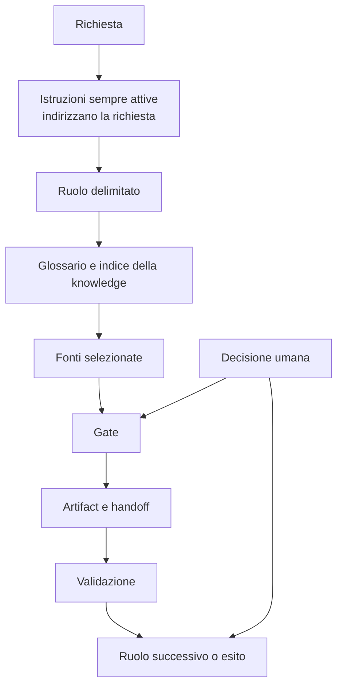
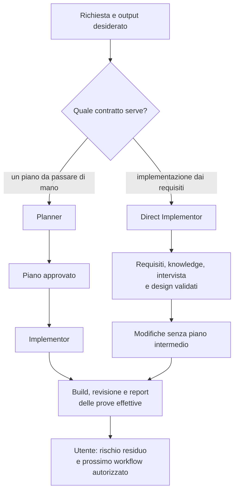
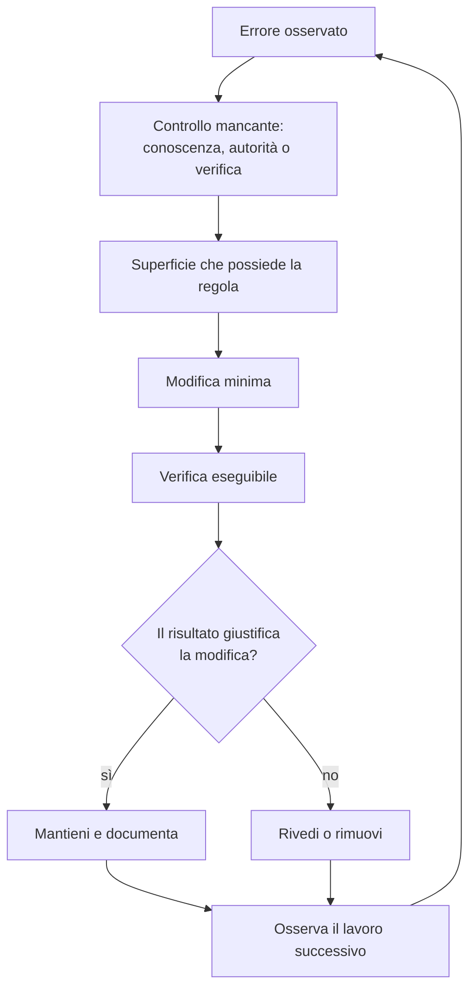

[Corso](../README.md) › [Approfondimenti](README.md) › **Mappa del sistema**

# Mappa del sistema

Questa mappa mostra come si collegano gli elementi di un Agentic System. Non prescrive nomi di file, agent o cartelle per il tuo repository.

## Come scorre un'attività

| Elemento | Che cosa fa | Principio |
| --- | --- | --- |
| Istruzioni sempre attive | Indirizzano verso i contratti necessari | [6. Composizione e ciclo di vita](../principi/06-composizione-e-ciclo-di-vita.md) |
| Ruolo | Limita autorità, strumenti e output | [1. Autorità delimitata](../principi/01-autorita-delimitata.md) |
| Gate | Controlla il passaggio | [2. Gate e controllo umano](../principi/02-gate-e-controllo-umano.md) |
| Validazione | Smentisce gli esiti non affidabili | [3. Validazione come prova](../principi/03-validazione-come-prova.md) |
| Artifact | Conserva prove, stato e handoff | [4. Artifact durevoli](../principi/04-artifact-durevoli.md) |
| Glossario | Stabilizza i termini | [5. Conoscenza selettiva](../principi/05-conoscenza-selettiva.md) |
| Indice della knowledge | Seleziona le fonti da leggere | [5. Conoscenza selettiva](../principi/05-conoscenza-selettiva.md) |

## Due percorsi di implementazione

Mappe dei ruoli: [Planner](../role-maps/agents/planner.md) · [Implementor](../role-maps/agents/implementor.md) · [Direct Implementor](../role-maps/agents/direct-implementor.md) · [Come scegliere](../role-maps/README.md#quale-percorso-scegliere).

Il diagramma riassume i percorsi: non permette di unire o saltare i gate. Il Direct Implementor non crea test; una verifica successiva richiede il ruolo incaricato, con il suo intake.

## Ciclo di manutenzione

Ogni regola resta nella superficie che la possiede; le altre superfici rimandano a lei invece di copiarla. Il risultato della verifica distingue ciò che è stato controllato dal rischio che resta aperto.

---

[↑ Approfondimenti](README.md)
