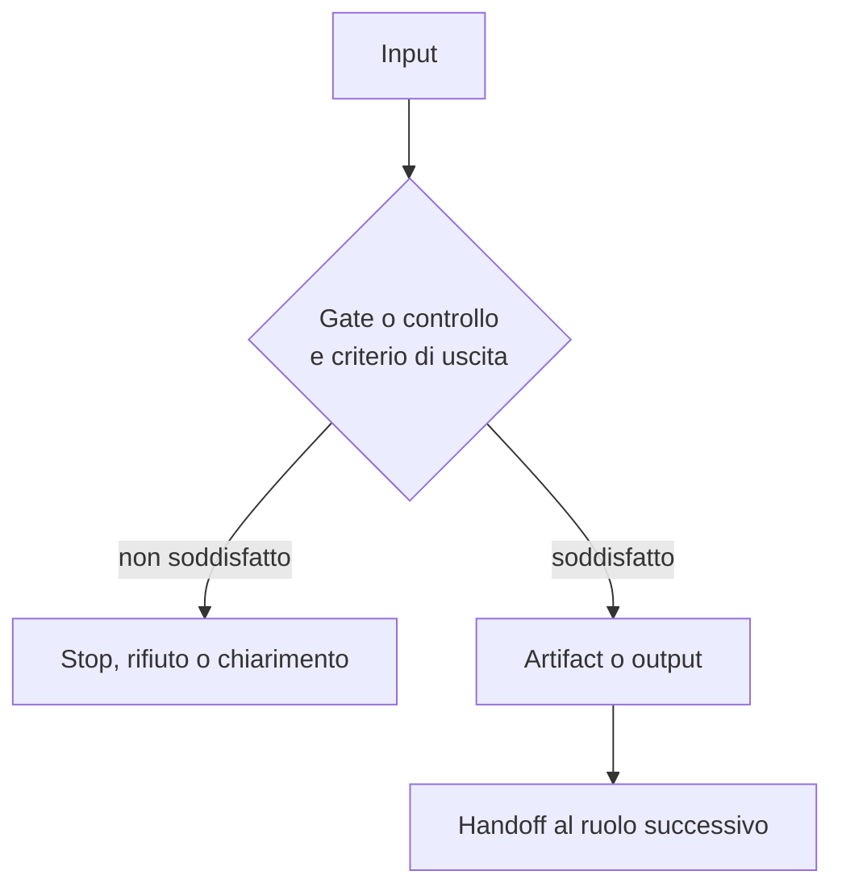

[Corso](../README.md) › **Mappe di agent e skill**

# Mappe di agent e skill

Ogni mappa descrive un agent o una skill del sistema di riferimento: una sintesi in tre righe, il diagramma del flusso e una tabella che spiega ogni passaggio. In alto trovi il link al file sorgente; in fondo, i principi in cui il ruolo compare e i link alla mappa precedente e successiva.

Le mappe sono materiale didattico. Non prescrivono ruoli, nomi o strumenti per il tuo repository.

## Agent

1. [Planner](agents/planner.md): prepara un piano e lo fa approvare, senza modificare il codice.
2. [Implementor](agents/implementor.md): esegue un piano approvato e ne registra le prove.
3. [Direct Implementor](agents/direct-implementor.md): implementa da requisiti validati, senza piano intermedio.
4. [Ask](agents/ask.md): risponde a domande tecniche senza modificare nulla.
5. [Integration Tester](agents/integration-tester.md): pianifica e scrive test di integrazione.
6. [Knowledge Builder](agents/knowledge-builder.md): ricava regole dal repository e le salva come knowledge.

## Skill

7. [Plan User Story From Id](skills/plan-user-story-from-id.md): recupera una user story tramite il suo ID.
8. [Plan Bug From Id](skills/plan-bug-from-id.md): recupera un bug e fa scegliere la causa da pianificare.
9. [User Story Analysis](skills/user-story-analysis.md): trova lacune e ambiguità prima del design.
10. [Business Logic Gap Detector](skills/business-logic-gap-detector.md): scrive test che falliscono per esporre un difetto reale.
11. [Integration Test Knowledge Checklist](skills/integration-test-knowledge-checklist.md): definisce la knowledge per i test di integrazione.
12. [Author Repo Skill](skills/author-repo-skill.md): crea o aggiorna una procedura ripetibile come skill.
13. [Manage Work Item](skills/manage-work-item.md): crea o aggiorna un ticket, fuori dal percorso di pianificazione.

## Quale percorso scegliere?

| Esigenza | Percorso | Che cosa serve prima di modificare |
| --- | --- | --- |
| Capire o spiegare | [Ask](agents/ask.md) | Fonti verificabili; nessuna implementazione implicita |
| Preparare un piano da approvare e passare di mano | [Planner](agents/planner.md) → [Implementor](agents/implementor.md) | Un piano approvato e uno scope leggibile |
| Implementare dai requisiti, senza documento di piano | [Direct Implementor](agents/direct-implementor.md) | Requisiti, regole e decisioni di design validati nei gate |
| Scrivere test di integrazione | [Integration Tester](agents/integration-tester.md) | Intake e piano di test propri del ruolo; nessun handoff che salti i suoi gate |
| Creare o aggiornare un ticket | [Manage Work Item](skills/manage-work-item.md) | Approvazione esplicita della proposta finale |

La scelta dipende dall'autorità e dall'output richiesti, non solo dalla dimensione del task.

## Come leggere una mappa

Ogni diagramma segue la stessa catena:

La tabella sotto il diagramma risponde a quattro domande: quale decisione protegge il passaggio, che cosa produce, chi riceve il lavoro e che cosa succede se il criterio non è soddisfatto.

Due avvertenze:

- **I gate numerati** sono quelli del file sorgente. Nelle mappe senza gate numerati, i controlli del diagramma servono alla lettura: non aggiungono stop, approvazioni o artifact al workflow originale.
- **Un output in chat** non diventa un artifact salvato solo perché compare nel diagramma.

Seguire le frecce non conferisce autorità: il file sorgente collegato resta la fonte di verità.

---

[↑ Torna al corso](../README.md) · [Inizia: Planner →](agents/planner.md)
