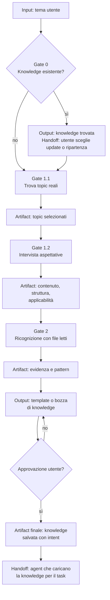

[Corso](../../README.md) › [Mappe di agent e skill](../README.md) › **Knowledge Builder**

# Knowledge Builder

**File sorgente:** [agents/knowledge-builder.agent.md](../../system/canonical/agents/knowledge-builder.agent.md)

## In 30 secondi

**Fa:** legge il repository per produrre knowledge applicabile da un agente che non conosce il progetto, basata su evidenza reale e salvata come knowledge riusabile.

**Non fa:** non modifica codice di produzione, non confonde nomi file con evidenza e non trasforma supposizioni in fatti.

**Consegna:** topic e aspettative come artifact di sessione, quindi una knowledge salvata nella fonte approvata con intent e contenuto applicabile.

## Flusso, gate e artifact

## Lettura del diagramma

| Gate | Decisione che protegge | Artifact o output | Handoff successivo |
| --- | --- | --- | --- |
| 0. Knowledge esistente | Si aggiorna una base utile o si parte da zero? | Esito del catalogo e scelta utente | Gate 1.1 |
| 1.1. Topic | Quali concetti distinti esistono davvero nel codice? | Artifact per ogni topic scelto | Gate 1.2 |
| 1.2. Aspettative | Cosa deve sapere e come userà la knowledge il destinatario? | Artifact di intervista | Gate 2 |
| 2. Ricognizione | Quali prove derivano da file realmente letti? | Evidenza, relazioni e esempi | Bozza |
| Bozza e approvazione | La knowledge è utile, supportata e leggibile senza contesto? | Template o draft approvato | Pubblicazione |
| Salvataggio | Dove la troverà il prossimo agente? | Documento salvato nella fonte knowledge approvata, con intent | Ruoli che consultano la knowledge |

**Da ricordare:** un artifact di ricerca non è ancora knowledge. Diventa riusabile soltanto dopo bozza, approvazione e salvataggio nella fonte knowledge approvata.

---

**Nei principi:** [1. Autorità delimitata](../../principi/01-autorita-delimitata.md) · [5. Conoscenza selettiva](../../principi/05-conoscenza-selettiva.md)

[← Precedente: Integration Tester](integration-tester.md) · [↑ Mappe di agent e skill](../README.md) · [Successivo: Plan User Story From Id →](../skills/plan-user-story-from-id.md)
