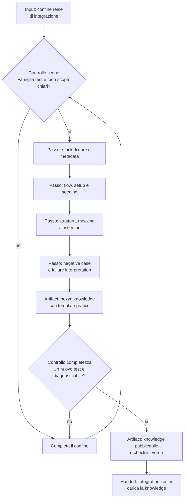

[Corso](../../README.md) › [Mappe di agent e skill](../README.md) › **Integration Test Knowledge Checklist**

# Integration Test Knowledge Checklist

**File sorgente:** [skills/integration-test-knowledge-checklist/SKILL.md](../../system/canonical/skills/integration-test-knowledge-checklist/SKILL.md)

## In 30 secondi

**Fa:** guida la costruzione di una knowledge project-specific che permetta di creare e diagnosticare test di integrazione nel confine reale del progetto.

**Non fa:** non sostituisce una convenzione locale con consigli generici e non confonde test di integrazione con unit, system o end-to-end test.

**Consegna:** una knowledge indicizzata con metadata, stack, setup, seeding, mocking, assertion, failure interpretation e checklist verde.

## Flusso, controlli e output

## Lettura del diagramma

| Passaggio o controllo | Decisione che protegge | Artifact o output | Handoff successivo |
| --- | --- | --- | --- |
| Scope | Quale famiglia test e quale confine reale copre? | Scope e fuori scope espliciti | Stack |
| Stack e setup | Quali fixture, dipendenze, dati e seeding sono necessari? | Regole di stack, setup e seeding | Struttura |
| Struttura e assertion | Come si organizzano test, mock e prove degli effetti? | Template e policy di assertion | Failure interpretation |
| Failure interpretation | Come distinguere setup errato da difetto reale? | Casi negativi e segnali di failure | Completezza |
| Completezza | Un agente può creare e debuggare un test nuovo? | Knowledge indicizzabile e checklist verde | Integration Tester |

**Da ricordare:** il prodotto non è un elenco di librerie. È una knowledge che permette al tester di ricostruire setup, prova e interpretazione di una failure.

---

**Nei principi:** [5. Conoscenza selettiva](../../principi/05-conoscenza-selettiva.md)

[← Precedente: Business Logic Gap Detector](business-logic-gap-detector.md) · [↑ Mappe di agent e skill](../README.md) · [Successivo: Author Repo Skill →](author-repo-skill.md)
