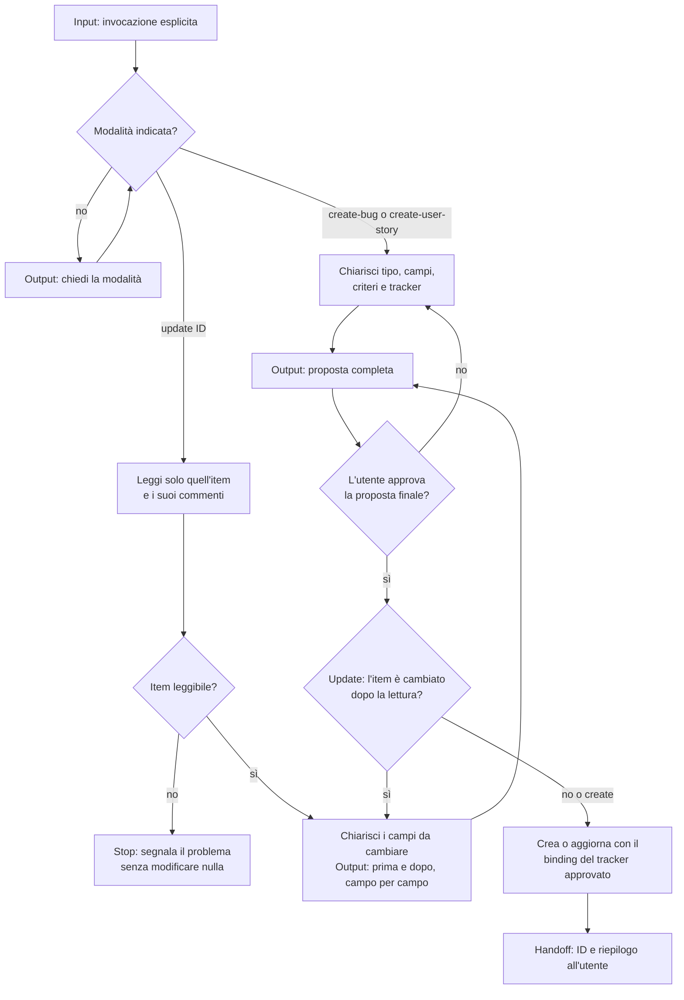

[Corso](../../README.md) › [Mappe di agent e skill](../README.md) › **Manage Work Item**

# Manage Work Item

**File sorgente:** [skills/manage-work-item/SKILL.md](../../system/canonical/skills/manage-work-item/SKILL.md)

## In 30 secondi

**Fa:** crea un bug o una user story, oppure aggiorna un work item esistente nel tracker del repository. Parte solo quando l'utente la invoca per nome.

**Non fa:** non apre né riprende una sessione di pianificazione, non coinvolge il Planner e non prepara un piano. Non cerca nel tracker per indovinare l'item da aggiornare, non cancella item o commenti e non cambia campi che l'utente non ha chiesto di cambiare.

**Consegna:** modalità, tipo, ID del work item, adapter usato, link o percorso della fonte, campi cambiati e campi ancora aperti. L'ID serve poi, se l'utente lo vuole, a una skill di pianificazione.

**Autorità:** l'invocazione autorizza il workflow, non la scrittura. Ogni creazione o modifica richiede l'approvazione esplicita della proposta finale.

## Flusso, controlli e output

## Lettura del diagramma

| Passaggio | Decisione che protegge | Output | Passaggio successivo |
| --- | --- | --- | --- |
| Modalità | Che cosa si vuole fare: creare un bug, una story o aggiornare un item? | Modalità scelta | Chiarimento o lettura |
| Chiarimento | La proposta è abbastanza precisa da poter essere revisionata? | Tipo, titolo, descrizione, criteri o passi di riproduzione, tracker | Approvazione |
| Lettura (update) | L'item esiste ed è leggibile? Quali commenti contano? | Stato attuale e confronto prima/dopo | Approvazione, oppure stop |
| Approvazione | L'utente accetta esattamente questa proposta? | Approvazione esplicita | Rilettura o scrittura |
| Rilettura (update) | L'item è cambiato nel frattempo? | Differenza e nuova richiesta di approvazione, se serve | Scrittura |
| Scrittura | Il binding del tracker approvato può eseguire l'operazione? | Item creato o aggiornato, oppure blocco spiegato | Utente |

Se il binding del tracker richiesto non è disponibile, la skill spiega il blocco e non crea né modifica nulla. Non sostituisce il binding con comandi shell, chiamate API o strumenti di altri client.

**Da ricordare:** l'approvazione del workflow o della discussione precedente non vale come approvazione della modifica. Conta solo il sì alla proposta finale.

---

**Nei principi:** [1. Autorità delimitata](../../principi/01-autorita-delimitata.md) · [2. Gate e controllo umano](../../principi/02-gate-e-controllo-umano.md)

[← Precedente: Author Repo Skill](author-repo-skill.md) · [↑ Mappe di agent e skill](../README.md) · [Torna al corso →](../../README.md)
