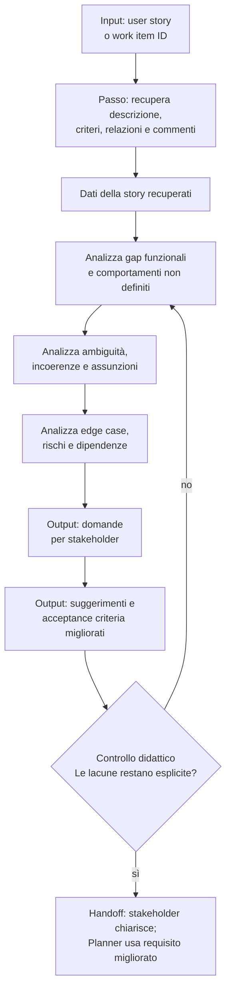

[Corso](../../README.md) › [Mappe di agent e skill](../README.md) › **User Story Analysis**

# User Story Analysis

**File sorgente:** [skills/user-story-analysis/SKILL.md](../../system/canonical/skills/user-story-analysis/SKILL.md)

## In 30 secondi

**Fa:** analizza criticamente una user story prima del design, esponendo ciò che manca, e le conseguenze di ambiguità, assunzioni, casi limite e rischi.

**Non fa:** non inventa requisiti. Quando mancano dettagli, li trasforma in domande per stakeholder e suggerimenti di miglioramento.

**Consegna:** un'analisi strutturata che rende il requisito più verificabile prima che un Planner lo trasformi in piano.

## Flusso, controlli e output

## Lettura del diagramma

| Passaggio o controllo | Decisione che protegge | Output | Handoff successivo |
| --- | --- | --- | --- |
| Recupero | Quale evidenza definisce davvero la story? | Descrizione, criteri, commenti e relazioni | Analisi |
| Gap e ambiguità | Cosa manca, e cosa può avere più interpretazioni? | Gap, incoerenze e assunzioni esplicite | Scenari |
| Scenari e rischi | Quali casi limite, dipendenze e rischi richiedono decisione? | Inventario di scenari e rischi | Domande |
| Domande e miglioramenti | Come si ottiene un requisito più preciso senza inventarlo? | Domande stakeholder e proposte di AC | Controllo dell'output |
| Controllo dell'output | Le lacune restano esplicite senza requisiti inventati? | Analisi strutturata | Stakeholder e Planner |

**Da ricordare:** il valore della skill è rendere esplicita l'incertezza. Un requisito migliore nasce da domande tracciabili, non da dettagli aggiunti dall'analista.

---

**Nei principi:** [1. Autorità delimitata](../../principi/01-autorita-delimitata.md) · [6. Composizione e ciclo di vita](../../principi/06-composizione-e-ciclo-di-vita.md)

[← Precedente: Plan Bug From Id](plan-bug-from-id.md) · [↑ Mappe di agent e skill](../README.md) · [Successivo: Business Logic Gap Detector →](business-logic-gap-detector.md)
