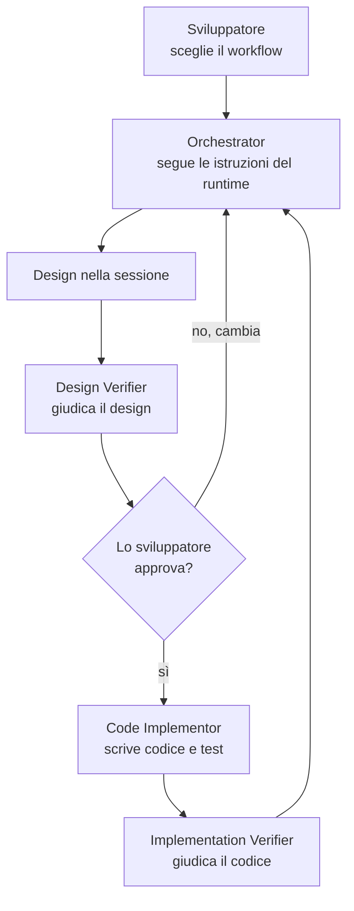

[Corso](../README.md) › [Principi](README.md) › **1. Autorità delimitata**

# 1. Autorità delimitata

> **In breve:** ogni ruolo ha un mandato scritto: che cosa può decidere, che cosa non può toccare, che cosa consegna e a chi. Quando cambia l'autorità, cambia il ruolo.

[Slide](../slides/01-autorita-delimitata.md) · [Caso guida](../caso-guida.md)

## Il problema

Un solo agente interpreta il requisito, sceglie il design, modifica il codice, scrive i test e dichiara il lavoro concluso. Nessuno vede il momento in cui una scelta è stata presa, e chi ha scritto il codice è anche chi giudica se il codice è giusto. Il risultato sembra preciso, ma contiene decisioni che nessuno ha autorizzato.

## Il principio

Un ruolo non è un titolo: è un contratto. Stabilisce:

- **il mandato**: quale problema risolve;
- **i limiti**: che cosa non può fare;
- **la consegna**: che cosa produce e per chi.

Serve un ruolo separato quando cambiano l'autorità, gli strumenti, il tipo di output o la persona che deve approvare. Il limite più utile è spesso il più semplice: chi produce un risultato non è chi lo giudica.

## Nel sistema di riferimento

Il sistema separa chi **dirige** il lavoro da chi lo **esegue** e da chi lo **giudica**:

| Ruolo | Può | Non può |
| --- | --- | --- |
| [Orchestrator](../role-maps/agents/orchestrator.md) | Seguire il workflow scelto dallo sviluppatore, scrivere le obbligazioni del requisito e il design nella sessione, avviare i delegate e agire sui loro verdict | Scrivere codice di produzione, scegliere il workflow, tagliare lo scope del requisito |
| [Code Implementor](../role-maps/agents/code-implementor.md) | Modificare i file, compilare, scrivere ed eseguire i test unitari | Cambiare la specifica che riceve |
| [Design Verifier](../role-maps/agents/design-verifier.md) | Leggere requisito, design e knowledge e dare un verdict | Progettare, correggere o scrivere codice: non ha strumenti sui file, solo le operazioni del runtime |
| [Implementation Verifier](../role-maps/agents/implementation-verifier.md) | Leggere il codice prodotto e dare un verdict | Correggere: non ha strumenti di scrittura |

**Chi sceglie il workflow.** Lo sviluppatore indica sempre in modo esplicito `DESIGN`, `FAST_IMPLEMENTATION` o `DOCUMENTATION`. Se non lo fa, l'orchestrator mostra l'elenco e chiede. Un ragionamento come “mi ha chiesto un design, quindi il workflow è DESIGN” è una violazione del [contratto](../role-maps/agents/orchestrator.md).

**Lo scope lo fissa il requisito.** L'orchestrator non riduce, non rimanda e non approssima ciò che il requisito chiede, nemmeno quando il lavoro è grande. Una capacità richiesta e non progettata è un'omissione, non una scelta di scope.

**Che cosa può decidere l'orchestrator, e che cosa no.** Ogni scelta che il requisito non fissa diventa una decisione con la risposta scelta e alternative complete. L'orchestrator può scegliere *come* realizzare il requisito; non può cambiare *che cosa* il requisito chiede. Solo lo sviluppatore aggiunge, modifica o toglie un'obbligazione, e una sua decisione prevale sul requisito.

**I delegate ricevono identificatori, non riassunti.** L'orchestrator avvia i delegate in un contesto pulito con un prompt fisso: id della sessione e del job, operazioni da eseguire, knowledge. Il delegate legge la specifica da solo. Un riassunto scritto da chi dirige il lavoro sarebbe un modo di condizionare chi lo esegue o lo giudica.

**Altri ruoli, per altri bisogni.**

- [Ask](../role-maps/agents/ask.md) risponde a domande tecniche senza modificare nulla.
- [Knowledge Builder](../role-maps/agents/knowledge-builder.md) ricava regole dal repository e le salva come knowledge, senza toccare il codice.
- [Documentation Reviewer](../role-maps/agents/documentation-reviewer.md) rilegge una guida come un lettore nuovo e la corregge, ma non la scrive da zero.
- [User Story Analysis](../role-maps/skills/user-story-analysis.md) trasforma lacune e ambiguità di una story in domande per gli stakeholder, prima di qualsiasi workflow.
- [Manage Work Item](../role-maps/skills/manage-work-item.md) crea o aggiorna un ticket fuori dal workflow.

Il tuo repository può usare altri nomi o meno ruoli. Conta una cosa sola: un cambio di autorità deve essere visibile.

## Nel caso guida

La story non dice se una motivazione di soli spazi è valida. L'orchestrator non lo chiede a metà lavoro e non lo nasconde: sceglie una risposta, scrive tre alternative e segna la decisione come `highlight`, quella su cui vuole il giudizio dello sviluppatore alla review. Che il vincolo valga anche per l'API, invece, non si sceglie: la story dice “solo dopo” per ogni chiusura, e l'obbligazione lo rende esplicito. [Leggi la traccia](../caso-guida.md#traccia-1-workflow-requisito-e-decisioni).

## Nel tuo repository

- Nel tuo flusso, chi produce il codice è anche chi dichiara che è corretto?
- Quale scelta ricorrente del tuo agente oggi non lascia traccia di alternative, e quindi nessuno la può contestare?

---

[← Precedente: I sei principi](README.md) · [↑ Principi](README.md) · [Successivo: 2. Gate e controllo umano →](02-gate-e-controllo-umano.md)
