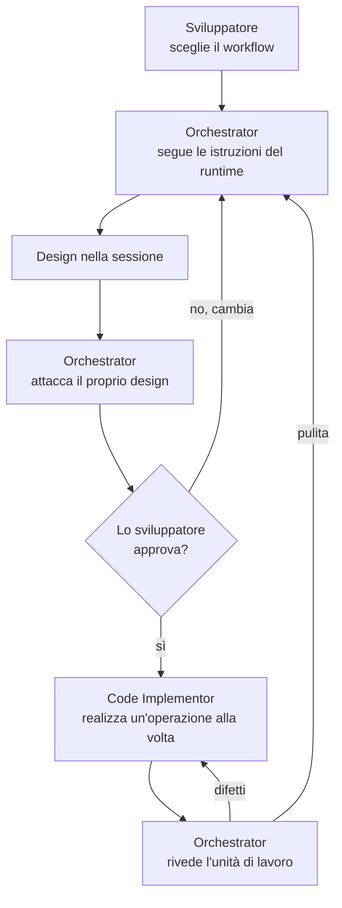

[Corso](../README.md) › [Principi](README.md) › **1. Autorità delimitata**

# 1. Autorità delimitata

> **In breve:** ogni ruolo ha un mandato scritto: che cosa può decidere, che cosa non può toccare, che cosa consegna e a chi. Quando cambia l'autorità, cambia il ruolo.

[Slide](../slides/01-autorita-delimitata.md) · [Caso guida](../caso-guida.md)

## Il problema

Un solo agente interpreta il requisito, sceglie il design, modifica il codice, scrive i test e dichiara il lavoro concluso. Nessuno vede il momento in cui una scelta è stata presa, e chi ha scritto il codice è anche chi giudica se il codice è giusto. Il risultato sembra preciso, ma contiene decisioni che nessuno ha autorizzato.

## Il principio

Un ruolo non è un titolo: è un contratto. Stabilisce:

- **il mandato**: quale problema risolve;
- **i limiti**: che cosa non può fare;
- **la consegna**: che cosa produce e per chi.

Serve un ruolo separato quando cambiano l'autorità, gli strumenti, il tipo di output o la persona che deve approvare. Il limite più utile è spesso il più semplice: chi produce un risultato non è chi lo giudica.

## Nel sistema di riferimento

Il sistema separa chi **dirige** il lavoro da chi lo **esegue**, e lascia allo **sviluppatore** il giudizio che nessun agente può dare al posto suo:

| Ruolo | Può | Non può |
| --- | --- | --- |
| [Orchestrator](../role-maps/agents/orchestrator.md) | Seguire il workflow scelto dallo sviluppatore, scrivere le obbligazioni e il design nella sessione, attaccare il proprio design prima di presentarlo, avviare il code implementor e rivedere ogni unità di lavoro che consegna | Scrivere codice di produzione in `DESIGN`, scegliere il workflow, tagliare lo scope del requisito, approvare il design al posto dello sviluppatore |
| [Code Implementor](../role-maps/agents/code-implementor.md) | Modificare i file dell'operazione servita; usare il terminale per build e test solo quando il prompt o l'operazione lo chiede | Cambiare il design o i flag di avanzamento, chiedere o indovinare le operazioni successive, dichiarare concluso il proprio lavoro |
| Sviluppatore | Scegliere il workflow, approvare o cambiare il design, selezionare le operazioni di test e quelle distruttive | — |

**Chi giudica che cosa.** Il codice lo scrive il code implementor e lo giudica l'orchestrator, che non l'ha scritto. Il design, invece, lo scrive l'orchestrator, e la revisione prima della review è sua: l'[istruzione di review](../system/canonical/workflows/design/09-design-review.md) gli chiede di attaccarlo come se fosse di un altro, perché “non c'è un verificatore esterno”. Il giudizio di chi non ha scritto il design arriva dallo sviluppatore, alla review. Nel sistema esistono ancora due contratti di verifica, il [Design Verifier](../role-maps/agents/design-verifier.md) e l'[Implementation Verifier](../role-maps/agents/implementation-verifier.md), ma dalla versione 3.0.3 nessuna istruzione li avvia. È una scelta del sistema di riferimento, con un costo: dove l'autore giudica sé stesso, il controllo indipendente deve trovarsi altrove, e qui si trova nella persona che approva.

**In `FAST_IMPLEMENTATION` i ruoli si riducono.** L'orchestrator scrive da solo codice e test, li esegue e riferisce; nessun delegate interviene. È lo sviluppatore che sceglie questo workflow per un lavoro semplice, e che giudica il risultato alla fine.

**Chi sceglie il workflow.** Lo sviluppatore indica sempre in modo esplicito `DESIGN`, `FAST_IMPLEMENTATION` o `DOCUMENTATION`. Se non lo fa, l'orchestrator mostra l'elenco e chiede. Un ragionamento come “mi ha chiesto un design, quindi il workflow è DESIGN” è una violazione del [contratto](../role-maps/agents/orchestrator.md).

**Lo scope lo fissa il requisito.** L'orchestrator non riduce, non rimanda e non approssima ciò che il requisito chiede, nemmeno quando il lavoro è grande. Una capacità richiesta e non progettata è un'omissione, non una scelta di scope.

**Che cosa può decidere l'orchestrator, e che cosa no.** Ogni scelta che il requisito non fissa diventa una decisione con la risposta scelta e alternative complete. L'orchestrator può scegliere *come* realizzare il requisito; non può cambiare *che cosa* il requisito chiede. Solo lo sviluppatore aggiunge, modifica o toglie un'obbligazione, e una sua decisione prevale sul requisito.

**I delegate ricevono identificatori, non riassunti.** L'orchestrator avvia il code implementor in un contesto pulito con un prompt fisso: id della sessione e del job, i nomi delle immagini allegate, il ciclo di lavoro e, quando serve, le operazioni scelte dallo sviluppatore o l'elenco esatto delle correzioni. Mai la knowledge e mai il testo del design: il delegate chiede al runtime un'operazione alla volta, con tutto il suo contesto. Un riassunto scritto da chi dirige il lavoro sarebbe un modo di condizionare chi lo esegue.

**Il limite sta anche negli strumenti.** Ogni ruolo ha un elenco di operazioni del runtime, e con l'opzione [`--role`](../system/canonical/contracts/workflow-loop.md#step-serving) il runtime rifiuta le altre. Il ruolo si dichiara da solo, quindi questo ferma una chiamata sbagliata, non una ostile; dove il client può imporre lo stesso limite, lo fa lui. Le pagine [DESIGN](../reference/strumenti-design.md), [FAST_IMPLEMENTATION](../reference/strumenti-fast-implementation.md) e [DOCUMENTATION](../reference/strumenti-documentation.md) mostrano chi chiama che cosa.

**Altri ruoli, per altri bisogni.**

- [Ask](../role-maps/agents/ask.md) risponde a domande tecniche senza modificare nulla.
- [Knowledge Builder](../role-maps/agents/knowledge-builder.md) ricava regole dal repository e le salva come knowledge, senza toccare il codice.
- [Documentation Reviewer](../role-maps/agents/documentation-reviewer.md) rilegge una guida come un lettore nuovo e la corregge, ma non la scrive da zero.
- [User Story Analysis](../role-maps/skills/user-story-analysis.md) trasforma lacune e ambiguità di una story in domande per gli stakeholder, prima di qualsiasi workflow.
- [Manage Work Item](../role-maps/skills/manage-work-item.md) crea o aggiorna un ticket fuori dal workflow.

Il tuo repository può usare altri nomi o meno ruoli. Conta una cosa sola: un cambio di autorità deve essere visibile.

## Nel caso guida

La story non dice se una motivazione di soli spazi è valida. L'orchestrator non lo chiede a metà lavoro e non lo nasconde: sceglie una risposta, scrive tre alternative e segna la decisione come `highlight`, quella su cui vuole il giudizio dello sviluppatore alla review. Che il vincolo valga anche per l'API, invece, non si sceglie: la story dice “solo dopo” per ogni chiusura, e l'obbligazione lo rende esplicito. [Leggi la traccia](../caso-guida.md#traccia-1-workflow-requisito-e-decisioni).

## Nel tuo repository

- Nel tuo flusso, chi produce il codice è anche chi dichiara che è corretto? E chi giudica il design, se non chi lo ha scritto?
- Quale scelta ricorrente del tuo agente oggi non lascia traccia di alternative, e quindi nessuno la può contestare?

---

[← Precedente: I sei principi](README.md) · [↑ Principi](README.md) · [Successivo: 2. Gate e controllo umano →](02-gate-e-controllo-umano.md)
