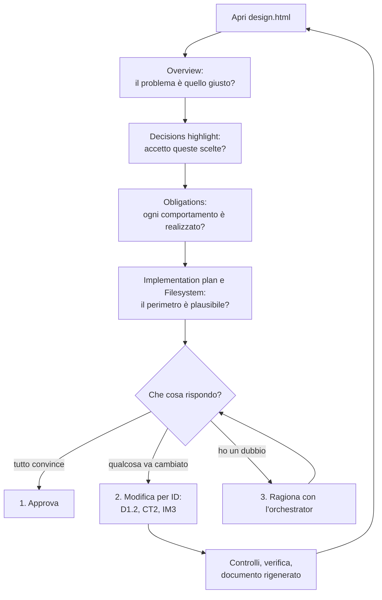

[Corso](../README.md) › [Approfondimenti](README.md) › **Il documento di design**

# Il documento di design

> **In breve:** `design.html` è la pagina che lo sviluppatore apre nel browser per rivedere un design prima di approvarlo. Non aggiunge informazioni: mostra il design salvato nella sessione in un ordine pensato per decidere. Questa pagina spiega come leggerlo.

## Quando lo ricevi

Nel workflow `DESIGN`, alla fine del [Design walkthrough](../system/canonical/workflows/design/07-design-walkthrough.md), [l'orchestrator](../role-maps/agents/orchestrator.md) rigenera il documento, ti spiega a voce come lo vede (le direzioni prese, i dubbi, i rischi, le decisioni `highlight`) e si ferma con tre possibilità:

1. approvare il design;
2. chiedere una modifica, indicando l'elemento per ID (per esempio `CT2` o `IM3`);
3. fare domande e ragionare insieme sul design.

Il messaggio contiene il percorso del file e un link `file://` da aprire nel browser. Il documento torna anche nell'handoff finale. `FAST_IMPLEMENTATION` e `DOCUMENTATION` non producono questo documento.

Il file è una **vista**: il runtime lo riscrive a ogni modifica del design e non va mai modificato a mano ([regole delle sessioni](../system/canonical/instructions/sessions.instructions.md)). Si apre senza server, ha un tema chiaro e uno scuro e in stampa mostra tutte le sezioni.

## Com'è fatta la pagina

- **Intestazione.** Titolo, ID del design, numero di obbligazioni e, dopo l'approvazione, il nome del piano. A destra un timbro con lo stato: `Draft`, `Approved` con la data, oppure `Changed after approval` se il design è cambiato dopo l'approvazione.
- **Strumenti.** `Legend` apre la legenda di tutti gli ID; `Theme` cambia tema. Accanto compaiono le sezioni da consultare, con il loro conteggio.
- **Percorso.** A sinistra le sezioni numerate da leggere in ordine; se ne vede una alla volta, con i link *Previous* e *Next* in fondo.
- **ID cliccabili.** Ogni elemento ha un ID (`D3`, `D3.1`, `O1.2`, `IM4`, `FS7`…) e ogni menzione di un ID è un link all'elemento. Puoi anche aprire direttamente `design.html#IM4`.

## Il percorso di lettura

| # | Sezione | Che cosa mostra | Che cosa chiederti |
| --- | --- | --- | --- |
| 1 | `Overview` | Che cosa fa oggi il codice e che cosa manca per soddisfare il requisito. | Il punto di partenza è descritto correttamente? |
| 2 | `Decisions` | Le scelte che il design ha dovuto fare: domanda, contesto, risposta scelta, alternative considerate, operazioni che la realizzano. Prima le decisioni `highlight`, poi le altre raggruppate per origine (requisito, codice, ragionamento dell'agente). | Sono d'accordo con le risposte, soprattutto con quelle evidenziate? |
| 3 | `Implementation plan` | Le operazioni in ordine, ciascuna con tipo, peso, stato, file, obbligazioni realizzate e knowledge applicata. I casi limite (rami, casi negativi, errori) sono richiusi sotto *Edge cases*. | Il piano fa tutto ciò che serve, e niente di più? |
| 4 | `Filesystem` | L'albero dei file aggiunti (`A`) o modificati (`M`). Cliccando un file si vedono motivo, modifica, impatto, operazioni e decisioni collegate. | Il perimetro della modifica è quello che mi aspetto? |
| 5 | `Contracts` | Le API pubbliche (metodo, percorso, richiesta, risposte) e i contratti interni (che cosa promette un modulo, firma, rischi in *What could break it*). | Le interfacce sono quelle giuste da mantenere nel tempo? |
| 6 | `History` | Le iterazioni di implementazione: richiesta, file cambiati, verifiche, blocchi. Prima dell'implementazione è vuota. | Che cosa è già stato fatto e verificato? |

## Le sezioni da consultare

Queste sezioni compaiono nell'intestazione solo quando hanno contenuto, tranne `Checks`, che c'è sempre.

| Sezione | Che cosa mostra |
| --- | --- |
| `Obligations` | I comportamenti richiesti dal requisito o decisi dallo sviluppatore, ciascuno diviso in elementi verificabili, con l'operazione che li realizza. In alto il conteggio di obbligazioni ed elementi coperti. |
| `File references` | I simboli che servono all'implementazione, con file esistenti che li usano già e il motivo per cui sono un buon esempio. |
| `Knowledge references` | Le regole della knowledge applicate dal design: ogni riferimento è un intervallo di righe di un documento, mostrato con il testo attuale. |
| `Checks` | Errori e avvisi dei controlli meccanici: collegamenti mancanti, elementi non realizzati. Dicono se il design è integro, non se è giusto. |

## Come aiuta a decidere

- **Le decisioni `highlight` vengono prima.** Sono quelle in cui serve di più il giudizio dello sviluppatore, e approvando il design le accetti tutte, comprese quelle che nessuna operazione realizza.
- **Gli ID rendono precisa la risposta.** Per cambiare una decisione basta indicare l'opzione che preferisci (`D1.2`); per cambiare il resto, il contratto, il file o l'operazione. L'orchestrator applica la modifica, ripete controlli e verifica e ti ripresenta un documento aggiornato.
- **Quando arriva da te, il design ha già passato i controlli meccanici e il [design verifier](../role-maps/agents/design-verifier.md).** Il tuo compito non è ripetere quelle prove, ma giudicare ciò che solo tu puoi giudicare: se le scelte sono quelle giuste per il progetto.
- **Il documento non approva nulla.** L'approvazione è la tua risposta “1”; il runtime la registra e la rifiuta finché il design ha errori. Una modifica successiva resta visibile nel timbro.

Nel caso guida, lo sviluppatore legge la decisione `highlight` sugli spazi e chiede una modifica prima di approvare: [traccia 3](../caso-guida.md#traccia-3-design-verifica-e-approvazione).

## Per approfondire

- [Viste del design, sezione `document`](../system/canonical/contracts/projections.md#document): che cosa contiene il documento.
- [Modello del design](../system/canonical/contracts/design-model.md): gli elementi che il documento mostra.
- [Controlli del design](../system/canonical/contracts/design-checks.md): le regole dietro la sezione `Checks`.

**Per il tuo repository:** quando un agente ti chiede di approvare un lavoro, che cosa ti mostra? Ti basta per capire le scelte fatte, il perimetro della modifica e ciò che resta aperto?

---

[← Precedente: Mappa del sistema](mappa-del-sistema.md) · [↑ Approfondimenti](README.md)
