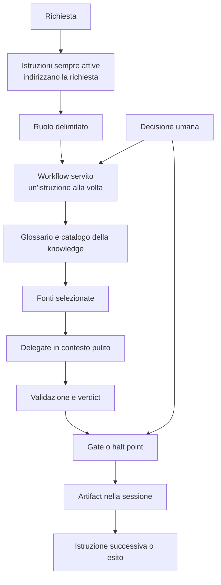
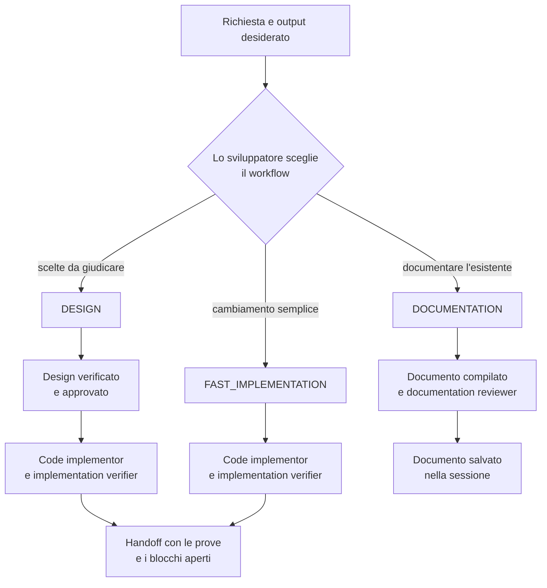
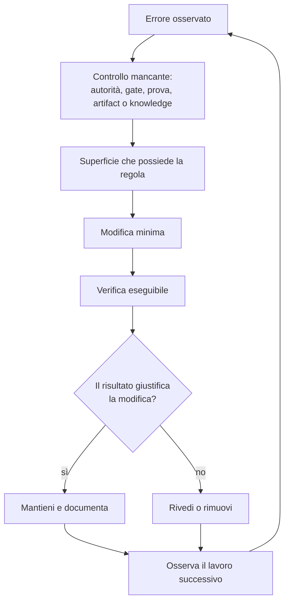

[Corso](../README.md) › [Approfondimenti](README.md) › **Mappa del sistema**

# Mappa del sistema

Questa mappa mostra come si collegano gli elementi di un Agentic System. Non prescrive nomi di file, agent o cartelle per il tuo repository.

## Come scorre un'attività

| Elemento | Che cosa fa | Principio |
| --- | --- | --- |
| Istruzioni sempre attive | Indirizzano verso i contratti necessari | [6. Composizione e ciclo di vita](../principi/06-composizione-e-ciclo-di-vita.md) |
| Ruolo | Limita autorità, strumenti e output | [1. Autorità delimitata](../principi/01-autorita-delimitata.md) |
| Workflow e runtime | Impongono l'ordine dei passaggi | [2. Gate e controllo umano](../principi/02-gate-e-controllo-umano.md) |
| Gate e halt point | Controllano il passaggio | [2. Gate e controllo umano](../principi/02-gate-e-controllo-umano.md) |
| Delegate e verificatori | Separano chi produce da chi giudica | [3. Validazione come prova](../principi/03-validazione-come-prova.md) |
| Sessione e design | Conservano requisito, decisioni, prove e stato | [4. Artifact durevoli](../principi/04-artifact-durevoli.md) |
| Glossario e catalogo | Stabilizzano i termini e selezionano le fonti | [5. Conoscenza selettiva](../principi/05-conoscenza-selettiva.md) |

## Tre workflow, un orchestrator

Mappe dei ruoli: [Orchestrator](../role-maps/agents/orchestrator.md) · [Code Implementor](../role-maps/agents/code-implementor.md) · [Implementation Verifier](../role-maps/agents/implementation-verifier.md) · [Documentation Reviewer](../role-maps/agents/documentation-reviewer.md) · [Come scegliere](../role-maps/README.md#quale-percorso-scegliere).

Il diagramma riassume i percorsi: non permette di unire o saltare istruzioni. Tutte le istruzioni sono nel [riferimento dei workflow](../slides/reference-flow.md).

## Ciclo di manutenzione

Ogni regola resta nella superficie che la possiede; le altre superfici rimandano a lei invece di copiarla. Il risultato della verifica distingue ciò che è stato controllato dal rischio che resta aperto.

---

[← Precedente: Approfondimenti](README.md) · [↑ Approfondimenti](README.md)
