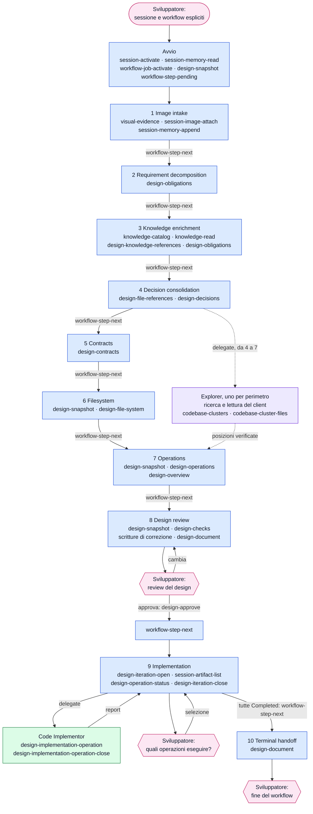
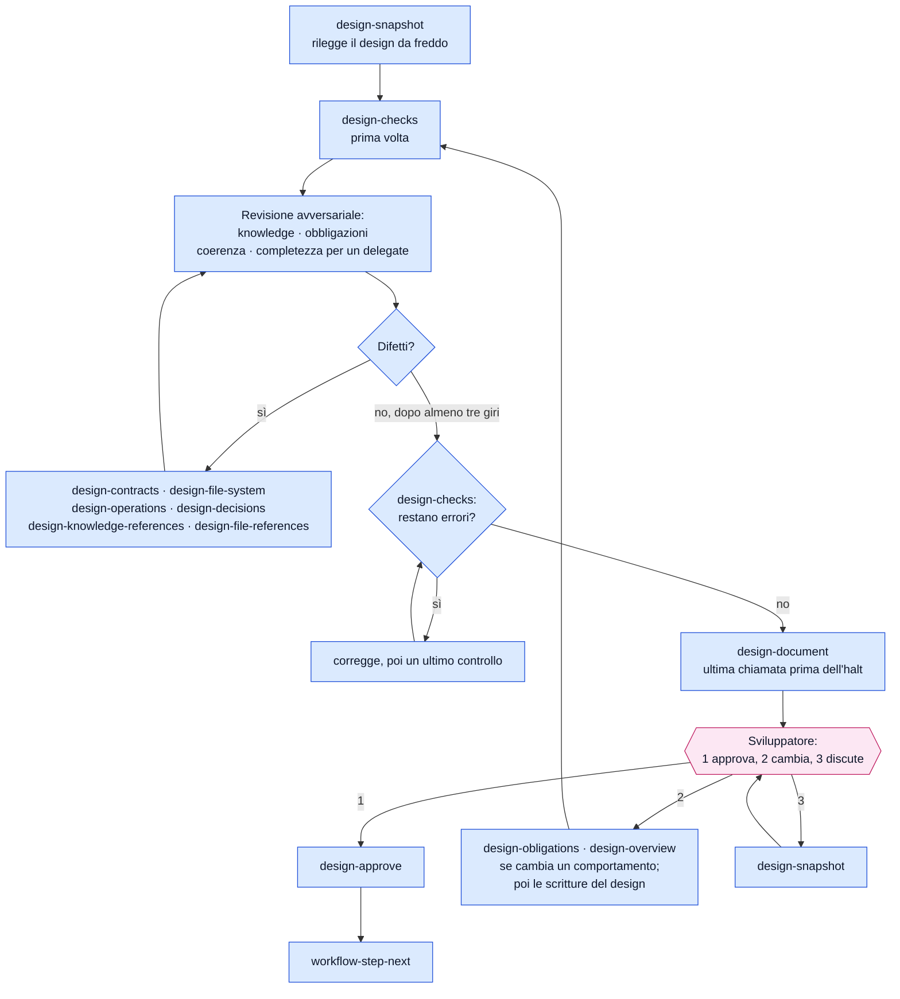
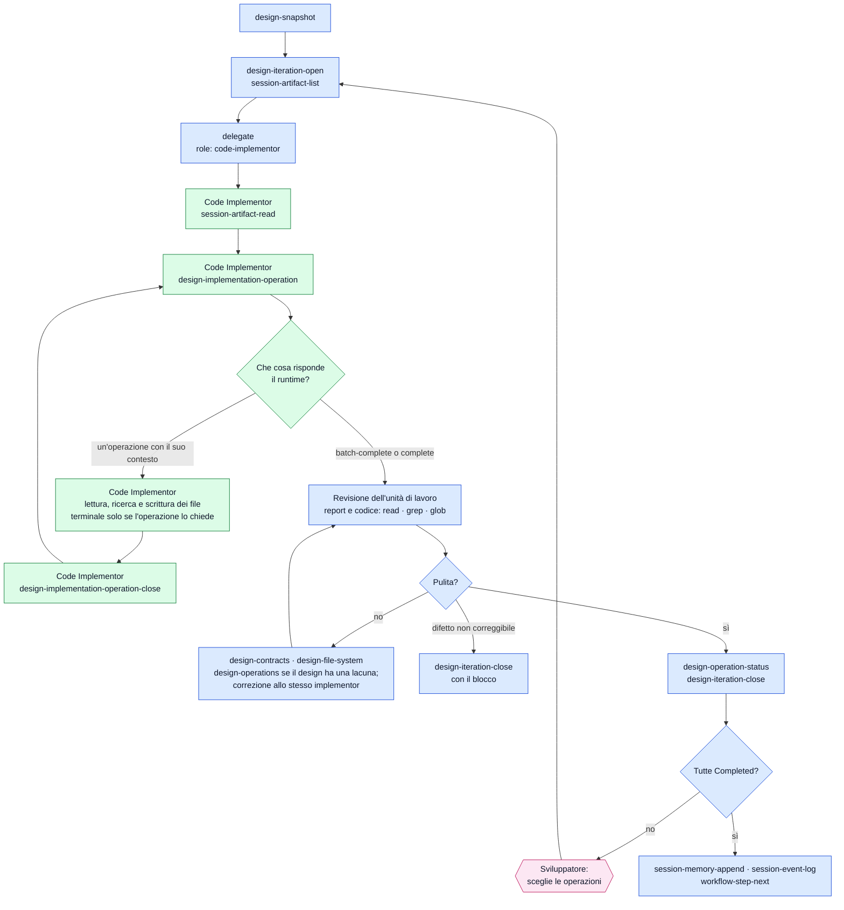
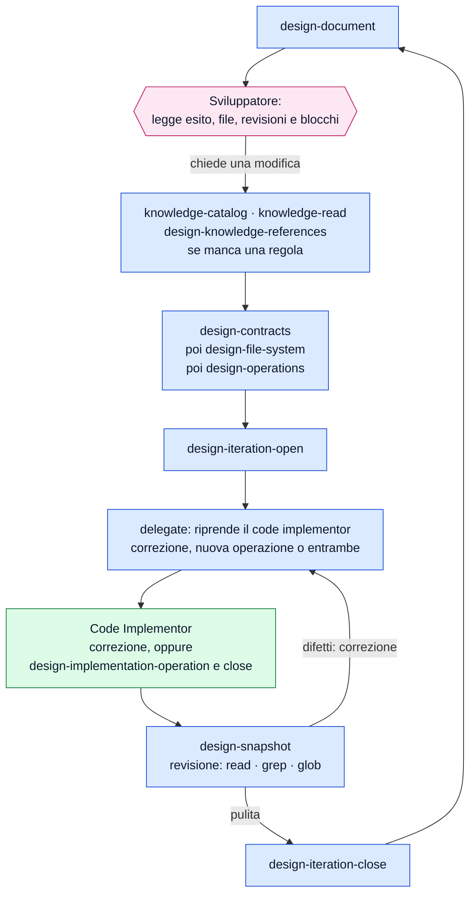

[Corso](../README.md) › [Approfondimenti](README.md) › **Strumenti di DESIGN**

# DESIGN: chi chiama quali strumenti

> **In breve:** il [riferimento dei workflow](../slides/reference-flow.md#design) dice che cosa produce ogni istruzione. Questa pagina mostra la stessa sequenza dal lato degli strumenti: chi chiama che cosa, in quale istruzione e dove leggere il contratto.

Nei diagrammi il colore indica chi chiama lo strumento:

| Colore | Chi chiama |
| --- | --- |
| Azzurro | [Orchestrator](../role-maps/agents/orchestrator.md) |
| Viola | [Explorer](../role-maps/agents/explorer.md) |
| Verde | [Code Implementor](../role-maps/agents/code-implementor.md) |
| Rosa | Sviluppatore: qui il workflow si ferma e aspetta |

Una freccia etichettata `delegate` avvia un delegate in un contesto pulito; il delegate chiama i suoi strumenti e torna con un report nella stessa conversazione. I nomi nei riquadri sono i *capability token* del sistema di riferimento: il nome di ciò che uno strumento fa, non di un prodotto. Le risposte lunghe arrivano [in più parti](../system/canonical/contracts/workflow-loop.md#step-serving), e ogni parte si legge prima di agire.

## Il flusso completo

Il diagramma nomina gli strumenti principali di ogni istruzione. L'elenco completo è più sotto.

Se lo sviluppatore non indica la sessione o il workflow, l'avvio aggiunge `session-list` e `workflow-types-list`: l'orchestrator mostra l'elenco e chiede. Nell'istruzione 1 una richiesta che non chiede di cambiare il codice si conclude subito: l'orchestrator mostra il risultato, lo annota con `session-memory-append` e `session-event-log` e si ferma.

Dalle istruzioni 4 a 7 ogni sezione comincia allo stesso modo: l'orchestrator ricostruisce la knowledge già letta, legge solo il delta con `knowledge-catalog` e `knowledge-read`, registra le prescrizioni con `design-knowledge-references` e corregge con `design-decisions` una decisione che la sezione contraddice.

Nelle stesse istruzioni il codice non lo cerca l'orchestrator. Legge direttamente solo i file di cui conosce già il percorso; ogni altro fatto lo chiede agli explorer: elenca i fatti che servono, li divide nei perimetri più piccoli e indipendenti e avvia un explorer per perimetro, tutti nello stesso momento, ciascuno con gli indizi già noti. Ogni explorer ha un limite di otto chiamate e risponde con percorso, riga ed estratto verificati. L'orchestrator avvia un secondo gruppo solo se le risposte aprono domande nuove, e registra ogni simbolo usato con `design-file-references`.

## Scrivere nel design: tutto o niente

Una scrittura del design si applica intera oppure non si applica: se una riga è rifiutata, nessuna riga cambia. Tre regole del runtime evitano che questo costi lavoro ripetuto.

- **La forma arriva con l'istruzione.** Quando un'istruzione nomina per la prima volta una scrittura del design, il runtime le allega gli argomenti del comando e i campi della richiesta: l'agente non deve interrogare il comando prima di usarlo. È descritto nel [ciclo del workflow](../system/canonical/contracts/workflow-loop.md#step-serving).
- **Una richiesta rifiutata non si rimanda.** Il runtime la [conserva](../system/canonical/contracts/design-model.md#kept-requests) e il rifiuto indica come correggerla: la chiamata successiva porta solo la correzione, e la richiesta corretta si applica di nuovo intera.
- **Una frase si corregge senza riscrivere il campo.** Una [modifica sul posto](../system/canonical/contracts/design-model.md#edits) cambia un testo dentro un campo già salvato, indicando la riga, il campo, il testo da trovare e quello che lo sostituisce.

## Da vicino: istruzione 8, la revisione e l'approvazione

[Design review](../system/canonical/workflows/design/08-design-review.md). Non c'è un verificatore esterno: l'orchestrator attacca il proprio design da quattro punti di vista e lo corregge finché un giro completo non trova difetti. I controlli meccanici girano due volte, all'inizio e alla fine, non dopo ogni correzione.

Se il runtime rifiuta il nome del piano, l'orchestrator ne sceglie un altro; se rifiuta l'approvazione per l'integrità del design, corregge e riprova al massimo quattro volte. Da questa istruzione in poi valgono le regole di discussione con lo sviluppatore: giudizio indipendente, una domanda alla volta, nessuna azione su ciò che resta aperto senza consenso esplicito.

## Da vicino: istruzione 9, l'implementazione

[Implementation](../system/canonical/workflows/design/09-implementation.md). L'orchestrator non vede le operazioni come compiti da assegnare: il code implementor le chiede al runtime una alla volta e non conosce quelle successive. Il prompt gli dà gli id e i nomi di tutti gli artifact della sessione, non solo delle immagini. Dopo ogni operazione il code implementor rilegge il codice scritto contro le regole servite e segnala difetti e lacune. L'orchestrator rivede ogni unità di lavoro e non esegue una build propria: la prova di build e test è nel report.

Il primo giro serve i **batch automatici**: prima le operazioni `Production`, poi quelle `Documentation`. Le operazioni `Testing` e quelle con effetti distruttivi entrano solo quando lo sviluppatore le seleziona: il prompt porta i loro `IM#` e lo stesso delegate le esegue in sequenza, nella stessa invocazione. Una correzione non passa dal ciclo: il prompt elenca i file e le modifiche esatte. Un blocco lascia l'istruzione incompleta e arriva allo sviluppatore.

## Da vicino: istruzione 10, dopo la consegna

[Terminal handoff](../system/canonical/workflows/design/10-terminal-handoff.md). L'orchestrator resta con lo sviluppatore nello scope del design. Ogni modifica passa prima dal design, nell'ordine contratti, file, operazioni; poi dallo stesso implementor, dentro una nuova iterazione, con la stessa revisione.

Una modifica solo documentale o procedurale, che non tocca codice né test, l'orchestrator la esegue da sé, nello scope del design.

## Gli strumenti, ruolo per ruolo

Il numero rimanda all'istruzione canonical che usa lo strumento; **avvio** è la procedura che precede la prima istruzione, nel contratto dell'orchestrator. L'ultima colonna porta al contratto dello strumento.

### [Orchestrator](../role-maps/agents/orchestrator.md)

Oltre agli strumenti in tabella usa quelli del client: `read` per i file di cui conosce già il percorso nelle istruzioni da 4 a 7, e `read`, `grep` e `glob` per rivedere le unità di lavoro nelle istruzioni 9 e 10. Non scrive codice di produzione e, nelle istruzioni da 4 a 7, non cerca nel codice.

| Strumento | Istruzioni | A che cosa serve | Riferimento canonical |
| --- | --- | --- | --- |
| `session-list` | [avvio](../system/canonical/agents/orchestrator.agent.md#agentic-system-session) | Elenca le sessioni, se lo sviluppatore non ne indica una. | [session-store › session-list](../system/canonical/contracts/session-store.md#session-list) |
| `session-activate` | [avvio](../system/canonical/agents/orchestrator.agent.md#agentic-system-session) | Attiva la sessione che lo sviluppatore ha chiesto. | [session-store › session-activate](../system/canonical/contracts/session-store.md#session-activate) |
| `session-memory-read` | [avvio](../system/canonical/agents/orchestrator.agent.md#agentic-system-session) | Legge la memoria della sessione e l'elenco degli artifact. | [session-store › session-memory](../system/canonical/contracts/session-store.md#session-memory) |
| `workflow-types-list` | [avvio](../system/canonical/agents/orchestrator.agent.md#agentic-system-session) | Elenca i workflow, se lo sviluppatore non ne nomina uno. | [workflow-loop › workflow-types](../system/canonical/contracts/workflow-loop.md#workflow-types) |
| `workflow-job-activate` | [avvio](../system/canonical/agents/orchestrator.agent.md#agentic-system-session) | Crea o riprende il job del workflow scelto. | [workflow-loop › job-activate](../system/canonical/contracts/workflow-loop.md#job-activate) |
| `workflow-step-pending` | [avvio](../system/canonical/agents/orchestrator.agent.md#agentic-system-session) | Serve la prima istruzione. | [workflow-loop › step-serving](../system/canonical/contracts/workflow-loop.md#step-serving) |
| `workflow-step-next` | [1](../system/canonical/workflows/design/01-image-intake.md) · [2](../system/canonical/workflows/design/02-requirement-decomposition.md) · [3](../system/canonical/workflows/design/03-knowledge-enrichment.md) · [4](../system/canonical/workflows/design/04-decision-consolidation.md) · [5](../system/canonical/workflows/design/05-contracts.md) · [6](../system/canonical/workflows/design/06-filesystem.md) · [7](../system/canonical/workflows/design/07-operations.md) · [8](../system/canonical/workflows/design/08-design-review.md) · [9](../system/canonical/workflows/design/09-implementation.md) | Serve l'istruzione successiva; con la prima scrittura del design che nomina, anche la definizione del comando. | [workflow-loop › step-serving](../system/canonical/contracts/workflow-loop.md#step-serving) |
| `session-memory-append` | [1](../system/canonical/workflows/design/01-image-intake.md) · [9](../system/canonical/workflows/design/09-implementation.md) | Aggiunge alla memoria fatti validati e puntatori agli artifact. | [session-store › session-memory](../system/canonical/contracts/session-store.md#session-memory) |
| `session-event-log` | [1](../system/canonical/workflows/design/01-image-intake.md) · [9](../system/canonical/workflows/design/09-implementation.md) | Registra un evento nel log della sessione. | [session-store › session-log](../system/canonical/contracts/session-store.md#session-log) |
| `visual-evidence` | [1](../system/canonical/workflows/design/01-image-intake.md) | Guarda un'immagine: è l'unico modo ammesso. Strumento del client, non del runtime. | [orchestrator › Image acquisition](../system/canonical/agents/orchestrator.agent.md#image-acquisition) |
| `session-image-attach` | [1](../system/canonical/workflows/design/01-image-intake.md) | Salva un'immagine come artifact della sessione. | [session-store › session-images](../system/canonical/contracts/session-store.md#session-images) |
| `session-artifact-read` | [1](../system/canonical/workflows/design/01-image-intake.md) | Rilegge un artifact per nome. | [session-store › session-artifacts](../system/canonical/contracts/session-store.md#session-artifacts) |
| `design-obligations` | [2](../system/canonical/workflows/design/02-requirement-decomposition.md) · [3](../system/canonical/workflows/design/03-knowledge-enrichment.md) · [4](../system/canonical/workflows/design/04-decision-consolidation.md) · [8](../system/canonical/workflows/design/08-design-review.md) | Scrive e legge le obbligazioni `O#`; nella review registra un comportamento chiesto dallo sviluppatore. | [design-model › row-writes](../system/canonical/contracts/design-model.md#row-writes) |
| `knowledge-catalog` | [3](../system/canonical/workflows/design/03-knowledge-enrichment.md) · [4](../system/canonical/workflows/design/04-decision-consolidation.md) · [5](../system/canonical/workflows/design/05-contracts.md) · [6](../system/canonical/workflows/design/06-filesystem.md) · [7](../system/canonical/workflows/design/07-operations.md) · [8](../system/canonical/workflows/design/08-design-review.md) · [10](../system/canonical/workflows/design/10-terminal-handoff.md) | Legge il catalogo della knowledge a tre livelli. | [knowledge-catalog › catalog](../system/canonical/contracts/knowledge-catalog.md#catalog) |
| `knowledge-read` | [3](../system/canonical/workflows/design/03-knowledge-enrichment.md) · [4](../system/canonical/workflows/design/04-decision-consolidation.md) · [5](../system/canonical/workflows/design/05-contracts.md) · [6](../system/canonical/workflows/design/06-filesystem.md) · [7](../system/canonical/workflows/design/07-operations.md) · [8](../system/canonical/workflows/design/08-design-review.md) · [10](../system/canonical/workflows/design/10-terminal-handoff.md) | Legge i documenti di knowledge scelti, con le righe numerate. | [knowledge-catalog › read](../system/canonical/contracts/knowledge-catalog.md#read) |
| `design-knowledge-references` | [3](../system/canonical/workflows/design/03-knowledge-enrichment.md) · [4](../system/canonical/workflows/design/04-decision-consolidation.md) · [5](../system/canonical/workflows/design/05-contracts.md) · [6](../system/canonical/workflows/design/06-filesystem.md) · [7](../system/canonical/workflows/design/07-operations.md) · [8](../system/canonical/workflows/design/08-design-review.md) · [10](../system/canonical/workflows/design/10-terminal-handoff.md) | Registra le prescrizioni applicabili (`kid`): segue ogni lettura di knowledge. | [design-model › knowledge-references](../system/canonical/contracts/design-model.md#knowledge-references) |
| `design-file-references` | [4](../system/canonical/workflows/design/04-decision-consolidation.md) · [5](../system/canonical/workflows/design/05-contracts.md) · [6](../system/canonical/workflows/design/06-filesystem.md) · [7](../system/canonical/workflows/design/07-operations.md) · [8](../system/canonical/workflows/design/08-design-review.md) | Registra i riferimenti al codice `FR#`: ogni simbolo usato, con il file che lo definisce e i punti d'uso. | [design-model › row-writes](../system/canonical/contracts/design-model.md#row-writes) |
| `design-decisions` | [4](../system/canonical/workflows/design/04-decision-consolidation.md) · [5](../system/canonical/workflows/design/05-contracts.md) · [6](../system/canonical/workflows/design/06-filesystem.md) · [7](../system/canonical/workflows/design/07-operations.md) · [8](../system/canonical/workflows/design/08-design-review.md) | Scrive le decisioni `D#` con la risposta scelta e le alternative; le corregge quando una sezione successiva le contraddice. | [design-model › row-writes](../system/canonical/contracts/design-model.md#row-writes) |
| `design-contracts` | [5](../system/canonical/workflows/design/05-contracts.md) · [8](../system/canonical/workflows/design/08-design-review.md) · [9](../system/canonical/workflows/design/09-implementation.md) · [10](../system/canonical/workflows/design/10-terminal-handoff.md) | Scrive intestazione, contratti `CT#` e API `API#`. | [design-model › section-writes](../system/canonical/contracts/design-model.md#section-writes) |
| `design-file-system` | [6](../system/canonical/workflows/design/06-filesystem.md) · [8](../system/canonical/workflows/design/08-design-review.md) · [9](../system/canonical/workflows/design/09-implementation.md) · [10](../system/canonical/workflows/design/10-terminal-handoff.md) | Scrive i file `FS#`: aggiunti, modificati o eliminati. | [design-model › section-writes](../system/canonical/contracts/design-model.md#section-writes) |
| `design-operations` | [7](../system/canonical/workflows/design/07-operations.md) · [8](../system/canonical/workflows/design/08-design-review.md) · [9](../system/canonical/workflows/design/09-implementation.md) · [10](../system/canonical/workflows/design/10-terminal-handoff.md) | Scrive le operazioni `IM#` e il loro ordine. | [design-model › section-writes](../system/canonical/contracts/design-model.md#section-writes) |
| `design-overview` | [7](../system/canonical/workflows/design/07-operations.md) · [8](../system/canonical/workflows/design/08-design-review.md) | Scrive la situazione di partenza e le lacune, dopo le operazioni. | [design-model › overview](../system/canonical/contracts/design-model.md#overview) |
| `design-snapshot` | [avvio](../system/canonical/agents/orchestrator.agent.md#agentic-system-session) · [6](../system/canonical/workflows/design/06-filesystem.md) · [7](../system/canonical/workflows/design/07-operations.md) · [8](../system/canonical/workflows/design/08-design-review.md) · [9](../system/canonical/workflows/design/09-implementation.md) · [10](../system/canonical/workflows/design/10-terminal-handoff.md) | Legge la proiezione compatta del design. | [projections › snapshot](../system/canonical/contracts/projections.md#snapshot) |
| `design-checks` | [8](../system/canonical/workflows/design/08-design-review.md) | Restituisce errori, avvisi e copertura dei controlli meccanici: all'inizio e alla fine della revisione. | [design-checks](../system/canonical/contracts/design-checks.md) |
| `design-document` | [8](../system/canonical/workflows/design/08-design-review.md) · [10](../system/canonical/workflows/design/10-terminal-handoff.md) | Rigenera il documento di review e ne restituisce il percorso. | [projections › document](../system/canonical/contracts/projections.md#document) |
| `design-approve` | [8](../system/canonical/workflows/design/08-design-review.md) | Registra l'approvazione dello sviluppatore; è rifiutata finché restano errori. | [design-model › approval](../system/canonical/contracts/design-model.md#approval) |
| `session-artifact-list` | [9](../system/canonical/workflows/design/09-implementation.md) | Elenca gli artifact, per passare al delegate i loro nomi. | [session-store › session-artifacts](../system/canonical/contracts/session-store.md#session-artifacts) |
| `design-iteration-open` | [9](../system/canonical/workflows/design/09-implementation.md) · [10](../system/canonical/workflows/design/10-terminal-handoff.md) | Apre un'iterazione e fotografa il workspace. | [design-model › iterations](../system/canonical/contracts/design-model.md#iterations) |
| `design-iteration-close` | [9](../system/canonical/workflows/design/09-implementation.md) · [10](../system/canonical/workflows/design/10-terminal-handoff.md) | Chiude l'iterazione con revisioni e blocchi; i file cambiati li calcola il runtime. | [design-model › iterations](../system/canonical/contracts/design-model.md#iterations) |
| `design-operation-status` | [9](../system/canonical/workflows/design/09-implementation.md) | Segna `Completed` le operazioni di un'unità di lavoro rivista. | [design-model › operation-status](../system/canonical/contracts/design-model.md#operation-status) |
| `delegate` | [9](../system/canonical/workflows/design/09-implementation.md) · [10](../system/canonical/workflows/design/10-terminal-handoff.md) | Avvia o riprende il code implementor in un contesto pulito. Strumento del client, non del runtime. |
| `delegate` | [4](../system/canonical/workflows/design/04-decision-consolidation.md) · [5](../system/canonical/workflows/design/05-contracts.md) · [6](../system/canonical/workflows/design/06-filesystem.md) · [7](../system/canonical/workflows/design/07-operations.md) | Avvia gli explorer in parallelo, uno per perimetro. Strumento del client, non del runtime. | [glossario › Explorer](../system/canonical/CONTEXT.md) |

### [Explorer](../role-maps/agents/explorer.md)

Cerca e legge con gli strumenti del client: lettura e terminale, senza scrittura. Le istruzioni da 4 a 7 gli assegnano il perimetro, gli indizi e il limite di otto chiamate; gli strumenti del runtime vengono dal suo contratto.

| Strumento | Istruzioni | A che cosa serve | Riferimento canonical |
| --- | --- | --- | --- |
| `codebase-clusters` | [contratto del ruolo](../system/canonical/agents/explorer.agent.md) | Mostra la mappa dei cluster, per decidere dove cercare. | [codebase-clusters › clusters](../system/canonical/contracts/codebase-clusters.md#clusters) |
| `codebase-cluster-files` | [contratto del ruolo](../system/canonical/agents/explorer.agent.md) | Elenca i file di un cluster. | [codebase-clusters › cluster-files](../system/canonical/contracts/codebase-clusters.md#cluster-files) | [glossario › Delegate](../system/canonical/CONTEXT.md) |

### [Code Implementor](../role-maps/agents/code-implementor.md)

Legge e modifica i file con gli strumenti del client; usa il terminale solo quando il prompt o l'operazione lo chiedono. Gli strumenti del runtime gli servono per ricevere il lavoro.

| Strumento | Istruzioni | A che cosa serve | Riferimento canonical |
| --- | --- | --- | --- |
| `session-artifact-read` | [9](../system/canonical/workflows/design/09-implementation.md) | Legge gli artifact della sessione nominati nel prompt. | [session-store › session-artifacts](../system/canonical/contracts/session-store.md#session-artifacts) |
| `design-implementation-operation` | [9](../system/canonical/workflows/design/09-implementation.md) · [10](../system/canonical/workflows/design/10-terminal-handoff.md) | Serve l'unica operazione da realizzare ora, con tutto il suo contesto e la sua knowledge, oppure il terminatore. | [design-model › implementation-loop](../system/canonical/contracts/design-model.md#implementation-loop) |
| `design-implementation-operation-close` | [9](../system/canonical/workflows/design/09-implementation.md) · [10](../system/canonical/workflows/design/10-terminal-handoff.md) | Chiude l'operazione servita e rende raggiungibile la successiva. | [design-model › implementation-loop](../system/canonical/contracts/design-model.md#implementation-loop) |
| `knowledge-read` | [9](../system/canonical/workflows/design/09-implementation.md) · [10](../system/canonical/workflows/design/10-terminal-handoff.md) | Legge una regola che l'operazione servita non porta, senza sostituirla con una convenzione propria. | [knowledge-catalog › read](../system/canonical/contracts/knowledge-catalog.md#read) |
| `knowledge-catalog` | [contratto del ruolo](../system/canonical/agents/code-implementor.agent.md) | Trova la regola che manca. | [knowledge-catalog › catalog](../system/canonical/contracts/knowledge-catalog.md#catalog) |

## Disponibile non significa prescritto

I file `.capabilities.yaml` elencano ciò che ogni ruolo può usare: [orchestrator](../system/canonical/agents/orchestrator.capabilities.yaml), [explorer](../system/canonical/agents/explorer.capabilities.yaml), [code implementor](../system/canonical/agents/code-implementor.capabilities.yaml). L'elenco è più ampio di questa pagina: il code implementor dispone anche di `codebase-clusters`, `codebase-cluster-files`, `session-activate` e `session-artifact-list`, e l'explorer di `session-artifact-read`, che le istruzioni di `DESIGN` non nominano. Le integrazioni `work-item-*` servono alle [skill](../role-maps/README.md#skill) che recuperano un ticket prima del workflow.

Il [Design Verifier](../role-maps/agents/design-verifier.md) e l'[Implementation Verifier](../role-maps/agents/implementation-verifier.md) non compaiono: dalla versione 3.0.3 nessuna istruzione li avvia, anche se i loro contratti e la vista di verifica (`design-verification-view`) restano nel sistema.

**Per il tuo repository:** il tuo agente può scrivere il codice e anche dichiararlo verificato con gli stessi strumenti? E quando la stessa persona, o lo stesso agente, scrive e rivede il design, dove si trova lo sguardo indipendente?

---

[← Precedente: Il documento di design](documento-di-design.md) · [↑ Approfondimenti](README.md) · [Successivo: Strumenti di FAST_IMPLEMENTATION →](strumenti-fast-implementation.md)
