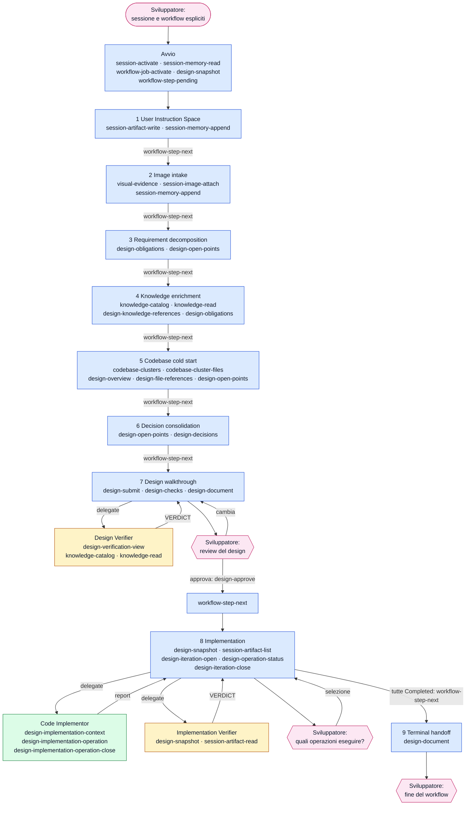
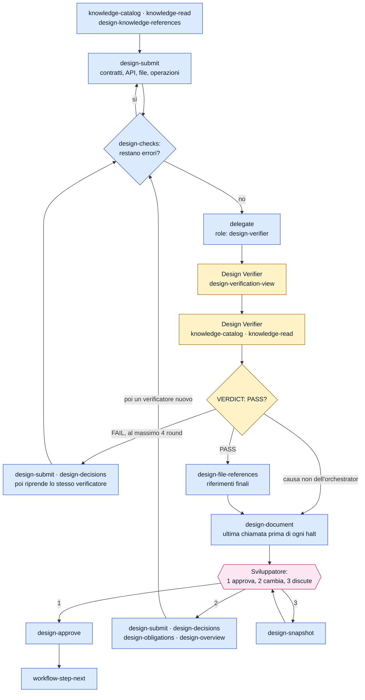
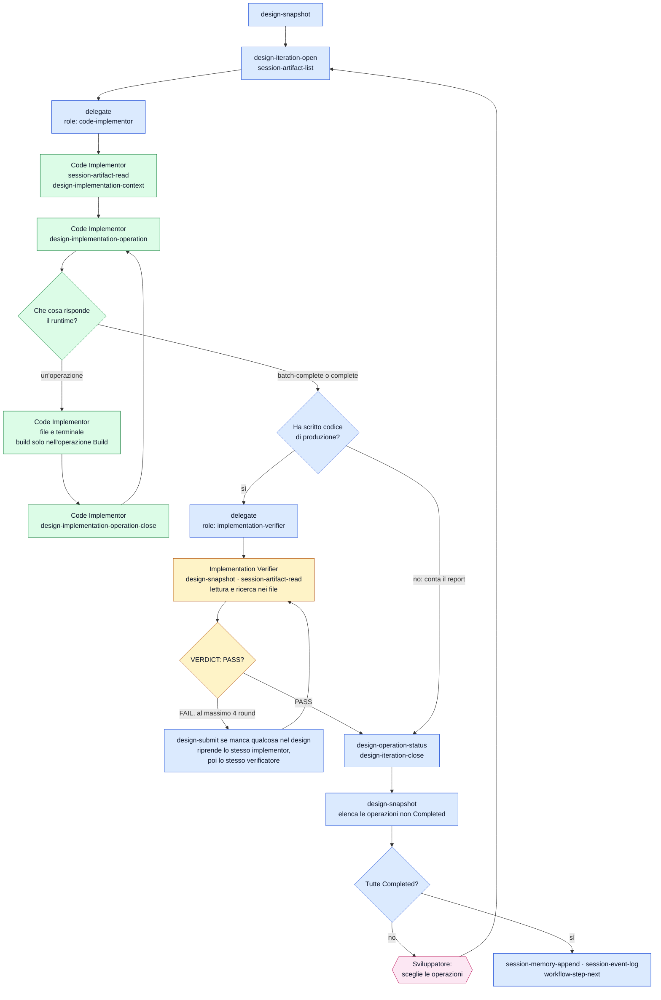
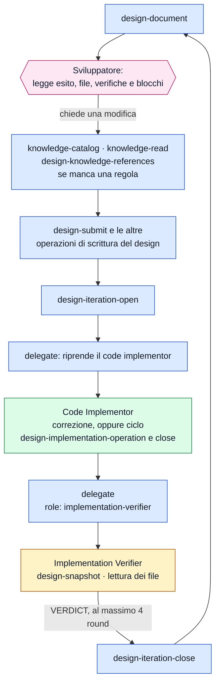

[Corso](../README.md) › [Approfondimenti](README.md) › **Strumenti di DESIGN**

# DESIGN: chi chiama quali strumenti

> **In breve:** il [riferimento dei workflow](../slides/reference-flow.md#design) dice che cosa produce ogni istruzione. Questa pagina mostra la stessa sequenza dal lato degli strumenti: chi chiama che cosa, in quale istruzione e dove leggere il contratto.

Nei diagrammi il colore indica chi chiama lo strumento:

| Colore | Chi chiama |
| --- | --- |
| Azzurro | [Orchestrator](../role-maps/agents/orchestrator.md) |
| Verde | [Code Implementor](../role-maps/agents/code-implementor.md) |
| Giallo | [Design Verifier](../role-maps/agents/design-verifier.md) e [Implementation Verifier](../role-maps/agents/implementation-verifier.md) |
| Rosa | Sviluppatore: qui il workflow si ferma e aspetta |

Una freccia etichettata `delegate` avvia un delegate in un contesto pulito; il delegate chiama i suoi strumenti e torna con un report nella stessa conversazione. I nomi nei riquadri sono i *capability token* del sistema di riferimento: il nome di ciò che uno strumento fa, non di un prodotto. Le risposte lunghe arrivano [in più parti](../system/canonical/contracts/workflow-loop.md#step-serving), e ogni parte si legge prima di agire.

## Il flusso completo

Il diagramma nomina gli strumenti principali di ogni istruzione. L'elenco completo è più sotto.

Se lo sviluppatore non indica la sessione o il workflow, l'avvio aggiunge `session-list` e `workflow-types-list`: l'orchestrator mostra l'elenco e chiede. Nell'istruzione 2 una richiesta che non chiede di cambiare il codice si conclude subito: l'orchestrator mostra il risultato, lo annota con `session-memory-append` e `session-event-log` e si ferma.

## Da vicino: istruzione 7, il design e la sua verifica

[Design walkthrough](../system/canonical/workflows/design/07-design-walkthrough.md). L'orchestrator scrive il design; il verificatore lo legge da una vista di sola lettura e non ha altri strumenti. I controlli meccanici e il verdict rispondono a domande diverse.

Dopo un `FAIL` l'orchestrator riprende lo stesso verificatore con l'elenco delle correzioni. Dopo una modifica chiesta dallo sviluppatore avvia invece un verificatore nuovo, che non ha già giudicato il design. Anche un'approvazione rifiutata e ogni escalation passano da `design-document` prima di fermarsi.

## Da vicino: istruzione 8, l'implementazione

[Implementation](../system/canonical/workflows/design/08-implementation.md). L'orchestrator non vede le operazioni come compiti da assegnare: il code implementor le chiede al runtime una alla volta e non conosce quelle successive.

Il primo giro serve il **batch automatico**: le operazioni `Code`, `NotCode` e `Build`. Le operazioni `Commands` e `Testing` entrano solo quando lo sviluppatore le seleziona: il prompt porta i loro `IM#` e `design-implementation-operation` le riceve con `operationId`. Lo stesso delegate le esegue e il suo report è l'esito, senza una verifica. Una correzione dopo un `FAIL` non passa dal ciclo: legge una volta `design-implementation-context`, corregge i file, esegue build e test e riferisce. Dopo il quarto `FAIL` il blocco viene registrato, l'iterazione si chiude con quel blocco e l'istruzione resta incompleta.

## Da vicino: istruzione 9, dopo la consegna

[Terminal handoff](../system/canonical/workflows/design/09-terminal-handoff.md). L'orchestrator resta con lo sviluppatore nello scope del design. Se la modifica richiesta scrive codice o test, ripassa dagli stessi strumenti dentro una nuova iterazione.

## Gli strumenti, ruolo per ruolo

Il numero rimanda all'istruzione canonical che usa lo strumento; **avvio** è la procedura che precede la prima istruzione, nel contratto dell'orchestrator. L'ultima colonna porta al contratto dello strumento.

### [Orchestrator](../role-maps/agents/orchestrator.md)

Oltre agli strumenti in tabella usa quelli del client: `read`, `bash`, `grep` e `glob` per l'esplorazione dell'istruzione 5, dopo i cluster. Non scrive codice di produzione.

| Strumento | Istruzioni | A che cosa serve | Riferimento canonical |
| --- | --- | --- | --- |
| `session-list` | [avvio](../system/canonical/agents/orchestrator.agent.md#agentic-system-session) | Elenca le sessioni, se lo sviluppatore non ne indica una. | [session-store › session-list](../system/canonical/contracts/session-store.md#session-list) |
| `session-activate` | [avvio](../system/canonical/agents/orchestrator.agent.md#agentic-system-session) | Attiva la sessione che lo sviluppatore ha chiesto. | [session-store › session-activate](../system/canonical/contracts/session-store.md#session-activate) |
| `session-memory-read` | [avvio](../system/canonical/agents/orchestrator.agent.md#agentic-system-session) | Legge la memoria della sessione e l'elenco degli artifact. | [session-store › session-memory](../system/canonical/contracts/session-store.md#session-memory) |
| `workflow-types-list` | [avvio](../system/canonical/agents/orchestrator.agent.md#agentic-system-session) | Elenca i workflow, se lo sviluppatore non ne nomina uno. | [workflow-loop › workflow-types](../system/canonical/contracts/workflow-loop.md#workflow-types) |
| `workflow-job-activate` | [avvio](../system/canonical/agents/orchestrator.agent.md#agentic-system-session) | Crea o riprende il job del workflow scelto. | [workflow-loop › job-activate](../system/canonical/contracts/workflow-loop.md#job-activate) |
| `workflow-step-pending` | [avvio](../system/canonical/agents/orchestrator.agent.md#agentic-system-session) | Serve la prima istruzione. | [workflow-loop › step-serving](../system/canonical/contracts/workflow-loop.md#step-serving) |
| `workflow-step-next` | [1](../system/canonical/workflows/shared/01-user-instruction-space.md) · [2](../system/canonical/workflows/design/02-image-intake.md) · [3](../system/canonical/workflows/design/03-requirement-decomposition.md) · [4](../system/canonical/workflows/design/04-knowledge-enrichment.md) · [5](../system/canonical/workflows/design/05-codebase-cold-start.md) · [6](../system/canonical/workflows/design/06-decision-consolidation.md) · [7](../system/canonical/workflows/design/07-design-walkthrough.md) · [8](../system/canonical/workflows/design/08-implementation.md) | Serve l'istruzione successiva, con il registro delle richieste particolari. | [workflow-loop › step-serving](../system/canonical/contracts/workflow-loop.md#step-serving) |
| `session-artifact-write` | [1](../system/canonical/workflows/shared/01-user-instruction-space.md) | Crea il registro delle richieste particolari. | [session-store › session-artifacts](../system/canonical/contracts/session-store.md#session-artifacts) |
| `session-memory-append` | [1](../system/canonical/workflows/shared/01-user-instruction-space.md) · [2](../system/canonical/workflows/design/02-image-intake.md) · [8](../system/canonical/workflows/design/08-implementation.md) | Aggiunge alla memoria fatti validati e puntatori agli artifact. | [session-store › session-memory](../system/canonical/contracts/session-store.md#session-memory) |
| `session-event-log` | [2](../system/canonical/workflows/design/02-image-intake.md) · [8](../system/canonical/workflows/design/08-implementation.md) | Registra un evento nel log della sessione. | [session-store › session-log](../system/canonical/contracts/session-store.md#session-log) |
| `visual-evidence` | [2](../system/canonical/workflows/design/02-image-intake.md) | Guarda un'immagine: è l'unico modo ammesso. Strumento del client, non del runtime. | [orchestrator › Image acquisition](../system/canonical/agents/orchestrator.agent.md#image-acquisition) |
| `session-image-attach` | [2](../system/canonical/workflows/design/02-image-intake.md) | Salva un'immagine come artifact della sessione. | [session-store › session-images](../system/canonical/contracts/session-store.md#session-images) |
| `session-artifact-read` | [2](../system/canonical/workflows/design/02-image-intake.md) | Rilegge un artifact per nome. | [session-store › session-artifacts](../system/canonical/contracts/session-store.md#session-artifacts) |
| `design-obligations` | [3](../system/canonical/workflows/design/03-requirement-decomposition.md) · [4](../system/canonical/workflows/design/04-knowledge-enrichment.md) · [7](../system/canonical/workflows/design/07-design-walkthrough.md) | Scrive e legge le obbligazioni `O#` e i loro elementi `O#.k`. | [design-model › row-writes](../system/canonical/contracts/design-model.md#row-writes) |
| `design-open-points` | [3](../system/canonical/workflows/design/03-requirement-decomposition.md) · [4](../system/canonical/workflows/design/04-knowledge-enrichment.md) · [5](../system/canonical/workflows/design/05-codebase-cold-start.md) · [6](../system/canonical/workflows/design/06-decision-consolidation.md) | Scrive e legge i punti aperti `OP#`. | [design-model › row-writes](../system/canonical/contracts/design-model.md#row-writes) |
| `knowledge-catalog` | [4](../system/canonical/workflows/design/04-knowledge-enrichment.md) · [7](../system/canonical/workflows/design/07-design-walkthrough.md) · [9](../system/canonical/workflows/design/09-terminal-handoff.md) | Legge il catalogo della knowledge a tre livelli. | [knowledge-catalog › catalog](../system/canonical/contracts/knowledge-catalog.md#catalog) |
| `knowledge-read` | [4](../system/canonical/workflows/design/04-knowledge-enrichment.md) · [5](../system/canonical/workflows/design/05-codebase-cold-start.md) · [6](../system/canonical/workflows/design/06-decision-consolidation.md) · [7](../system/canonical/workflows/design/07-design-walkthrough.md) · [9](../system/canonical/workflows/design/09-terminal-handoff.md) | Legge i documenti di knowledge scelti, con le righe numerate. | [knowledge-catalog › read](../system/canonical/contracts/knowledge-catalog.md#read) |
| `design-knowledge-references` | [4](../system/canonical/workflows/design/04-knowledge-enrichment.md) · [5](../system/canonical/workflows/design/05-codebase-cold-start.md) · [6](../system/canonical/workflows/design/06-decision-consolidation.md) · [7](../system/canonical/workflows/design/07-design-walkthrough.md) · [9](../system/canonical/workflows/design/09-terminal-handoff.md) | Registra le prescrizioni applicabili (`kid`): segue ogni lettura di knowledge. | [design-model › knowledge-references](../system/canonical/contracts/design-model.md#knowledge-references) |
| `codebase-clusters` | [5](../system/canonical/workflows/design/05-codebase-cold-start.md) | Apre la mappa del codice: il primo passo di ogni esplorazione. | [codebase-clusters › clusters](../system/canonical/contracts/codebase-clusters.md#clusters) |
| `codebase-cluster-files` | [5](../system/canonical/workflows/design/05-codebase-cold-start.md) | Elenca i percorsi di un cluster; solo questi file si possono leggere. | [codebase-clusters › cluster-files](../system/canonical/contracts/codebase-clusters.md#cluster-files) |
| `design-overview` | [5](../system/canonical/workflows/design/05-codebase-cold-start.md) · [7](../system/canonical/workflows/design/07-design-walkthrough.md) | Scrive lo stato attuale e le lacune, ancorate agli elementi. | [design-model › overview](../system/canonical/contracts/design-model.md#overview) |
| `design-file-references` | [5](../system/canonical/workflows/design/05-codebase-cold-start.md) · [7](../system/canonical/workflows/design/07-design-walkthrough.md) | Registra i riferimenti ai file `FR#`, simbolo per simbolo. | [design-model › row-writes](../system/canonical/contracts/design-model.md#row-writes) |
| `design-decisions` | [6](../system/canonical/workflows/design/06-decision-consolidation.md) · [7](../system/canonical/workflows/design/07-design-walkthrough.md) | Scrive le decisioni `D#` con la risposta scelta e le alternative. | [design-model › row-writes](../system/canonical/contracts/design-model.md#row-writes) |
| `design-submit` | [7](../system/canonical/workflows/design/07-design-walkthrough.md) · [8](../system/canonical/workflows/design/08-implementation.md) · [9](../system/canonical/workflows/design/09-terminal-handoff.md) | Scrive contratti, API, file e operazioni, anche in chiamate parziali. | [design-model › design-submit](../system/canonical/contracts/design-model.md#design-submit) |
| `design-checks` | [7](../system/canonical/workflows/design/07-design-walkthrough.md) | Restituisce errori, avvisi e copertura dei controlli meccanici. | [design-checks](../system/canonical/contracts/design-checks.md) |
| `delegate` | [7](../system/canonical/workflows/design/07-design-walkthrough.md) · [8](../system/canonical/workflows/design/08-implementation.md) · [9](../system/canonical/workflows/design/09-terminal-handoff.md) | Avvia o riprende un delegate in un contesto pulito. Strumento del client, non del runtime. | [glossario › Delegate](../system/canonical/CONTEXT.md) |
| `design-document` | [7](../system/canonical/workflows/design/07-design-walkthrough.md) · [9](../system/canonical/workflows/design/09-terminal-handoff.md) | Rigenera il documento di review e ne restituisce il percorso. | [projections › document](../system/canonical/contracts/projections.md#document) |
| `design-approve` | [7](../system/canonical/workflows/design/07-design-walkthrough.md) | Registra l'approvazione dello sviluppatore; è rifiutata finché restano errori. | [design-model › approval](../system/canonical/contracts/design-model.md#approval) |
| `design-snapshot` | [avvio](../system/canonical/agents/orchestrator.agent.md#agentic-system-session) · [7](../system/canonical/workflows/design/07-design-walkthrough.md) · [8](../system/canonical/workflows/design/08-implementation.md) | Legge la proiezione compatta del design. | [projections › snapshot](../system/canonical/contracts/projections.md#snapshot) |
| `session-artifact-list` | [8](../system/canonical/workflows/design/08-implementation.md) | Elenca gli artifact, per passare ai delegate i nomi delle immagini. | [session-store › session-artifacts](../system/canonical/contracts/session-store.md#session-artifacts) |
| `design-iteration-open` | [8](../system/canonical/workflows/design/08-implementation.md) · [9](../system/canonical/workflows/design/09-terminal-handoff.md) | Apre un'iterazione e fotografa il workspace. | [design-model › iterations](../system/canonical/contracts/design-model.md#iterations) |
| `design-iteration-close` | [8](../system/canonical/workflows/design/08-implementation.md) · [9](../system/canonical/workflows/design/09-terminal-handoff.md) | Chiude l'iterazione; i file cambiati li calcola il runtime. | [design-model › iterations](../system/canonical/contracts/design-model.md#iterations) |
| `design-operation-status` | [8](../system/canonical/workflows/design/08-implementation.md) | Segna le operazioni `Completed`. | [design-model › operation-status](../system/canonical/contracts/design-model.md#operation-status) |

### [Design Verifier](../role-maps/agents/design-verifier.md)

Non ha strumenti sui file: legge solo ciò che il runtime gli mostra.

| Strumento | Istruzioni | A che cosa serve | Riferimento canonical |
| --- | --- | --- | --- |
| `design-verification-view` | [7](../system/canonical/workflows/design/07-design-walkthrough.md) | Legge la vista che il verificatore giudica, obbligazione per obbligazione. | [projections › verification-view](../system/canonical/contracts/projections.md#verification-view) |
| `knowledge-catalog` | [7](../system/canonical/workflows/design/07-design-walkthrough.md) | Legge il catalogo per trovare la knowledge citata. | [knowledge-catalog › catalog](../system/canonical/contracts/knowledge-catalog.md#catalog) |
| `knowledge-read` | [7](../system/canonical/workflows/design/07-design-walkthrough.md) | Legge i documenti della knowledge grounding, per trovare i conflitti. | [knowledge-catalog › read](../system/canonical/contracts/knowledge-catalog.md#read) |

### [Code Implementor](../role-maps/agents/code-implementor.md)

Modifica i file ed esegue i comandi con gli strumenti `read`, `write` e `terminal` del client. Gli strumenti del runtime gli servono per ricevere il lavoro.

| Strumento | Istruzioni | A che cosa serve | Riferimento canonical |
| --- | --- | --- | --- |
| `session-artifact-read` | [8](../system/canonical/workflows/design/08-implementation.md) | Legge le immagini nominate nel prompt. | [session-store › session-artifacts](../system/canonical/contracts/session-store.md#session-artifacts) |
| `design-implementation-context` | [8](../system/canonical/workflows/design/08-implementation.md) · [9](../system/canonical/workflows/design/09-terminal-handoff.md) | Legge contratti, file, decisioni e riferimenti, mai un'operazione. Una sola volta. | [projections › implementation-context](../system/canonical/contracts/projections.md#implementation-context) |
| `design-implementation-operation` | [8](../system/canonical/workflows/design/08-implementation.md) · [9](../system/canonical/workflows/design/09-terminal-handoff.md) | Serve l'unica operazione da realizzare ora, con la sua knowledge, oppure il terminatore. | [design-model › implementation-loop](../system/canonical/contracts/design-model.md#implementation-loop) |
| `design-implementation-operation-close` | [8](../system/canonical/workflows/design/08-implementation.md) · [9](../system/canonical/workflows/design/09-terminal-handoff.md) | Chiude l'operazione servita e rende raggiungibile la successiva. | [design-model › implementation-loop](../system/canonical/contracts/design-model.md#implementation-loop) |
| `knowledge-catalog` | [8](../system/canonical/workflows/design/08-implementation.md) · [9](../system/canonical/workflows/design/09-terminal-handoff.md) | Colma una lacuna di knowledge che l'operazione servita non copre. | [knowledge-catalog › catalog](../system/canonical/contracts/knowledge-catalog.md#catalog) |
| `knowledge-read` | [8](../system/canonical/workflows/design/08-implementation.md) · [9](../system/canonical/workflows/design/09-terminal-handoff.md) | Legge la knowledge che manca, senza sostituirla con una convenzione propria. | [knowledge-catalog › read](../system/canonical/contracts/knowledge-catalog.md#read) |
| `codebase-clusters` | [contratto del ruolo](../system/canonical/agents/code-implementor.agent.md) | Trova un percorso che il prompt non nomina. | [codebase-clusters › clusters](../system/canonical/contracts/codebase-clusters.md#clusters) |
| `codebase-cluster-files` | [contratto del ruolo](../system/canonical/agents/code-implementor.agent.md) | Elenca i file del cluster scelto. | [codebase-clusters › cluster-files](../system/canonical/contracts/codebase-clusters.md#cluster-files) |

### [Implementation Verifier](../role-maps/agents/implementation-verifier.md)

Legge il codice con `read`, `grep` e `glob`. Non ha strumenti di scrittura.

| Strumento | Istruzioni | A che cosa serve | Riferimento canonical |
| --- | --- | --- | --- |
| `design-snapshot` | [8](../system/canonical/workflows/design/08-implementation.md) · [9](../system/canonical/workflows/design/09-terminal-handoff.md) | Legge operazioni, obbligazioni, contratti e decisioni dell'unità di lavoro. | [projections › snapshot](../system/canonical/contracts/projections.md#snapshot) |
| `session-artifact-read` | [8](../system/canonical/workflows/design/08-implementation.md) | Legge le immagini nominate nel prompt. | [session-store › session-artifacts](../system/canonical/contracts/session-store.md#session-artifacts) |

## Disponibile non significa prescritto

I file `.capabilities.yaml` elencano ciò che ogni ruolo può usare: [orchestrator](../system/canonical/agents/orchestrator.capabilities.yaml), [design verifier](../system/canonical/agents/design-verifier.capabilities.yaml), [code implementor](../system/canonical/agents/code-implementor.capabilities.yaml), [implementation verifier](../system/canonical/agents/implementation-verifier.capabilities.yaml). L'elenco è più ampio di questa pagina: `session-activate` e `session-artifact-list` sono disponibili ai due delegate di implementazione, ma le istruzioni non li nominano. Le integrazioni `work-item-*` servono alle [skill](../role-maps/README.md#skill) che recuperano un ticket prima del workflow.

**Per il tuo repository:** il tuo agente può scrivere il codice e anche dichiararlo verificato con gli stessi strumenti? Quale strumento toglieresti al ruolo che giudica?

---

[← Precedente: Il documento di design](documento-di-design.md) · [↑ Approfondimenti](README.md) · [Successivo: Strumenti di FAST_IMPLEMENTATION →](strumenti-fast-implementation.md)
