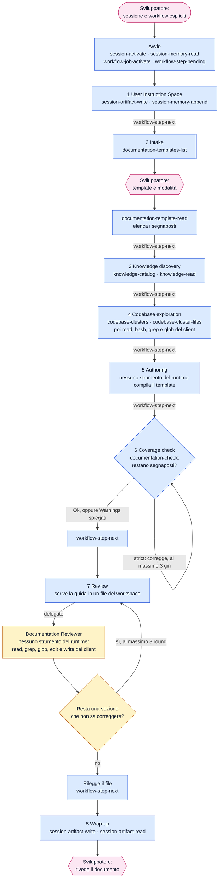

[Corso](../README.md) › [Approfondimenti](README.md) › **Strumenti di DOCUMENTATION**

# DOCUMENTATION: chi chiama quali strumenti

> **In breve:** l'orchestrator compila un template con ciò che trova nella knowledge e nel codice, poi un revisore corregge la guida da lettore nuovo. Il flusso non usa il design. Il [riferimento dei workflow](../slides/reference-flow.md#documentation) elenca che cosa produce ogni istruzione.

Nei diagrammi il colore indica chi chiama lo strumento:

| Colore | Chi chiama |
| --- | --- |
| Azzurro | [Orchestrator](../role-maps/agents/orchestrator.md) |
| Giallo | [Documentation Reviewer](../role-maps/agents/documentation-reviewer.md) |
| Rosa | Sviluppatore: qui il workflow si ferma e aspetta |

Una freccia etichettata `delegate` avvia un delegate in un contesto pulito; il delegate chiama i suoi strumenti e torna con un report nella stessa conversazione. I nomi nei riquadri sono i *capability token* del sistema di riferimento: il nome di ciò che uno strumento fa, non di un prodotto. Le risposte lunghe arrivano [in più parti](../system/canonical/contracts/workflow-loop.md#step-serving), e ogni parte si legge prima di agire.

## Il flusso completo

Se lo sviluppatore non indica la sessione o il workflow, l'avvio aggiunge `session-list` e `workflow-types-list`.

## Tre cose da notare

- **Nessuno strumento del design.** L'[istruzione 3](../system/canonical/workflows/documentation/03-knowledge-discovery.md) lo vieta e un job `DOCUMENTATION` [non ha un design](../system/canonical/contracts/workflow-loop.md#job-activate). Il contratto dell'orchestrator chiede comunque `design-snapshot` dopo l'attivazione: qui il runtime risponde solo che non c'è nulla da mostrare, e il diagramma omette quella chiamata.
- **Il revisore non usa il runtime.** Il suo [elenco delle capacità](../system/canonical/agents/documentation-reviewer.capabilities.yaml) è vuoto: riceve il percorso del file e il punto di ingresso, e corregge il file direttamente.
- **Il risultato è un artifact.** Il file di lavoro dell'istruzione 7 serve al revisore. Il documento finale è quello salvato con `session-artifact-write`.

## Gli strumenti, ruolo per ruolo

Il numero rimanda all'istruzione canonical che usa lo strumento; **avvio** è la procedura che precede la prima istruzione, nel contratto dell'orchestrator. L'ultima colonna porta al contratto dello strumento.

### [Orchestrator](../role-maps/agents/orchestrator.md)

Oltre agli strumenti in tabella usa quelli del client: `read`, `bash`, `grep` e `glob` nell'istruzione 4, e la scrittura di file nell'istruzione 7.

| Strumento | Istruzioni | A che cosa serve | Riferimento canonical |
| --- | --- | --- | --- |
| `session-list` | [avvio](../system/canonical/agents/orchestrator.agent.md#agentic-system-session) | Elenca le sessioni, se lo sviluppatore non ne indica una. | [session-store › session-list](../system/canonical/contracts/session-store.md#session-list) |
| `session-activate` | [avvio](../system/canonical/agents/orchestrator.agent.md#agentic-system-session) | Attiva la sessione che lo sviluppatore ha chiesto. | [session-store › session-activate](../system/canonical/contracts/session-store.md#session-activate) |
| `session-memory-read` | [avvio](../system/canonical/agents/orchestrator.agent.md#agentic-system-session) | Legge la memoria della sessione e l'elenco degli artifact. | [session-store › session-memory](../system/canonical/contracts/session-store.md#session-memory) |
| `workflow-types-list` | [avvio](../system/canonical/agents/orchestrator.agent.md#agentic-system-session) | Elenca i workflow, se lo sviluppatore non ne nomina uno. | [workflow-loop › workflow-types](../system/canonical/contracts/workflow-loop.md#workflow-types) |
| `workflow-job-activate` | [avvio](../system/canonical/agents/orchestrator.agent.md#agentic-system-session) | Crea o riprende il job del workflow scelto. | [workflow-loop › job-activate](../system/canonical/contracts/workflow-loop.md#job-activate) |
| `workflow-step-pending` | [avvio](../system/canonical/agents/orchestrator.agent.md#agentic-system-session) | Serve la prima istruzione. | [workflow-loop › step-serving](../system/canonical/contracts/workflow-loop.md#step-serving) |
| `workflow-step-next` | [1](../system/canonical/workflows/shared/01-user-instruction-space.md) · [2](../system/canonical/workflows/documentation/02-intake.md) · [3](../system/canonical/workflows/documentation/03-knowledge-discovery.md) · [4](../system/canonical/workflows/documentation/04-codebase-exploration.md) · [5](../system/canonical/workflows/documentation/05-authoring.md) · [6](../system/canonical/workflows/documentation/06-coverage-check.md) · [7](../system/canonical/workflows/documentation/07-review.md) | Serve l'istruzione successiva, con il registro delle richieste particolari. | [workflow-loop › step-serving](../system/canonical/contracts/workflow-loop.md#step-serving) |
| `session-artifact-write` | [1](../system/canonical/workflows/shared/01-user-instruction-space.md) · [8](../system/canonical/workflows/documentation/08-wrap-up.md) | Crea il registro delle richieste particolari; alla fine salva il documento. | [session-store › session-artifacts](../system/canonical/contracts/session-store.md#session-artifacts) |
| `session-memory-append` | [1](../system/canonical/workflows/shared/01-user-instruction-space.md) | Aggiunge alla memoria fatti validati e puntatori agli artifact. | [session-store › session-memory](../system/canonical/contracts/session-store.md#session-memory) |
| `documentation-templates-list` | [2](../system/canonical/workflows/documentation/02-intake.md) | Elenca i template disponibili. | [documentation-templates › discovery](../system/canonical/contracts/documentation-templates.md#discovery) |
| `documentation-template-read` | [2](../system/canonical/workflows/documentation/02-intake.md) | Carica il template scelto, parola per parola. | [documentation-templates › discovery](../system/canonical/contracts/documentation-templates.md#discovery) |
| `knowledge-catalog` | [3](../system/canonical/workflows/documentation/03-knowledge-discovery.md) | Legge il catalogo della knowledge a tre livelli. | [knowledge-catalog › catalog](../system/canonical/contracts/knowledge-catalog.md#catalog) |
| `knowledge-read` | [3](../system/canonical/workflows/documentation/03-knowledge-discovery.md) | Legge i documenti di knowledge scelti, con le righe numerate. | [knowledge-catalog › read](../system/canonical/contracts/knowledge-catalog.md#read) |
| `codebase-clusters` | [4](../system/canonical/workflows/documentation/04-codebase-exploration.md) | Apre la mappa del codice: il primo passo di ogni esplorazione. | [codebase-clusters › clusters](../system/canonical/contracts/codebase-clusters.md#clusters) |
| `codebase-cluster-files` | [4](../system/canonical/workflows/documentation/04-codebase-exploration.md) | Elenca i percorsi di un cluster; solo questi file si possono leggere. | [codebase-clusters › cluster-files](../system/canonical/contracts/codebase-clusters.md#cluster-files) |
| `documentation-check` | [6](../system/canonical/workflows/documentation/06-coverage-check.md) | Controlla segnaposti residui e sezioni richieste: `Ok`, `Warnings` o `Errors`. | [documentation-templates › check](../system/canonical/contracts/documentation-templates.md#check) |
| `delegate` | [7](../system/canonical/workflows/documentation/07-review.md) | Avvia o riprende un delegate in un contesto pulito. Strumento del client, non del runtime. | [glossario › Delegate](../system/canonical/CONTEXT.md) |
| `session-artifact-read` | [8](../system/canonical/workflows/documentation/08-wrap-up.md) | Conferma che il documento salvato si può rileggere. | [session-store › session-artifacts](../system/canonical/contracts/session-store.md#session-artifacts) |

### [Documentation Reviewer](../role-maps/agents/documentation-reviewer.md)

Nessuno strumento del runtime. Lavora solo con quelli del client, secondo il [suo contratto](../system/canonical/agents/documentation-reviewer.agent.md):

| Operazione | Istruzione | A che cosa serve |
| --- | --- | --- |
| `read`, `grep`, `glob` | [7](../system/canonical/workflows/documentation/07-review.md) | Legge la guida e il punto di ingresso. |
| `edit`, `write` | [7](../system/canonical/workflows/documentation/07-review.md) | Corregge direttamente nel file le sezioni poco chiare. |

## Disponibile non significa prescritto

Il [file delle capacità dell'orchestrator](../system/canonical/agents/orchestrator.capabilities.yaml) copre tutti e tre i workflow: l'elenco è più ampio di questa pagina.

**Per il tuo repository:** chi rilegge la tua documentazione generata con gli occhi di chi non conosce il sistema?

---

[← Precedente: Strumenti di FAST_IMPLEMENTATION](strumenti-fast-implementation.md) · [↑ Approfondimenti](README.md)
