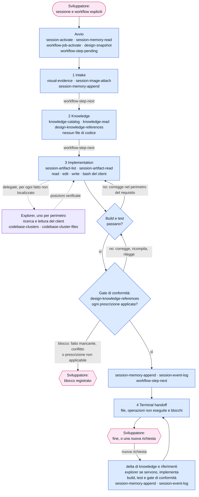

[Corso](../README.md) › [Approfondimenti](README.md) › **Strumenti di FAST_IMPLEMENTATION**

# FAST_IMPLEMENTATION: chi chiama quali strumenti

> **In breve:** un flusso corto, senza documento di design e senza approvazione. L'orchestrator prende il requisito dal prompt, registra le prescrizioni di knowledge che valgono per il job, si fa localizzare dagli explorer i fatti del codice, implementa da solo con build e test e, prima di chiudere, rilegge ogni prescrizione registrata contro il codice. Il [riferimento dei workflow](../slides/reference-flow.md#fast_implementation) elenca che cosa produce ogni istruzione.

Nei diagrammi il colore indica chi chiama lo strumento:

| Colore | Chi chiama |
| --- | --- |
| Azzurro | [Orchestrator](../role-maps/agents/orchestrator.md) |
| Viola | [Explorer](../role-maps/agents/explorer.md) |
| Rosa | Sviluppatore: qui il workflow si ferma e aspetta |

Una freccia etichettata `delegate` avvia un delegate in un contesto pulito; il delegate chiama i suoi strumenti e torna con un report nella stessa conversazione. I nomi nei riquadri sono i *capability token* del sistema di riferimento: il nome di ciò che uno strumento fa, non di un prodotto. Le risposte lunghe arrivano [in più parti](../system/canonical/contracts/workflow-loop.md#step-serving), e ogni parte si legge prima di agire.

## Il flusso completo

Se lo sviluppatore non indica la sessione o il workflow, l'avvio aggiunge `session-list` e `workflow-types-list`. Nell'istruzione 1 una richiesta che non chiede di cambiare il codice si conclude subito: l'orchestrator mostra il risultato, lo annota con `session-memory-append` e `session-event-log` e si ferma.

Un job `FAST_IMPLEMENTATION` ha un [design di job](../system/canonical/contracts/workflow-loop.md#job-activate) che contiene soltanto i riferimenti di knowledge del job: niente obbligazioni, operazioni o approvazione, e nessun documento di review. `design-snapshot`, che il contratto dell'orchestrator chiede dopo l'attivazione, legge quel design.

## Il gate di conformità alla knowledge

[Implementation](../system/canonical/workflows/fast-implementation/03-implementation.md) e [Terminal handoff](../system/canonical/workflows/fast-implementation/04-terminal-handoff.md) si chiudono con lo stesso controllo, anche dopo ogni nuova richiesta dello sviluppatore. Build e test verdi non bastano a completare il lavoro.

1. L'orchestrator rilegge con `design-knowledge-references` ogni prescrizione registrata per il job, con il suo testo e il suo ambito.
2. Per ciascuna controlla il codice di produzione o i test che governa: un'applicazione parziale, “abbastanza simile” o saltata di proposito è una violazione.
3. Corregge ogni violazione, ricompila e riesegue i test.
4. Rilegge e ricontrolla da capo, finché un giro completo non trova violazioni.
5. Annota nella memoria i riferimenti verificati e le correzioni. Una prescrizione che non si può applicare è un blocco: il lavoro non è completo.

## Che cosa cambia rispetto a DESIGN

| | [DESIGN](strumenti-design.md) | `FAST_IMPLEMENTATION` |
| --- | --- | --- |
| Il requisito | Obbligazioni scritte nel design | Il testo del prompt, così com'è scritto: nessuna scomposizione |
| Chi scrive il codice | Il code implementor, un'operazione alla volta | L'orchestrator stesso |
| Fatti del codice | Explorer, nelle istruzioni da 4 a 7 | Explorer, nelle istruzioni 3 e 4 |
| Knowledge | Prescrizioni registrate nel design e servite con ogni operazione | Prescrizioni registrate nel design di job, applicate dall'orchestrator e rilette dal gate di conformità |
| Build e test | Riportati dal code implementor; i test solo su selezione dello sviluppatore | Parte dell'implementazione: test unitari scritti dopo il codice, build e test ripetuti finché passano |
| Revisione | L'orchestrator rivede ogni unità di lavoro; lo sviluppatore approva il design prima del codice | Il gate di conformità, fatto dall'autore del codice; lo sviluppatore giudica il risultato alla fine |
| Traccia | Iterazioni con `design-iteration-open` e `design-iteration-close` | Riferimenti di knowledge del job, memoria e log della sessione |

## Gli strumenti, ruolo per ruolo

Il numero rimanda all'istruzione canonical che usa lo strumento; **avvio** è la procedura che precede la prima istruzione, nel contratto dell'orchestrator. L'ultima colonna porta al contratto dello strumento.

### [Orchestrator](../role-maps/agents/orchestrator.md)

Oltre agli strumenti in tabella, nelle istruzioni [3](../system/canonical/workflows/fast-implementation/03-implementation.md) e [4](../system/canonical/workflows/fast-implementation/04-terminal-handoff.md) usa quelli del client: `read` per i file di cui conosce già il percorso, `edit` e `write` per modificarli, `bash` per build e test. Non cerca nel codice: ogni altro fatto lo chiede agli explorer.

| Strumento | Istruzioni | A che cosa serve | Riferimento canonical |
| --- | --- | --- | --- |
| `session-list` | [avvio](../system/canonical/agents/orchestrator.agent.md#agentic-system-session) | Elenca le sessioni, se lo sviluppatore non ne indica una. | [session-store › session-list](../system/canonical/contracts/session-store.md#session-list) |
| `session-activate` | [avvio](../system/canonical/agents/orchestrator.agent.md#agentic-system-session) | Attiva la sessione che lo sviluppatore ha chiesto. | [session-store › session-activate](../system/canonical/contracts/session-store.md#session-activate) |
| `session-memory-read` | [avvio](../system/canonical/agents/orchestrator.agent.md#agentic-system-session) | Legge la memoria della sessione e l'elenco degli artifact. | [session-store › session-memory](../system/canonical/contracts/session-store.md#session-memory) |
| `workflow-types-list` | [avvio](../system/canonical/agents/orchestrator.agent.md#agentic-system-session) | Elenca i workflow, se lo sviluppatore non ne nomina uno. | [workflow-loop › workflow-types](../system/canonical/contracts/workflow-loop.md#workflow-types) |
| `workflow-job-activate` | [avvio](../system/canonical/agents/orchestrator.agent.md#agentic-system-session) | Crea o riprende il job del workflow scelto, con il suo design di job. | [workflow-loop › job-activate](../system/canonical/contracts/workflow-loop.md#job-activate) |
| `design-snapshot` | [avvio](../system/canonical/agents/orchestrator.agent.md#agentic-system-session) | Legge il design di job. | [projections › snapshot](../system/canonical/contracts/projections.md#snapshot) |
| `workflow-step-pending` | [avvio](../system/canonical/agents/orchestrator.agent.md#agentic-system-session) | Serve la prima istruzione. | [workflow-loop › step-serving](../system/canonical/contracts/workflow-loop.md#step-serving) |
| `workflow-step-next` | [1](../system/canonical/workflows/fast-implementation/01-intake.md) · [2](../system/canonical/workflows/fast-implementation/02-knowledge.md) · [3](../system/canonical/workflows/fast-implementation/03-implementation.md) | Serve l'istruzione successiva. | [workflow-loop › step-serving](../system/canonical/contracts/workflow-loop.md#step-serving) |
| `session-memory-append` | [1](../system/canonical/workflows/fast-implementation/01-intake.md) · [3](../system/canonical/workflows/fast-implementation/03-implementation.md) · [4](../system/canonical/workflows/fast-implementation/04-terminal-handoff.md) | Annota immagini, file modificati, riferimenti verificati, correzioni di conformità, blocchi ed esito di ogni nuova richiesta. | [session-store › session-memory](../system/canonical/contracts/session-store.md#session-memory) |
| `session-event-log` | [1](../system/canonical/workflows/fast-implementation/01-intake.md) · [3](../system/canonical/workflows/fast-implementation/03-implementation.md) · [4](../system/canonical/workflows/fast-implementation/04-terminal-handoff.md) | Registra un evento nel log della sessione. | [session-store › session-log](../system/canonical/contracts/session-store.md#session-log) |
| `visual-evidence` | [1](../system/canonical/workflows/fast-implementation/01-intake.md) | Guarda un'immagine: è l'unico modo ammesso. Strumento del client, non del runtime. | [orchestrator › Image acquisition](../system/canonical/agents/orchestrator.agent.md#image-acquisition) |
| `session-image-attach` | [1](../system/canonical/workflows/fast-implementation/01-intake.md) | Salva un'immagine come artifact della sessione. | [session-store › session-images](../system/canonical/contracts/session-store.md#session-images) |
| `session-artifact-list` | [3](../system/canonical/workflows/fast-implementation/03-implementation.md) | Elenca gli artifact che rappresentano un'immagine. | [session-store › session-artifacts](../system/canonical/contracts/session-store.md#session-artifacts) |
| `session-artifact-read` | [1](../system/canonical/workflows/fast-implementation/01-intake.md) · [3](../system/canonical/workflows/fast-implementation/03-implementation.md) | Rilegge un'immagine per nome, come riferimento per l'implementazione. | [session-store › session-artifacts](../system/canonical/contracts/session-store.md#session-artifacts) |
| `knowledge-catalog` | [2](../system/canonical/workflows/fast-implementation/02-knowledge.md) · [3](../system/canonical/workflows/fast-implementation/03-implementation.md) · [4](../system/canonical/workflows/fast-implementation/04-terminal-handoff.md) | Legge il catalogo della knowledge a tre livelli; dopo la prima istruzione, solo per il delta. | [knowledge-catalog › catalog](../system/canonical/contracts/knowledge-catalog.md#catalog) |
| `knowledge-read` | [2](../system/canonical/workflows/fast-implementation/02-knowledge.md) · [3](../system/canonical/workflows/fast-implementation/03-implementation.md) · [4](../system/canonical/workflows/fast-implementation/04-terminal-handoff.md) | Legge i documenti di knowledge scelti, con le righe numerate. | [knowledge-catalog › read](../system/canonical/contracts/knowledge-catalog.md#read) |
| `design-knowledge-references` | [2](../system/canonical/workflows/fast-implementation/02-knowledge.md) · [3](../system/canonical/workflows/fast-implementation/03-implementation.md) · [4](../system/canonical/workflows/fast-implementation/04-terminal-handoff.md) | Registra le prescrizioni applicabili (`kid`) dopo ogni lettura di knowledge; nel gate di conformità le rilegge con il loro testo. | [design-model › knowledge-references](../system/canonical/contracts/design-model.md#knowledge-references) |
| `delegate` | [3](../system/canonical/workflows/fast-implementation/03-implementation.md) · [4](../system/canonical/workflows/fast-implementation/04-terminal-handoff.md) | Avvia gli explorer in parallelo, uno per perimetro. Strumento del client, non del runtime. | [glossario › Explorer](../system/canonical/CONTEXT.md) |

### [Explorer](../role-maps/agents/explorer.md)

Cerca e legge con gli strumenti del client: lettura e terminale, senza scrittura. Le istruzioni 3 e 4 gli assegnano il perimetro, gli indizi e il limite di otto chiamate; gli strumenti del runtime vengono dal suo contratto.

| Strumento | Istruzioni | A che cosa serve | Riferimento canonical |
| --- | --- | --- | --- |
| `codebase-clusters` | [contratto del ruolo](../system/canonical/agents/explorer.agent.md) | Mostra la mappa dei cluster, per decidere dove cercare. | [codebase-clusters › clusters](../system/canonical/contracts/codebase-clusters.md#clusters) |
| `codebase-cluster-files` | [contratto del ruolo](../system/canonical/agents/explorer.agent.md) | Elenca i file di un cluster. | [codebase-clusters › cluster-files](../system/canonical/contracts/codebase-clusters.md#cluster-files) |

## Disponibile non significa prescritto

Il [file delle capacità dell'orchestrator](../system/canonical/agents/orchestrator.capabilities.yaml) elenca anche gli altri strumenti del design e il code implementor: in questo workflow nessuna istruzione li nomina. I contratti del [Code Implementor](../role-maps/agents/code-implementor.md) e dell'[Implementation Verifier](../role-maps/agents/implementation-verifier.md) restano nel sistema, ma `FAST_IMPLEMENTATION` non li avvia: gli unici delegate sono gli explorer, che non scrivono codice.

**Per il tuo repository:** quando togli un gate per i lavori semplici, quale prova resta? Qui restano il gate di conformità, fatto da chi ha scritto il codice, e lo sviluppatore che legge il risultato: è abbastanza per il tipo di lavoro che affidi a questo flusso?

---

[← Precedente: Strumenti di DESIGN](strumenti-design.md) · [↑ Approfondimenti](README.md) · [Successivo: Strumenti di DOCUMENTATION →](strumenti-documentation.md)
