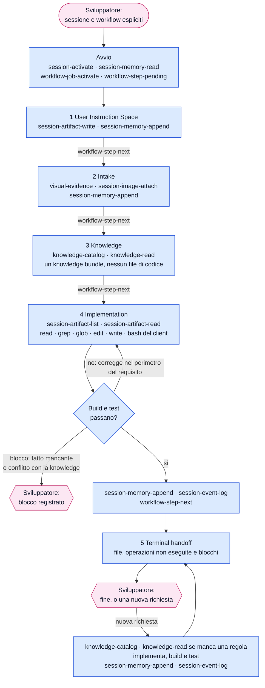

[Corso](../README.md) › [Approfondimenti](README.md) › **Strumenti di FAST_IMPLEMENTATION**

# FAST_IMPLEMENTATION: chi chiama quali strumenti

> **In breve:** un flusso corto, senza design, senza approvazione e senza delegate. L'orchestrator prende il requisito dal prompt, legge la knowledge, implementa da solo con build e test e riferisce. Il [riferimento dei workflow](../slides/reference-flow.md#fast_implementation) elenca che cosa produce ogni istruzione.

Nei diagrammi il colore indica chi chiama lo strumento:

| Colore | Chi chiama |
| --- | --- |
| Azzurro | [Orchestrator](../role-maps/agents/orchestrator.md) |
| Rosa | Sviluppatore: qui il workflow si ferma e aspetta |

I nomi nei riquadri sono i *capability token* del sistema di riferimento: il nome di ciò che uno strumento fa, non di un prodotto. Le risposte lunghe arrivano [in più parti](../system/canonical/contracts/workflow-loop.md#step-serving), e ogni parte si legge prima di agire.

## Il flusso completo

Se lo sviluppatore non indica la sessione o il workflow, l'avvio aggiunge `session-list` e `workflow-types-list`. Nell'istruzione 2 una richiesta che non chiede di cambiare il codice si conclude subito: l'orchestrator mostra il risultato, lo annota con `session-memory-append` e `session-event-log` e si ferma.

Un job `FAST_IMPLEMENTATION` [non ha un design](../system/canonical/contracts/workflow-loop.md#job-activate). Il contratto dell'orchestrator chiede comunque `design-snapshot` dopo l'attivazione: qui il runtime risponde solo che il job non ha un design, e il diagramma omette quella chiamata.

## Che cosa cambia rispetto a DESIGN

| | [DESIGN](strumenti-design.md) | `FAST_IMPLEMENTATION` |
| --- | --- | --- |
| Il requisito | Obbligazioni scritte nel design | Il testo del prompt, così com'è scritto: nessuna scomposizione |
| Chi scrive il codice | Il code implementor, un'operazione alla volta | L'orchestrator stesso |
| Knowledge | Prescrizioni registrate nel design e servite con ogni operazione | Un [knowledge bundle](../system/canonical/workflows/fast-implementation/03-knowledge.md) che l'orchestrator applica da sé |
| Build e test | Riportati dal code implementor; i test solo su selezione dello sviluppatore | Parte dell'implementazione: test unitari scritti dopo il codice, build e test ripetuti finché passano |
| Revisione | L'orchestrator rivede ogni unità di lavoro; lo sviluppatore approva il design prima del codice | Nessuna revisione separata: lo sviluppatore giudica il risultato alla fine |
| Traccia | Iterazioni con `design-iteration-open` e `design-iteration-close` | Memoria e log della sessione |

## Gli strumenti dell'orchestrator

Il numero rimanda all'istruzione canonical che usa lo strumento; **avvio** è la procedura che precede la prima istruzione, nel contratto dell'orchestrator. L'ultima colonna porta al contratto dello strumento.

Oltre agli strumenti in tabella, nelle istruzioni [4](../system/canonical/workflows/fast-implementation/04-implementation.md) e [5](../system/canonical/workflows/fast-implementation/05-terminal-handoff.md) usa quelli del client: `read`, `grep` e `glob` per capire il codice, `edit` e `write` per modificarlo, `bash` per build e test. L'esplorazione non ha una procedura prescritta: si legge quanto serve a capire il codice esistente.

| Strumento | Istruzioni | A che cosa serve | Riferimento canonical |
| --- | --- | --- | --- |
| `session-list` | [avvio](../system/canonical/agents/orchestrator.agent.md#agentic-system-session) | Elenca le sessioni, se lo sviluppatore non ne indica una. | [session-store › session-list](../system/canonical/contracts/session-store.md#session-list) |
| `session-activate` | [avvio](../system/canonical/agents/orchestrator.agent.md#agentic-system-session) | Attiva la sessione che lo sviluppatore ha chiesto. | [session-store › session-activate](../system/canonical/contracts/session-store.md#session-activate) |
| `session-memory-read` | [avvio](../system/canonical/agents/orchestrator.agent.md#agentic-system-session) | Legge la memoria della sessione e l'elenco degli artifact. | [session-store › session-memory](../system/canonical/contracts/session-store.md#session-memory) |
| `workflow-types-list` | [avvio](../system/canonical/agents/orchestrator.agent.md#agentic-system-session) | Elenca i workflow, se lo sviluppatore non ne nomina uno. | [workflow-loop › workflow-types](../system/canonical/contracts/workflow-loop.md#workflow-types) |
| `workflow-job-activate` | [avvio](../system/canonical/agents/orchestrator.agent.md#agentic-system-session) | Crea o riprende il job del workflow scelto, senza design. | [workflow-loop › job-activate](../system/canonical/contracts/workflow-loop.md#job-activate) |
| `workflow-step-pending` | [avvio](../system/canonical/agents/orchestrator.agent.md#agentic-system-session) | Serve la prima istruzione. | [workflow-loop › step-serving](../system/canonical/contracts/workflow-loop.md#step-serving) |
| `workflow-step-next` | [1](../system/canonical/workflows/shared/01-user-instruction-space.md) · [2](../system/canonical/workflows/fast-implementation/02-intake.md) · [3](../system/canonical/workflows/fast-implementation/03-knowledge.md) · [4](../system/canonical/workflows/fast-implementation/04-implementation.md) | Serve l'istruzione successiva, con il registro delle richieste particolari. | [workflow-loop › step-serving](../system/canonical/contracts/workflow-loop.md#step-serving) |
| `session-artifact-write` | [1](../system/canonical/workflows/shared/01-user-instruction-space.md) | Crea il registro delle richieste particolari. | [session-store › session-artifacts](../system/canonical/contracts/session-store.md#session-artifacts) |
| `session-memory-append` | [1](../system/canonical/workflows/shared/01-user-instruction-space.md) · [2](../system/canonical/workflows/fast-implementation/02-intake.md) · [4](../system/canonical/workflows/fast-implementation/04-implementation.md) · [5](../system/canonical/workflows/fast-implementation/05-terminal-handoff.md) | Annota immagini, file modificati, blocchi ed esito di ogni nuova richiesta. | [session-store › session-memory](../system/canonical/contracts/session-store.md#session-memory) |
| `session-event-log` | [2](../system/canonical/workflows/fast-implementation/02-intake.md) · [4](../system/canonical/workflows/fast-implementation/04-implementation.md) · [5](../system/canonical/workflows/fast-implementation/05-terminal-handoff.md) | Registra un evento nel log della sessione. | [session-store › session-log](../system/canonical/contracts/session-store.md#session-log) |
| `visual-evidence` | [2](../system/canonical/workflows/fast-implementation/02-intake.md) | Guarda un'immagine: è l'unico modo ammesso. Strumento del client, non del runtime. | [orchestrator › Image acquisition](../system/canonical/agents/orchestrator.agent.md#image-acquisition) |
| `session-image-attach` | [2](../system/canonical/workflows/fast-implementation/02-intake.md) | Salva un'immagine come artifact della sessione. | [session-store › session-images](../system/canonical/contracts/session-store.md#session-images) |
| `session-artifact-list` | [4](../system/canonical/workflows/fast-implementation/04-implementation.md) | Elenca gli artifact che rappresentano un'immagine. | [session-store › session-artifacts](../system/canonical/contracts/session-store.md#session-artifacts) |
| `session-artifact-read` | [2](../system/canonical/workflows/fast-implementation/02-intake.md) · [4](../system/canonical/workflows/fast-implementation/04-implementation.md) | Rilegge un'immagine per nome, come riferimento per l'implementazione. | [session-store › session-artifacts](../system/canonical/contracts/session-store.md#session-artifacts) |
| `knowledge-catalog` | [3](../system/canonical/workflows/fast-implementation/03-knowledge.md) · [5](../system/canonical/workflows/fast-implementation/05-terminal-handoff.md) | Legge il catalogo della knowledge a tre livelli. | [knowledge-catalog › catalog](../system/canonical/contracts/knowledge-catalog.md#catalog) |
| `knowledge-read` | [3](../system/canonical/workflows/fast-implementation/03-knowledge.md) · [5](../system/canonical/workflows/fast-implementation/05-terminal-handoff.md) | Legge i documenti di knowledge scelti, con le righe numerate. | [knowledge-catalog › read](../system/canonical/contracts/knowledge-catalog.md#read) |

## Disponibile non significa prescritto

Il [file delle capacità dell'orchestrator](../system/canonical/agents/orchestrator.capabilities.yaml) elenca anche gli strumenti del design e dei delegate: in questo workflow nessuna istruzione li nomina. I contratti del [Code Implementor](../role-maps/agents/code-implementor.md) e dell'[Implementation Verifier](../role-maps/agents/implementation-verifier.md) restano nel sistema, ma `FAST_IMPLEMENTATION` non avvia nessun delegate.

**Per il tuo repository:** quando togli un gate per i lavori semplici, quale prova indipendente resta? Qui resta lo sviluppatore che legge il risultato: è abbastanza per il tipo di lavoro che affidi a questo flusso?

---

[← Precedente: Strumenti di DESIGN](strumenti-design.md) · [↑ Approfondimenti](README.md) · [Successivo: Strumenti di DOCUMENTATION →](strumenti-documentation.md)
