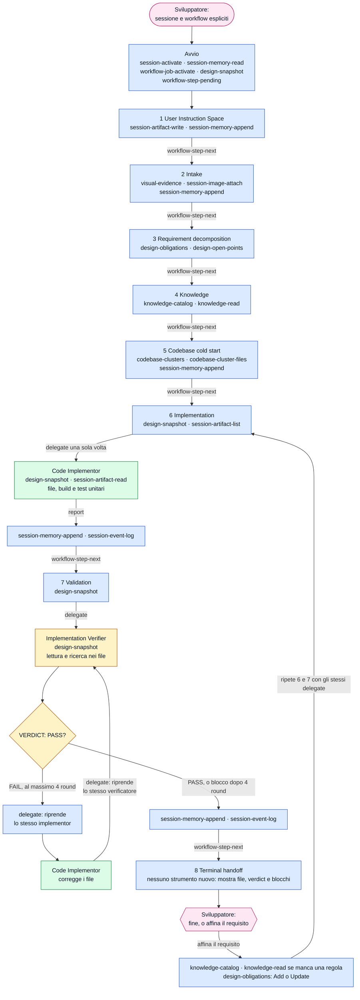

[Corso](../README.md) › [Approfondimenti](README.md) › **Strumenti di FAST_IMPLEMENTATION**

# FAST_IMPLEMENTATION: chi chiama quali strumenti

> **In breve:** un flusso più corto, senza documento di design né approvazione. Restano le obbligazioni in un job design, la lettura della knowledge e un verificatore separato da chi scrive il codice. Il [riferimento dei workflow](../slides/reference-flow.md#fast_implementation) elenca che cosa produce ogni istruzione.

Nei diagrammi il colore indica chi chiama lo strumento:

| Colore | Chi chiama |
| --- | --- |
| Azzurro | [Orchestrator](../role-maps/agents/orchestrator.md) |
| Verde | [Code Implementor](../role-maps/agents/code-implementor.md) |
| Giallo | [Implementation Verifier](../role-maps/agents/implementation-verifier.md) |
| Rosa | Sviluppatore: qui il workflow si ferma e aspetta |

Una freccia etichettata `delegate` avvia un delegate in un contesto pulito; il delegate chiama i suoi strumenti e torna con un report nella stessa conversazione. I nomi nei riquadri sono i *capability token* del sistema di riferimento: il nome di ciò che uno strumento fa, non di un prodotto. Le risposte lunghe arrivano [in più parti](../system/canonical/contracts/workflow-loop.md#step-serving), e ogni parte si legge prima di agire.

## Il flusso completo

Se lo sviluppatore non indica la sessione o il workflow, l'avvio aggiunge `session-list` e `workflow-types-list`. Nell'istruzione 2 una richiesta che non chiede di cambiare il codice si conclude subito: l'orchestrator mostra il risultato, lo annota con `session-memory-append` e `session-event-log` e si ferma.

## Che cosa cambia rispetto a DESIGN

| | [DESIGN](strumenti-design.md) | `FAST_IMPLEMENTATION` |
| --- | --- | --- |
| Da dove arriva il lavoro | Il runtime serve un'operazione alla volta | Il prompt fa leggere le obbligazioni da realizzare; il job design non ha operazioni |
| Knowledge per il code implementor | Espansa con ogni operazione servita | Un [knowledge bundle](../system/canonical/workflows/fast-implementation/04-knowledge.md) nel prompt |
| Build e test | Operazioni `Build` e `Testing` | Parte dell'unico lavoro del code implementor |
| Revisione umana | `design-document` e `design-approve` prima del codice | Nessuna: lo sviluppatore rivede il risultato alla fine |
| Traccia | Iterazioni con `design-iteration-open` e `design-iteration-close` | Memoria e log della sessione |

## Gli strumenti, ruolo per ruolo

Il numero rimanda all'istruzione canonical che usa lo strumento; **avvio** è la procedura che precede la prima istruzione, nel contratto dell'orchestrator. L'ultima colonna porta al contratto dello strumento.

### [Orchestrator](../role-maps/agents/orchestrator.md)

Oltre agli strumenti in tabella usa quelli del client: `read`, `bash`, `grep` e `glob` per l'esplorazione dell'istruzione 5, dopo i cluster. Non scrive codice di produzione e non esegue né build né test.

| Strumento | Istruzioni | A che cosa serve | Riferimento canonical |
| --- | --- | --- | --- |
| `session-list` | [avvio](../system/canonical/agents/orchestrator.agent.md#agentic-system-session) | Elenca le sessioni, se lo sviluppatore non ne indica una. | [session-store › session-list](../system/canonical/contracts/session-store.md#session-list) |
| `session-activate` | [avvio](../system/canonical/agents/orchestrator.agent.md#agentic-system-session) | Attiva la sessione che lo sviluppatore ha chiesto. | [session-store › session-activate](../system/canonical/contracts/session-store.md#session-activate) |
| `session-memory-read` | [avvio](../system/canonical/agents/orchestrator.agent.md#agentic-system-session) | Legge la memoria della sessione e l'elenco degli artifact. | [session-store › session-memory](../system/canonical/contracts/session-store.md#session-memory) |
| `workflow-types-list` | [avvio](../system/canonical/agents/orchestrator.agent.md#agentic-system-session) | Elenca i workflow, se lo sviluppatore non ne nomina uno. | [workflow-loop › workflow-types](../system/canonical/contracts/workflow-loop.md#workflow-types) |
| `workflow-job-activate` | [avvio](../system/canonical/agents/orchestrator.agent.md#agentic-system-session) | Crea o riprende il job del workflow scelto. | [workflow-loop › job-activate](../system/canonical/contracts/workflow-loop.md#job-activate) |
| `workflow-step-pending` | [avvio](../system/canonical/agents/orchestrator.agent.md#agentic-system-session) | Serve la prima istruzione. | [workflow-loop › step-serving](../system/canonical/contracts/workflow-loop.md#step-serving) |
| `workflow-step-next` | [1](../system/canonical/workflows/shared/01-user-instruction-space.md) · [2](../system/canonical/workflows/fast-implementation/02-intake.md) · [3](../system/canonical/workflows/fast-implementation/03-requirement-decomposition.md) · [4](../system/canonical/workflows/fast-implementation/04-knowledge.md) · [5](../system/canonical/workflows/fast-implementation/05-codebase-cold-start.md) · [6](../system/canonical/workflows/fast-implementation/06-implementation.md) · [7](../system/canonical/workflows/fast-implementation/07-validation.md) | Serve l'istruzione successiva, con il registro delle richieste particolari. | [workflow-loop › step-serving](../system/canonical/contracts/workflow-loop.md#step-serving) |
| `session-artifact-write` | [1](../system/canonical/workflows/shared/01-user-instruction-space.md) | Crea il registro delle richieste particolari. | [session-store › session-artifacts](../system/canonical/contracts/session-store.md#session-artifacts) |
| `session-memory-append` | [1](../system/canonical/workflows/shared/01-user-instruction-space.md) · [2](../system/canonical/workflows/fast-implementation/02-intake.md) · [5](../system/canonical/workflows/fast-implementation/05-codebase-cold-start.md) · [6](../system/canonical/workflows/fast-implementation/06-implementation.md) · [7](../system/canonical/workflows/fast-implementation/07-validation.md) | Annota immagini, panorama del codice, delegate, verdict e blocchi. | [session-store › session-memory](../system/canonical/contracts/session-store.md#session-memory) |
| `session-event-log` | [2](../system/canonical/workflows/fast-implementation/02-intake.md) · [6](../system/canonical/workflows/fast-implementation/06-implementation.md) · [7](../system/canonical/workflows/fast-implementation/07-validation.md) | Registra un evento nel log della sessione. | [session-store › session-log](../system/canonical/contracts/session-store.md#session-log) |
| `visual-evidence` | [2](../system/canonical/workflows/fast-implementation/02-intake.md) | Guarda un'immagine: è l'unico modo ammesso. Strumento del client, non del runtime. | [orchestrator › Image acquisition](../system/canonical/agents/orchestrator.agent.md#image-acquisition) |
| `session-image-attach` | [2](../system/canonical/workflows/fast-implementation/02-intake.md) | Salva un'immagine come artifact della sessione. | [session-store › session-images](../system/canonical/contracts/session-store.md#session-images) |
| `session-artifact-read` | [2](../system/canonical/workflows/fast-implementation/02-intake.md) | Rilegge un artifact per nome. | [session-store › session-artifacts](../system/canonical/contracts/session-store.md#session-artifacts) |
| `design-obligations` | [3](../system/canonical/workflows/fast-implementation/03-requirement-decomposition.md) · [4](../system/canonical/workflows/fast-implementation/04-knowledge.md) · [5](../system/canonical/workflows/fast-implementation/05-codebase-cold-start.md) · [8](../system/canonical/workflows/fast-implementation/08-terminal-handoff.md) | Scrive le obbligazioni del job design; all'istruzione 8 le aggiorna con il requisito affinato. | [design-model › row-writes](../system/canonical/contracts/design-model.md#row-writes) |
| `design-open-points` | [3](../system/canonical/workflows/fast-implementation/03-requirement-decomposition.md) | Scrive e legge i punti aperti `OP#`. | [design-model › row-writes](../system/canonical/contracts/design-model.md#row-writes) |
| `knowledge-catalog` | [4](../system/canonical/workflows/fast-implementation/04-knowledge.md) · [8](../system/canonical/workflows/fast-implementation/08-terminal-handoff.md) | Legge il catalogo della knowledge a tre livelli. | [knowledge-catalog › catalog](../system/canonical/contracts/knowledge-catalog.md#catalog) |
| `knowledge-read` | [4](../system/canonical/workflows/fast-implementation/04-knowledge.md) · [8](../system/canonical/workflows/fast-implementation/08-terminal-handoff.md) | Legge i documenti di knowledge scelti, con le righe numerate. | [knowledge-catalog › read](../system/canonical/contracts/knowledge-catalog.md#read) |
| `codebase-clusters` | [5](../system/canonical/workflows/fast-implementation/05-codebase-cold-start.md) | Apre la mappa del codice: il primo passo di ogni esplorazione. | [codebase-clusters › clusters](../system/canonical/contracts/codebase-clusters.md#clusters) |
| `codebase-cluster-files` | [5](../system/canonical/workflows/fast-implementation/05-codebase-cold-start.md) | Elenca i percorsi di un cluster; solo questi file si possono leggere. | [codebase-clusters › cluster-files](../system/canonical/contracts/codebase-clusters.md#cluster-files) |
| `design-snapshot` | [avvio](../system/canonical/agents/orchestrator.agent.md#agentic-system-session) · [4](../system/canonical/workflows/fast-implementation/04-knowledge.md) · [5](../system/canonical/workflows/fast-implementation/05-codebase-cold-start.md) · [6](../system/canonical/workflows/fast-implementation/06-implementation.md) · [7](../system/canonical/workflows/fast-implementation/07-validation.md) | Legge la proiezione compatta del design. | [projections › snapshot](../system/canonical/contracts/projections.md#snapshot) |
| `session-artifact-list` | [6](../system/canonical/workflows/fast-implementation/06-implementation.md) | Elenca gli artifact, per passare ai delegate i nomi delle immagini. | [session-store › session-artifacts](../system/canonical/contracts/session-store.md#session-artifacts) |
| `delegate` | [6](../system/canonical/workflows/fast-implementation/06-implementation.md) · [7](../system/canonical/workflows/fast-implementation/07-validation.md) | Avvia o riprende un delegate in un contesto pulito. Strumento del client, non del runtime. | [glossario › Delegate](../system/canonical/CONTEXT.md) |

### [Code Implementor](../role-maps/agents/code-implementor.md)

Modifica i file, esegue build e test con gli strumenti `read`, `write` e `terminal` del client.

| Strumento | Istruzioni | A che cosa serve | Riferimento canonical |
| --- | --- | --- | --- |
| `design-snapshot` | [6](../system/canonical/workflows/fast-implementation/06-implementation.md) | Legge le obbligazioni, che sono la specifica. Vedi la nota sotto. | [projections › snapshot](../system/canonical/contracts/projections.md#snapshot) |
| `session-artifact-read` | [6](../system/canonical/workflows/fast-implementation/06-implementation.md) | Legge le immagini nominate nel prompt. | [session-store › session-artifacts](../system/canonical/contracts/session-store.md#session-artifacts) |
| `knowledge-catalog` | [contratto del ruolo](../system/canonical/agents/code-implementor.agent.md) | Colma una lacuna che il knowledge bundle del prompt non copre. | [knowledge-catalog › catalog](../system/canonical/contracts/knowledge-catalog.md#catalog) |
| `knowledge-read` | [contratto del ruolo](../system/canonical/agents/code-implementor.agent.md) | Legge la knowledge che manca. | [knowledge-catalog › read](../system/canonical/contracts/knowledge-catalog.md#read) |
| `codebase-clusters` | [contratto del ruolo](../system/canonical/agents/code-implementor.agent.md) | Trova un percorso che il prompt non nomina. | [codebase-clusters › clusters](../system/canonical/contracts/codebase-clusters.md#clusters) |
| `codebase-cluster-files` | [contratto del ruolo](../system/canonical/agents/code-implementor.agent.md) | Elenca i file del cluster scelto. | [codebase-clusters › cluster-files](../system/canonical/contracts/codebase-clusters.md#cluster-files) |

> **Nota sul sistema di riferimento.** L'[istruzione 6](../system/canonical/workflows/fast-implementation/06-implementation.md) chiede al code implementor di leggere le obbligazioni con `design-snapshot`, ma il suo [elenco delle capacità](../system/canonical/agents/code-implementor.capabilities.yaml) non contiene quello strumento: se il runtime limita il ruolo, la chiamata viene rifiutata. Il diagramma segue l'istruzione. È una divergenza segnalata, non un comportamento da imitare.

### [Implementation Verifier](../role-maps/agents/implementation-verifier.md)

Legge il codice con `read`, `grep` e `glob`. Non ha strumenti di scrittura.

| Strumento | Istruzioni | A che cosa serve | Riferimento canonical |
| --- | --- | --- | --- |
| `design-snapshot` | [7](../system/canonical/workflows/fast-implementation/07-validation.md) | Legge le obbligazioni con cui giudica il codice. | [projections › snapshot](../system/canonical/contracts/projections.md#snapshot) |

## Disponibile non significa prescritto

I file `.capabilities.yaml` elencano ciò che ogni ruolo può usare: [orchestrator](../system/canonical/agents/orchestrator.capabilities.yaml), [code implementor](../system/canonical/agents/code-implementor.capabilities.yaml), [implementation verifier](../system/canonical/agents/implementation-verifier.capabilities.yaml). Il code implementor dispone anche di `design-implementation-operation`, ma qui il [ciclo](../system/canonical/contracts/design-model.md#implementation-loop) non ha operazioni da servire e risponderebbe `complete`.

**Per il tuo repository:** quando togli un gate per i lavori semplici, quale prova indipendente resta?

---

[← Precedente: Strumenti di DESIGN](strumenti-design.md) · [↑ Approfondimenti](README.md) · [Successivo: Strumenti di DOCUMENTATION →](strumenti-documentation.md)
