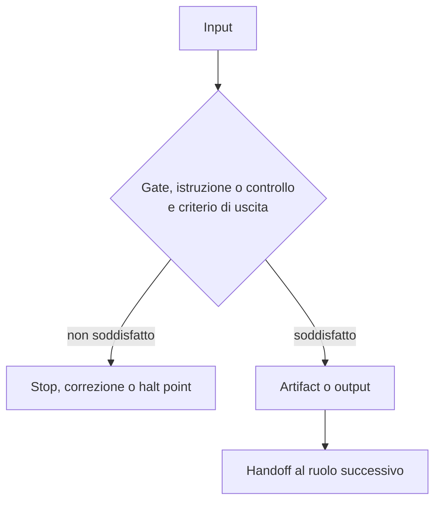

[Corso](../README.md) › **Mappe di agent e skill**

# Mappe di agent e skill

Ogni mappa descrive un agent o una skill del sistema di riferimento: una sintesi in tre righe, il diagramma del flusso e una tabella che spiega ogni passaggio. In alto trovi il link al file sorgente; in fondo, i principi in cui il ruolo compare e i link alla mappa precedente e successiva.

Le mappe sono materiale didattico. Non prescrivono ruoli, nomi o strumenti per il tuo repository.

## Agent avviati dallo sviluppatore

1. [Orchestrator](agents/orchestrator.md): guida il workflow scelto dallo sviluppatore, senza scrivere codice di produzione.
2. [Ask](agents/ask.md): risponde a domande tecniche senza modificare nulla.
3. [Knowledge Builder](agents/knowledge-builder.md): ricava regole dal repository e le salva come knowledge.

## Delegate avviati dall'orchestrator

4. [Code Implementor](agents/code-implementor.md): scrive il codice, poi i test unitari, e li esegue.
5. [Design Verifier](agents/design-verifier.md): giudica se il design realizza il requisito.
6. [Implementation Verifier](agents/implementation-verifier.md): giudica se il codice realizza la specifica e applica la knowledge.
7. [Documentation Reviewer](agents/documentation-reviewer.md): rilegge una guida come un lettore nuovo e la corregge.

## Skill

8. [Plan User Story From Id](skills/plan-user-story-from-id.md): recupera una user story tramite il suo ID e la salva nella sessione.
9. [Plan Bug From Id](skills/plan-bug-from-id.md): recupera un bug e fa scegliere la causa da affrontare.
10. [User Story Analysis](skills/user-story-analysis.md): trova lacune e ambiguità di una story.
11. [Manage Work Item](skills/manage-work-item.md): crea o aggiorna un ticket, fuori dai workflow.
12. [Author Repo Skill](skills/author-repo-skill.md): crea o aggiorna una procedura ripetibile come skill.

## Quale percorso scegliere?

| Esigenza | Percorso | Che cosa serve prima di modificare |
| --- | --- | --- |
| Capire o spiegare | [Ask](agents/ask.md) | Fonti verificabili; nessuna implementazione implicita |
| Un cambiamento con scelte da giudicare | [Orchestrator](agents/orchestrator.md) con `DESIGN` | Un design verificato e approvato dallo sviluppatore |
| Un cambiamento semplice o meccanico | [Orchestrator](agents/orchestrator.md) con `FAST_IMPLEMENTATION` | Un requisito chiaro: non c'è approvazione intermedia |
| Documentare ciò che esiste | [Orchestrator](agents/orchestrator.md) con `DOCUMENTATION` | Un template e la modalità scelta |
| Chiarire una story prima di lavorarci | [User Story Analysis](skills/user-story-analysis.md) | Nessuna modifica: domande per gli stakeholder |
| Salvare una regola del progetto | [Knowledge Builder](agents/knowledge-builder.md) | Evidenza letta nel codice e bozza approvata |
| Creare o aggiornare un ticket | [Manage Work Item](skills/manage-work-item.md) | Approvazione esplicita della proposta finale |

La scelta dipende dall'autorità e dall'output richiesti, non solo dalla dimensione del task. Il workflow lo sceglie sempre lo sviluppatore.

## Come leggere una mappa

Ogni diagramma segue la stessa catena:

La tabella sotto il diagramma risponde a quattro domande: quale decisione protegge il passaggio, che cosa produce, chi riceve il lavoro e che cosa succede se il criterio non è soddisfatto.

Tre avvertenze:

- **Istruzioni e gate numerati** sono quelli del file sorgente: le istruzioni `N/M` dei workflow, i gate di Ask e Knowledge Builder. Nelle mappe senza numeri, i controlli del diagramma servono alla lettura: non aggiungono stop, approvazioni o artifact.
- **Un output in chat** non diventa un artifact salvato solo perché compare nel diagramma.
- **Un report di un delegate** torna all'orchestrator nella stessa conversazione: non è un halt point.

Seguire le frecce non conferisce autorità: il file sorgente collegato resta la fonte di verità.

---

[↑ Torna al corso](../README.md) · [Inizia: Orchestrator →](agents/orchestrator.md)
