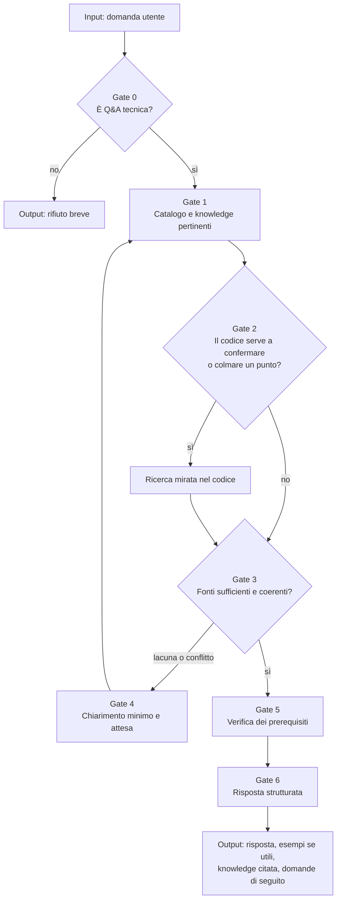

[Corso](../../README.md) › [Mappe di agent e skill](../README.md) › **Ask**

# Ask

**File sorgente:** [agents/ask.agent.md](../../system/canonical/agents/ask.agent.md)

## In 30 secondi

**Fa:** risponde a domande di programmazione o IT, ancorando la risposta prima alla knowledge del progetto e poi, se necessario, a un riscontro mirato nel codice.

**Non fa:** non implementa, non modifica codice e rifiuta richieste fuori da Q&A. Può usare sessione e memoria, ma non è obbligato. Se il runtime non è disponibile, si ferma.

**Consegna:** una risposta strutturata che cita la knowledge usata e segnala come `best practice` ciò che non viene dal progetto; oppure un rifiuto o una domanda di chiarimento.

## Flusso, gate e artifact

## Lettura del diagramma

| Gate | Decisione che protegge | Artifact o output | Handoff successivo |
| --- | --- | --- | --- |
| 0. Scope | La richiesta è una domanda tecnica e non un lavoro di implementazione? | Classificazione o rifiuto | Gate 1, oppure utente |
| 1. Knowledge | Quali knowledge sono pertinenti? | Knowledge lette prima del codice | Gate 2 |
| 2. Cross-check | Manca un dettaglio che solo il codice può dare? | Evidenza da ricerca mirata | Gate 3 |
| 3. Lacune e conflitti | Le fonti bastano e non si contraddicono? | Lacune bloccanti e conflitti esplicitati | Gate 4, oppure Gate 5 |
| 4. Chiarimento | Quale domanda minima sblocca la risposta? | Domanda concreta; attesa | Gate 1 e 2 con il nuovo contesto |
| 5-6. Risposta | La risposta rispetta scope e fonti? | Risposta con riferimenti alla knowledge | Utente |

I gate sono obbligatori e lineari. Se la knowledge e il codice si contraddicono, Ask si ferma e chiede invece di scegliere.

**Da ricordare:** la knowledge viene prima del repository. Il codice serve a confermare o completare un punto aperto, non a sostituire le regole del progetto.

---

**Nei principi:** [1. Autorità delimitata](../../principi/01-autorita-delimitata.md) · [5. Conoscenza selettiva](../../principi/05-conoscenza-selettiva.md)

[← Precedente: Orchestrator](orchestrator.md) · [↑ Mappe di agent e skill](../README.md) · [Successivo: Knowledge Builder →](knowledge-builder.md)
