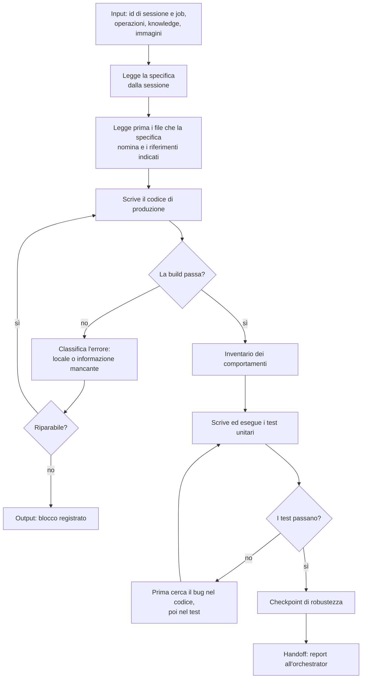

[Corso](../../README.md) › [Mappe di agent e skill](../README.md) › **Code Implementor**

# Code Implementor

**File sorgente:** [agents/code-implementor.agent.md](../../system/canonical/agents/code-implementor.agent.md)

## In 30 secondi

**Fa:** realizza l'unità di lavoro descritta nel prompt: legge la specifica con la procedura che il prompt indica, modifica i file, compila, scrive i test unitari *dopo* il codice e li esegue.

**Non fa:** non sceglie la specifica, non esplora il codice a caso, non cancella file che la specifica non chiede di cancellare e non dichiara riuscita una build che fallisce. Non scrive test tautologici.

**Consegna:** un report breve con l'unità realizzata, l'inventario dei comportamenti e il test che copre ciascuno, i file toccati, i comandi di test eseguiti con l'esito, i blocchi e gli avvisi.

## Flusso, controlli e output

## Lettura del diagramma

| Passaggio | Decisione che protegge | Output | Passaggio successivo |
| --- | --- | --- | --- |
| Specifica | Che cosa va realizzato, secondo chi? | Specifica letta dal design o dal requisito nella sessione | Lettura dei file |
| Esplorazione | Quali file servono davvero? | Solo i file nominati dalla specifica e i riferimenti indicati; altro solo con una ragione | Codice |
| Build | Il codice compila? | Errori classificati: quelli locali si riparano subito, solo un'informazione mancante giustifica una ricerca | Test, oppure blocco |
| Inventario | Quali comportamenti vanno provati? | Percorsi felici, condizioni, input non validi, errori | Test |
| Test | Il codice si comporta come la specifica chiede? | Test che osservano il codice e possono fallire | Checkpoint |
| Checkpoint | Concorrenza, risorse, log, errori, sicurezza: soddisfatti o fuori scope? | Una nota per ogni voce, nessuna saltata | Report |

La knowledge del prompt prevale sul buon senso, sulle best practice e sul codice esistente, anche per le convenzioni dei test. Se un'informazione manca, il delegate legge la knowledge dal catalogo; se non la trova, lo dichiara nel report.

**Da ricordare:** il code implementor non giudica il proprio lavoro. Il suo report è l'input dell'[Implementation Verifier](implementation-verifier.md), non la prova finale.

---

**Nei principi:** [1. Autorità delimitata](../../principi/01-autorita-delimitata.md) · [3. Validazione come prova](../../principi/03-validazione-come-prova.md) · [5. Conoscenza selettiva](../../principi/05-conoscenza-selettiva.md)

[← Precedente: Knowledge Builder](knowledge-builder.md) · [↑ Mappe di agent e skill](../README.md) · [Successivo: Design Verifier →](design-verifier.md)
