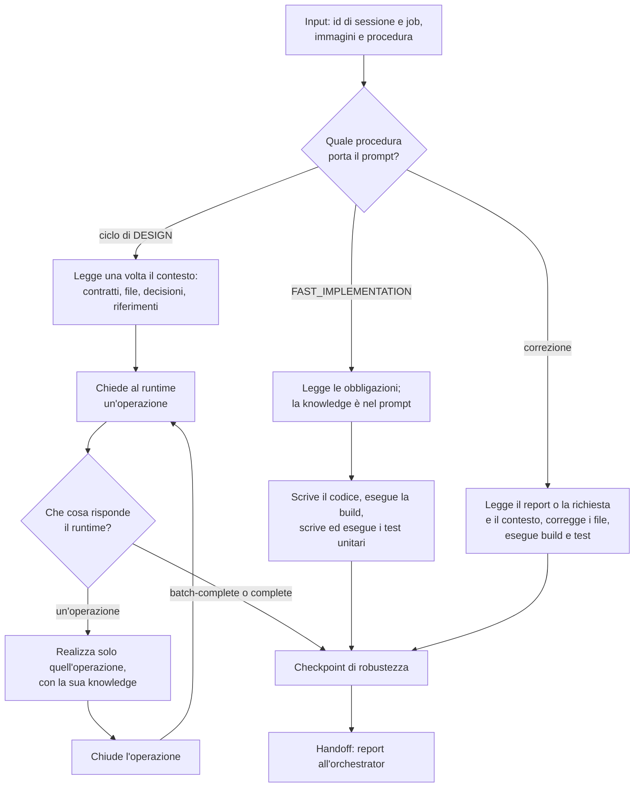

[Corso](../../README.md) › [Mappe di agent e skill](../README.md) › **Code Implementor**

# Code Implementor

**File sorgente:** [agents/code-implementor.agent.md](../../system/canonical/agents/code-implementor.agent.md)

## In 30 secondi

**Fa:** realizza l'unità di lavoro con la procedura che il prompt indica. Modifica i file; scrive ed esegue i test solo quando il prompt o la specifica servita li chiede.

**Non fa:** non sceglie la specifica, non chiede né indovina le operazioni successive, non cancella file che la specifica non chiede di cancellare, non cambia il design né i flag di avanzamento. Nel workflow `DESIGN` non esegue la build fuori dall'operazione `Build`. Non scrive test tautologici.

**Consegna:** un report breve con l'unità realizzata, l'inventario dei comportamenti e il test che copre ciascuno, i file toccati, i comandi di test eseguiti con l'esito, i blocchi e gli avvisi.

## Flusso, controlli e output

## Lettura del diagramma

| Passaggio | Decisione che protegge | Output | Passaggio successivo |
| --- | --- | --- | --- |
| Procedura | Che cosa va realizzato, secondo chi? | La specifica arriva dalla procedura del prompt, mai da un'ipotesi | Ciclo, lavoro unico o correzione |
| Ciclo di `DESIGN` | Si lavora su una cosa sola, senza vedere il resto del piano? | Un'operazione alla volta, con la knowledge espansa dal runtime | Chiusura e operazione successiva, fino al terminatore |
| Tipo di operazione | Chi esegue build, comandi e test, e quando? | `Code`, `NotCode` e `Build` entrano nel batch automatico; `Commands` e `Testing` solo dopo la scelta dello sviluppatore | Report |
| `FAST_IMPLEMENTATION` | Le obbligazioni sono realizzate e provate? | Codice, build e test unitari nello stesso lavoro | Checkpoint |
| Correzione | Il difetto segnalato è stato riparato senza toccare il piano? | File corretti, build e test eseguiti; nessun flag modificato | Checkpoint |
| Test | Il codice si comporta come la specifica chiede? | Inventario dei comportamenti e test che possono fallire | Checkpoint |
| Esplorazione | Quali file servono davvero? | Prima i file nominati; un percorso non nominato si cerca dai cluster, poi con ricerche limitate alla parte che un cluster ha nominato | Lavoro |
| Checkpoint | Concorrenza, risorse, log, errori, sicurezza: soddisfatti o fuori scope? | Una nota per ogni voce, nessuna saltata | Report |

La knowledge servita prevale sul buon senso, sulle best practice e sul codice esistente, anche per le convenzioni dei test. Se un'informazione manca, il delegate legge la knowledge dal catalogo; se non la trova, lo dichiara nel report.

Quali strumenti chiama, istruzione per istruzione: [DESIGN](../../reference/strumenti-design.md#code-implementor) · [FAST_IMPLEMENTATION](../../reference/strumenti-fast-implementation.md#code-implementor).

**Da ricordare:** il code implementor non giudica il proprio lavoro. Il suo report è l'input dell'[Implementation Verifier](implementation-verifier.md), non la prova finale.

---

**Nei principi:** [1. Autorità delimitata](../../principi/01-autorita-delimitata.md) · [3. Validazione come prova](../../principi/03-validazione-come-prova.md) · [5. Conoscenza selettiva](../../principi/05-conoscenza-selettiva.md)

[← Precedente: Knowledge Builder](knowledge-builder.md) · [↑ Mappe di agent e skill](../README.md) · [Successivo: Design Verifier →](design-verifier.md)
