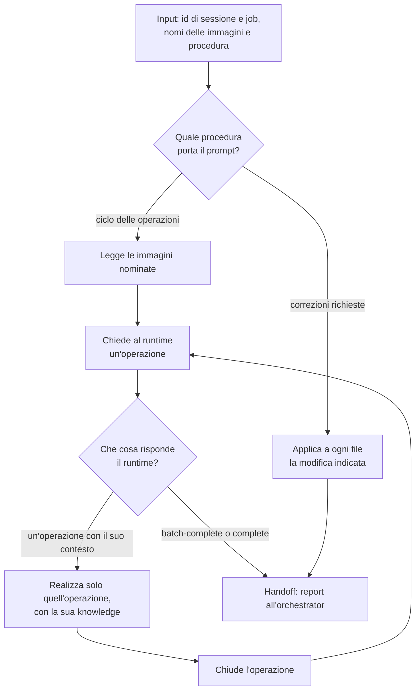

[Corso](../../README.md) › [Mappe di agent e skill](../README.md) › **Code Implementor**

# Code Implementor

**File sorgente:** [agents/code-implementor.agent.md](../../system/canonical/agents/code-implementor.agent.md)

## In 30 secondi

**Fa:** realizza l'unità di lavoro con la procedura che il prompt indica. Nel workflow `DESIGN` chiede al runtime un'operazione alla volta e la realizza come le sue istruzioni prescrivono, test compresi quando l'operazione li chiede.

**Non fa:** non sceglie la specifica, non chiede né indovina le operazioni successive, non cambia il design né i flag di avanzamento. Non usa il terminale di sua iniziativa, né per esplorare il codice: solo quando il prompt o l'operazione lo chiedono. Non aggira dentro un test un difetto reale del codice di produzione.

**Consegna:** un report breve con l'unità realizzata, l'inventario dei comportamenti e il test che copre ciascuno, le regole di knowledge applicate e dove, i file toccati, i comandi di test eseguiti con l'esito, i blocchi e gli avvisi.

## Flusso, controlli e output

## Lettura del diagramma

| Passaggio | Decisione che protegge | Output | Passaggio successivo |
| --- | --- | --- | --- |
| Procedura | Che cosa va realizzato, secondo chi? | La specifica arriva dal runtime o dall'elenco delle correzioni, mai da un'ipotesi | Ciclo o correzione |
| Ciclo delle operazioni | Si lavora su una cosa sola, senza vedere il resto del piano? | Un'operazione alla volta, con istruzioni, obbligazioni, decisioni, contratti, file e knowledge già espansi dal runtime | Chiusura e operazione successiva, fino al terminatore |
| Batch | Che cosa parte senza la scelta dello sviluppatore? | Prima il batch di produzione, poi quello di documentazione; le operazioni `Testing` e quelle distruttive solo se lo sviluppatore le ha selezionate | Report |
| Knowledge | Quale regola governa il codice? | Il testo delle prescrizioni servite con l'operazione prevale sul buon senso e sul codice esistente; una regola che manca si legge dal catalogo | Lavoro |
| Test | Il codice si comporta come la specifica chiede? | Inventario dei comportamenti e test che possono fallire; un difetto reale si corregge nel codice | Report |
| Correzione | Il difetto segnalato è stato riparato? | Le modifiche esatte, file per file, che l'orchestrator ha indicato | Report |

Il code implementor esplora il codice solo con lettura e ricerca, e parte dai file che l'operazione nomina. Se la knowledge servita contraddice altro, applica la knowledge e lo dice nel report.

Quali strumenti chiama, istruzione per istruzione: [DESIGN](../../reference/strumenti-design.md#code-implementor).

**Da ricordare:** il code implementor non giudica il proprio lavoro. Il suo report è l'input della revisione dell'[orchestrator](orchestrator.md), non la prova finale. In `FAST_IMPLEMENTATION` non interviene: l'orchestrator implementa da solo.

---

**Nei principi:** [1. Autorità delimitata](../../principi/01-autorita-delimitata.md) · [3. Validazione come prova](../../principi/03-validazione-come-prova.md) · [5. Conoscenza selettiva](../../principi/05-conoscenza-selettiva.md)

[← Precedente: Knowledge Builder](knowledge-builder.md) · [↑ Mappe di agent e skill](../README.md) · [Successivo: Design Verifier →](design-verifier.md)
