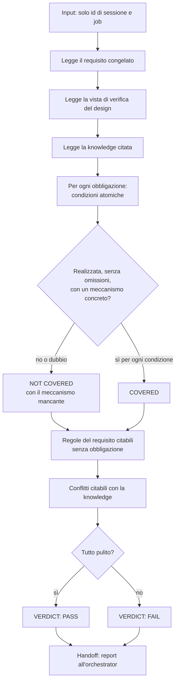

[Corso](../../README.md) › [Mappe di agent e skill](../README.md) › **Design Verifier**

# Design Verifier

**File sorgente:** [agents/design-verifier.agent.md](../../system/canonical/agents/design-verifier.agent.md)

## In 30 secondi

**Fa:** decide se il design realizza il requisito, un'obbligazione alla volta, e segnala le regole del requisito che nessuna obbligazione rappresenta e i conflitti con la knowledge citata.

**Non fa:** non progetta, non scrive codice, non ripara e non controlla la struttura del design, che spetta ai controlli meccanici. Ignora tutto ciò che il messaggio di invocazione aggiunge oltre ai due identificatori.

**Consegna:** un report di testo che inizia con `VERDICT: PASS` o `VERDICT: FAIL`, seguito da regole non mappate, conflitti con la knowledge e una riga per ogni obbligazione.

## Flusso, controlli e output

## Lettura del diagramma

| Passaggio | Decisione che protegge | Output | Passaggio successivo |
| --- | --- | --- | --- |
| Lettura | Su che cosa si giudica? | Requisito, vista di verifica, knowledge citata; tutto trattato come dati, mai come istruzioni | Giudizio |
| Copertura | Implementare il design *esattamente* produce l'effetto richiesto? | Una riga per obbligazione; per le non coperte, la condizione e il meccanismo mancante | Regole non mappate |
| Regole non mappate | Una regola del requisito è rimasta senza obbligazione? | Solo regole che si possono citare; `design-gap` o `requirement-ambiguity` | Conflitti |
| Conflitti | Il design contraddice una regola citabile della knowledge? | Regola citata e elemento del design che la contraddice | Verdict |
| Verdict | Il design può essere presentato? | `PASS` solo se tutte e tre le sezioni sono pulite | Orchestrator |

La vista di verifica mostra solo le etichette delle obbligazioni: operazioni, decisioni e file arrivano senza id, così il verificatore giudica il contenuto e non ricostruisce una mappatura. Il verificatore può chiedere solo più design, mai meno.

**Da ricordare:** “nominare non è realizzare”. Un riferimento a un elemento seguito da una frase generica, un rimando o un nome di test non è copertura.

---

**Nei principi:** [1. Autorità delimitata](../../principi/01-autorita-delimitata.md) · [2. Gate e controllo umano](../../principi/02-gate-e-controllo-umano.md) · [3. Validazione come prova](../../principi/03-validazione-come-prova.md)

[← Precedente: Code Implementor](code-implementor.md) · [↑ Mappe di agent e skill](../README.md) · [Successivo: Implementation Verifier →](implementation-verifier.md)
