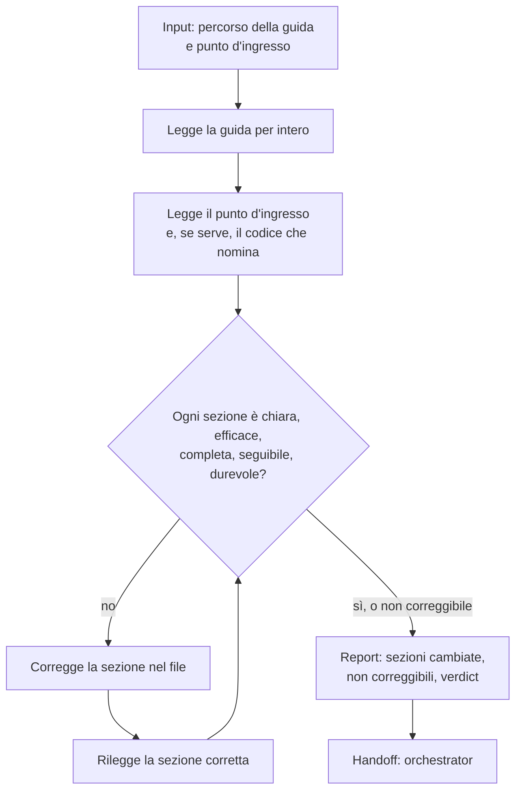

[Corso](../../README.md) › [Mappe di agent e skill](../README.md) › **Documentation Reviewer**

# Documentation Reviewer

**File sorgente:** [agents/documentation-reviewer.agent.md](../../system/canonical/agents/documentation-reviewer.agent.md)

## In 30 secondi

**Fa:** legge una guida prodotta nel workflow `DOCUMENTATION` come la leggerebbe una persona nuova, partendo dal suo punto d'ingresso, e corregge direttamente nel file le sezioni poco chiare, incomplete o fuorvianti.

**Non fa:** non scrive la documentazione da zero, non fa domande, non inventa comportamenti e non introduce nomi di file o percorsi.

**Consegna:** la guida corretta e un report con una riga per sezione cambiata, le sezioni che non ha potuto correggere e un verdict `ok` o `needs-work`.

## Flusso, controlli e output

## Lettura del diagramma

| Passaggio | Decisione che protegge | Output | Passaggio successivo |
| --- | --- | --- | --- |
| Lettura | Che cosa vede davvero un lettore all'inizio? | Guida e punto d'ingresso letti | Giudizio |
| Giudizio | La sezione spiega il meccanismo invece di ripetere il titolo? | Sezioni da correggere | Correzione |
| Correzione | Il testo si può rendere concreto senza inventare? | Sezione riscritta; contenuto valido preservato | Rilettura |
| Non correggibile | Manca un'informazione che la guida e il codice non danno? | Lacuna dichiarata nel testo e nel report | Report |
| Report | La guida è pronta? | `ok` se nessuna sezione resta non correggibile, altrimenti `needs-work` | Orchestrator |

Nel workflow, l'orchestrator rilegge il file corretto e, se restano sezioni non correggibili, le risolve e richiama il reviewer: al massimo tre round.

**Da ricordare:** il reviewer parte dal presupposto che una sezione sia poco chiara finché il testo non dimostra il contrario. Il suo compito è rendere la guida efficace, non lodarla.

---

**Nei principi:** [1. Autorità delimitata](../../principi/01-autorita-delimitata.md) · [3. Validazione come prova](../../principi/03-validazione-come-prova.md)

[← Precedente: Implementation Verifier](implementation-verifier.md) · [↑ Mappe di agent e skill](../README.md) · [Successivo: Plan User Story From Id →](../skills/plan-user-story-from-id.md)
