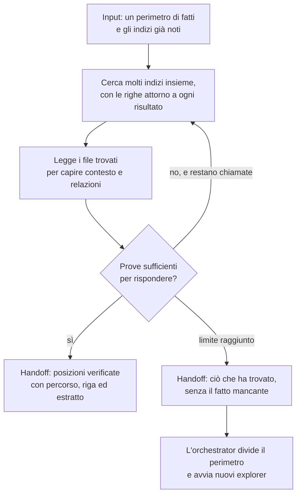

[Corso](../../README.md) › [Mappe di agent e skill](../README.md) › **Explorer**

# Explorer

**File sorgente:** [agents/explorer.agent.md](../../system/canonical/agents/explorer.agent.md)

## In 30 secondi

**Fa:** localizza nel codice i fatti che l'[orchestrator](orchestrator.md) gli chiede: dove è definito un simbolo, dove si trova una stringa o un file, dove un simbolo è usato e chi lo chiama. Cerca prima, legge poi, e si ferma quando ha prove sufficienti.

**Non fa:** non modifica il codice e non crea file, non conversa e non inventa: riferisce solo posizioni verificate nel codice. Non decide che cosa cercare né che cosa fare di ciò che trova.

**Consegna:** per ogni fatto del suo perimetro, il percorso del file relativo al repository, la riga, ciò che ha trovato e un estratto del codice parola per parola, così l'orchestrator capisce il codice senza aprire il file.

## Flusso, controlli e output

## Lettura del diagramma

| Passaggio | Decisione che protegge | Output | Passaggio successivo |
| --- | --- | --- | --- |
| Perimetro | Che cosa va cercato, e che cosa si sa già? | Un fatto, o pochi fatti a cui risponde la stessa ricerca, con gli indizi: simboli, stringhe, frammenti di nomi di file, cluster candidati | Ricerca |
| Ricerca | Dove potrebbe trovarsi il fatto? | Una prima mappa dai risultati, con più indizi per chiamata | Lettura |
| Lettura | Il risultato è davvero ciò che è stato chiesto? | Contesto e relazioni tra i simboli trovati | Risposta, o un'altra ricerca |
| Fermarsi | Le prove bastano? | Nessuna ricerca oltre il necessario | Risposta |
| Risposta | La posizione è verificata? | Percorso, riga, elemento trovato ed estratto | Orchestrator |

Il perimetro, gli indizi e il limite li fissano le istruzioni del workflow, non il contratto dell'explorer. L'orchestrator divide ciò che gli serve nei perimetri più piccoli e indipendenti e avvia un explorer per perimetro, tutti nello stesso momento: il tempo dell'esplorazione è quello dell'explorer più lento, non la somma. Ogni explorer ha un limite di otto chiamate. Se lo raggiunge senza il fatto, l'orchestrator divide ancora il perimetro; una risposta parziale non vale come fatto, e un fatto non trovato resta una lacuna o un blocco dichiarato.

Le istruzioni che lo avviano sono quelle da 4 a 7 di `DESIGN` e le istruzioni 3 e 4 di `FAST_IMPLEMENTATION`: [DESIGN](../../reference/strumenti-design.md#explorer) · [FAST_IMPLEMENTATION](../../reference/strumenti-fast-implementation.md#explorer). In `DOCUMENTATION` non interviene: lì l'orchestrator esplora da sé.

Gli strumenti che può usare sono nel suo [elenco delle capacità](../../system/canonical/agents/explorer.capabilities.yaml): lettura e terminale del client, e la [mappa dei cluster](../../system/canonical/contracts/codebase-clusters.md) del runtime per orientarsi.

**Da ricordare:** l'explorer risponde a “dove?”, non a “che cosa conviene fare?”. Separare chi cerca da chi decide tiene il contesto dell'orchestrator libero dal rumore della ricerca e rende ogni fatto usato una posizione che si può controllare.

---

**Nei principi:** [1. Autorità delimitata](../../principi/01-autorita-delimitata.md) · [5. Conoscenza selettiva](../../principi/05-conoscenza-selettiva.md)

[← Precedente: Knowledge Builder](knowledge-builder.md) · [↑ Mappe di agent e skill](../README.md) · [Successivo: Code Implementor →](code-implementor.md)
