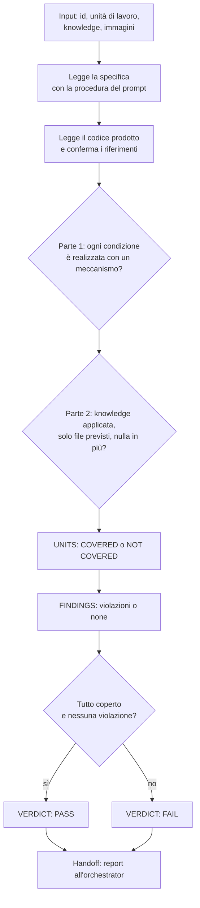

[Corso](../../README.md) › [Mappe di agent e skill](../README.md) › **Implementation Verifier**

# Implementation Verifier

**File sorgente:** [agents/implementation-verifier.agent.md](../../system/canonical/agents/implementation-verifier.agent.md)

> **Stato nel sistema di riferimento.** Dalla versione 3.0.3 nessuna istruzione avvia questo ruolo: nel workflow `DESIGN` è l'[orchestrator](orchestrator.md) a rivedere ogni unità di lavoro, nell'[istruzione di implementazione](../../system/canonical/workflows/design/10-implementation.md). Il contratto resta nel sistema, e questa mappa lo descrive perché mostra come si scrive un giudizio indipendente sul codice.

## In 30 secondi

**Fa:** giudica se il codice prodotto per un'unità di lavoro realizza la sua specifica, applica la knowledge ricevuta e rispetta i confini della specifica.

**Non fa:** non progetta, non scrive codice e non ripara: non ha strumenti di scrittura. Non giudica la specifica rispetto al requisito e non giudica documenti renderizzati.

**Consegna:** un report di testo che inizia con `VERDICT: PASS` o `VERDICT: FAIL`, con una riga per ogni voce dell'unità di lavoro e l'elenco delle violazioni di knowledge o specifica.

## Flusso, controlli e output

## Lettura del diagramma

| Passaggio | Decisione che protegge | Output | Passaggio successivo |
| --- | --- | --- | --- |
| Specifica | Contro che cosa si giudica? | Design o requisito letti dalla sessione | Codice |
| Codice | Che cosa è stato scritto davvero? | File dichiarati letti; riferimenti confermati nel repository | Giudizio |
| Parte 1 | Il codice produce necessariamente l'effetto richiesto da ogni condizione e rispetta i contratti? | Voci coperte o non coperte, con il meccanismo mancante | Parte 2 |
| Parte 2 | Il codice applica la knowledge alla lettera e resta nei confini della specifica? | Violazioni con file e regola | Verdict |
| Verdict | L'implementazione può chiudersi? | `PASS` solo se tutto è coperto e non ci sono violazioni | Orchestrator |

Giudica con la knowledge che riceve, la stessa che ha guidato chi ha scritto il codice. Con un dubbio reale sceglie “non coperto”. Codice morto, guardie mai impostate e rami irraggiungibili non contano come realizzazione. Può chiedere solo più conformità, mai meno.

Gli strumenti che può usare sono nel suo [elenco delle capacità](../../system/canonical/agents/implementation-verifier.capabilities.yaml): lettura e ricerca nei file, nessuno strumento di scrittura.

**Da ricordare:** il verdict è meccanico. Qualsiasi prima riga diversa da `VERDICT: PASS` vale come `FAIL`.

---

**Nei principi:** [1. Autorità delimitata](../../principi/01-autorita-delimitata.md) · [3. Validazione come prova](../../principi/03-validazione-come-prova.md) · [5. Conoscenza selettiva](../../principi/05-conoscenza-selettiva.md)

[← Precedente: Design Verifier](design-verifier.md) · [↑ Mappe di agent e skill](../README.md) · [Successivo: Documentation Reviewer →](documentation-reviewer.md)
