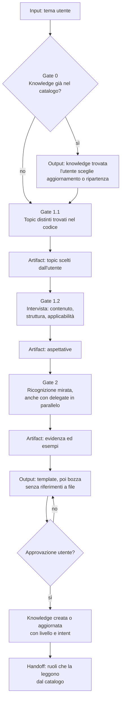

[Corso](../../README.md) › [Mappe di agent e skill](../README.md) › **Knowledge Builder**

# Knowledge Builder

**File sorgente:** [agents/knowledge-builder.agent.md](../../system/canonical/agents/knowledge-builder.agent.md)

## In 30 secondi

**Fa:** legge il repository per produrre una knowledge che un agente senza conoscenza del progetto possa applicare, basata su evidenza letta davvero e salvata nel catalogo.

**Non fa:** non scrive né modifica codice, non usa nomi di file come evidenza e non trasforma supposizioni in fatti. Se il runtime non è disponibile, si ferma.

**Consegna:** topic e aspettative come artifact della sessione, poi una knowledge nuova o aggiornata, con un intent che dice quando leggerla.

## Flusso, gate e artifact

## Lettura del diagramma

| Gate | Decisione che protegge | Artifact o output | Handoff successivo |
| --- | --- | --- | --- |
| 0. Knowledge esistente | Si aggiorna una base utile o si parte da zero? | Esito del catalogo e scelta dell'utente | Gate 1.1 |
| 1.1. Topic | Quali concetti distinti esistono davvero nel codice? | Un artifact per ogni topic scelto | Gate 1.2 |
| 1.2. Aspettative | Che cosa deve sapere e come userà la knowledge chi la legge? | Artifact dell'intervista | Gate 2 |
| 2. Ricognizione | Quali prove derivano da file realmente letti? | Evidenza, relazioni ed esempi di codice | Bozza |
| Bozza e approvazione | La knowledge è utile, supportata e leggibile senza conoscere i file? | Template e bozza approvati | Salvataggio |
| Salvataggio | Dove e quando la troverà il prossimo agente? | Documento nel catalogo, con intent | Ruoli che consultano il catalogo |

Un aggiornamento mantiene lo stile del documento esistente e cambia solo la parte interessata.

**Da ricordare:** un artifact di ricerca non è ancora knowledge. Diventa riusabile solo dopo bozza, approvazione e salvataggio nel catalogo.

---

**Nei principi:** [1. Autorità delimitata](../../principi/01-autorita-delimitata.md) · [5. Conoscenza selettiva](../../principi/05-conoscenza-selettiva.md)

[← Precedente: Ask](ask.md) · [↑ Mappe di agent e skill](../README.md) · [Successivo: Code Implementor →](code-implementor.md)
