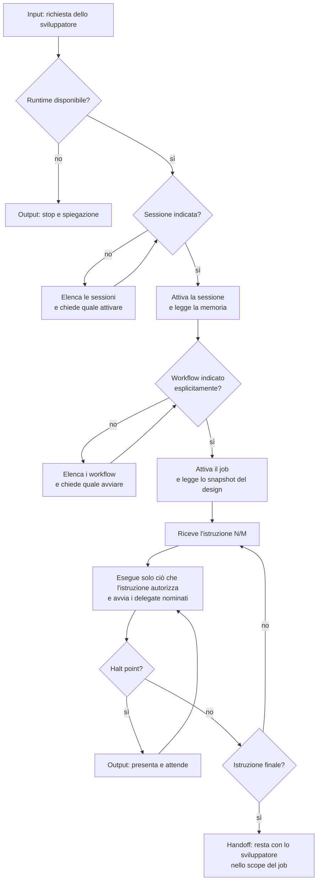

[Corso](../../README.md) › [Mappe di agent e skill](../README.md) › **Orchestrator**

# Orchestrator

**File sorgente:** [agents/orchestrator.agent.md](../../system/canonical/agents/orchestrator.agent.md)

## In 30 secondi

**Fa:** attiva la sessione indicata dallo sviluppatore, avvia il job del workflow che lo sviluppatore ha scelto e ne segue le istruzioni alla lettera, una alla volta. Scrive requisito, design e memoria attraverso il runtime, avvia i delegate e agisce sui loro verdict.

**Non fa:** non scrive codice di produzione, non sceglie né deduce il workflow, non attiva una sessione senza richiesta esplicita, non taglia lo scope del requisito e non approva il design al posto dello sviluppatore. Se il runtime non è disponibile, si ferma.

**Consegna:** nel workflow `DESIGN`, un design approvato e implementato con le prove; in `FAST_IMPLEMENTATION`, un'implementazione verificata; in `DOCUMENTATION`, un documento salvato nella sessione. Sempre con i blocchi aperti dichiarati.

## Flusso, istruzioni e artifact

## Lettura del diagramma

| Passaggio | Decisione che protegge | Artifact o output | Passaggio successivo |
| --- | --- | --- | --- |
| Runtime | Le operazioni richieste esistono? | Stop se mancano, anche se lo sviluppatore chiede di proseguire | Sessione |
| Sessione | Su quale registro durevole si lavora? | Sessione attivata su richiesta esplicita; memoria letta | Workflow |
| Workflow | Quale sequenza di istruzioni si segue? | Scelta esplicita dello sviluppatore, mai dedotta | Job |
| Job | Quale esecuzione, e su quale design? | Job attivo; design nuovo o riusato se lo sviluppatore indica un `designId` | Prima istruzione |
| Istruzione N/M | Che cosa è autorizzato adesso? | Ciò che l'istruzione prescrive: requisito, design, delegate, documento | Istruzione successiva o halt point |
| Halt point | Serve una persona? | Review, domanda o decisione presentata | Risposta dello sviluppatore |
| Handoff finale | Il risultato è dichiarato con le prove? | Messaggio che non afferma più di quanto accaduto | Lo sviluppatore |

**Gerarchia delle istruzioni.** Le regole obbligatorie del contratto valgono sempre; poi vengono le istruzioni servite dal runtime, poi le istruzioni di sistema, infine quelle dell'utente. Se una richiesta dello sviluppatore contraddice un'istruzione del workflow, l'orchestrator lo dice e segue l'istruzione. Le richieste particolari dichiarate nel primo prompt, invece, entrano nel registro del primo step e modificano il processo in modo tracciato.

**Regole che valgono in ogni istruzione:**

- una decisione dello sviluppatore registrata come obbligazione con origine `Developer` prevale sul requisito;
- lo scope lo fissa solo il requisito: “il resto è analogo” o “e così via” sono omissioni, non design;
- le immagini si guardano con un'unica procedura e si allegano alla sessione, così i delegate le ritrovano per nome;
- la knowledge del progetto prevale sul codice esistente, che si legge per i contratti e non come modello.

Le istruzioni di ogni workflow sono elencate nel [riferimento dei workflow](../../slides/reference-flow.md).

**Da ricordare:** l'orchestrator non sa che cosa farà finché il runtime non glielo serve. La sua affidabilità sta nel seguire il contratto e le istruzioni, non nell'improvvisare un piano.

---

**Nei principi:** [1. Autorità delimitata](../../principi/01-autorita-delimitata.md) · [2. Gate e controllo umano](../../principi/02-gate-e-controllo-umano.md) · [4. Artifact durevoli](../../principi/04-artifact-durevoli.md) · [6. Composizione e ciclo di vita](../../principi/06-composizione-e-ciclo-di-vita.md)

[← Mappe di agent e skill](../README.md) · [↑ Mappe di agent e skill](../README.md) · [Successivo: Ask →](ask.md)
