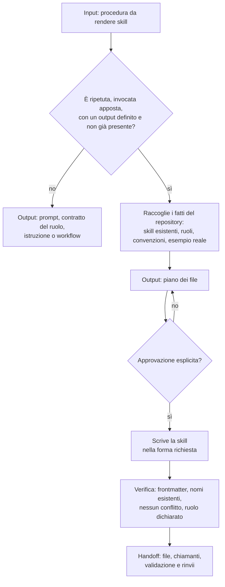

[Corso](../../README.md) › [Mappe di agent e skill](../README.md) › **Author Repo Skill**

# Author Repo Skill

**File sorgente:** [skills/author-repo-skill/SKILL.md](../../system/canonical/skills/author-repo-skill/SKILL.md)

## In 30 secondi

**Fa:** crea o aggiorna una skill del repository, dopo aver verificato che una skill sia davvero il posto giusto per quella procedura.

**Non fa:** non scrive prima dell'approvazione del piano dei file, non inventa strumenti, percorsi o comandi che la ricerca non ha trovato e non duplica una skill esistente.

**Consegna:** i file creati o modificati, i chiamanti coinvolti, i risultati della validazione e ciò che resta rimandato.

## Flusso, controlli e output

## Lettura del diagramma

| Passaggio | Decisione che protegge | Output | Passaggio successivo |
| --- | --- | --- | --- |
| Casa giusta | È una skill, o appartiene a un prompt, a un ruolo, a un'istruzione o a un workflow? | Decisione motivata | Raccolta o stop |
| Raccolta | Su quali fatti del repository si basa la procedura? | Fatti con la loro fonte | Piano |
| Piano e approvazione | L'utente accetta i file proposti? | Approvazione esplicita; falsa per default | Scrittura |
| Scrittura | La skill dice quando usarla, che cosa produce, quando fermarsi? | Skill specifica del repository | Verifica |
| Evoluzione | Che cosa si rompe cambiando una skill esistente? | Chiamanti, compatibilità, ragione di ogni regola tolta | Verifica |
| Verifica | Ogni nome citato esiste e nessuna regola contraddice i contratti? | Esito della validazione | Utente |

**Da ricordare:** una procedura di passi serviti uno alla volta con gate appartiene a un workflow, non a una skill. Due skill che differiscono solo per un nome sono una skill con un parametro.

---

**Nei principi:** [6. Composizione e ciclo di vita](../../principi/06-composizione-e-ciclo-di-vita.md)

[← Precedente: Manage Work Item](manage-work-item.md) · [↑ Mappe di agent e skill](../README.md) · [Torna al corso →](../../README.md)
