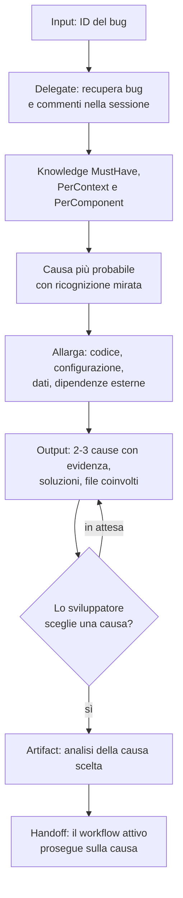

[Corso](../../README.md) › [Mappe di agent e skill](../README.md) › **Plan Bug From Id**

# Plan Bug From Id

**File sorgente:** [skills/plan-bug-from-id/SKILL.md](../../system/canonical/skills/plan-bug-from-id/SKILL.md)

## In 30 secondi

**Fa:** parte dall'ID di un bug. Lo fa recuperare a un delegate, legge la knowledge pertinente, cerca nel codice la causa più probabile e poi allarga l'indagine. Presenta le due o tre cause più probabili e fa scegliere allo sviluppatore quale affrontare.

**Non fa:** non sceglie la causa al posto dello sviluppatore e non insegue i sintomi. Non include i work item collegati.

**Consegna:** un artifact con l'analisi della causa scelta, che il workflow successivo usa come base. La causa scelta basta a procedere senza intervista.

## Flusso, controlli e output

## Lettura del diagramma

| Passaggio | Decisione che protegge | Output | Passaggio successivo |
| --- | --- | --- | --- |
| Recupero | Che cosa dice il bug, esattamente? | Artifact con titolo, descrizione, immagini e commenti | Knowledge |
| Knowledge | Quali regole spiegano il contesto del bug? | Knowledge lette | Analisi |
| Dalla causa più probabile alle altre | Si sta guardando la causa o il sintomo? | Cause e fattori, interni ed esterni | Esposizione |
| Scelta | Quale causa affrontare? | Decisione dello sviluppatore | Artifact |
| Artifact | La correzione resta concentrata sulla causa? | Analisi salvata; correzione in un solo passo, preferendo modificare il codice esistente | Workflow attivo |

**Da ricordare:** trovare più cause e farne scegliere una è un gate umano. Senza questa scelta, l'agente correggerebbe la prima ipotesi plausibile.

---

**Nei principi:** [1. Autorità delimitata](../../principi/01-autorita-delimitata.md) · [2. Gate e controllo umano](../../principi/02-gate-e-controllo-umano.md)

[← Precedente: Plan User Story From Id](plan-user-story-from-id.md) · [↑ Mappe di agent e skill](../README.md) · [Successivo: User Story Analysis →](user-story-analysis.md)
