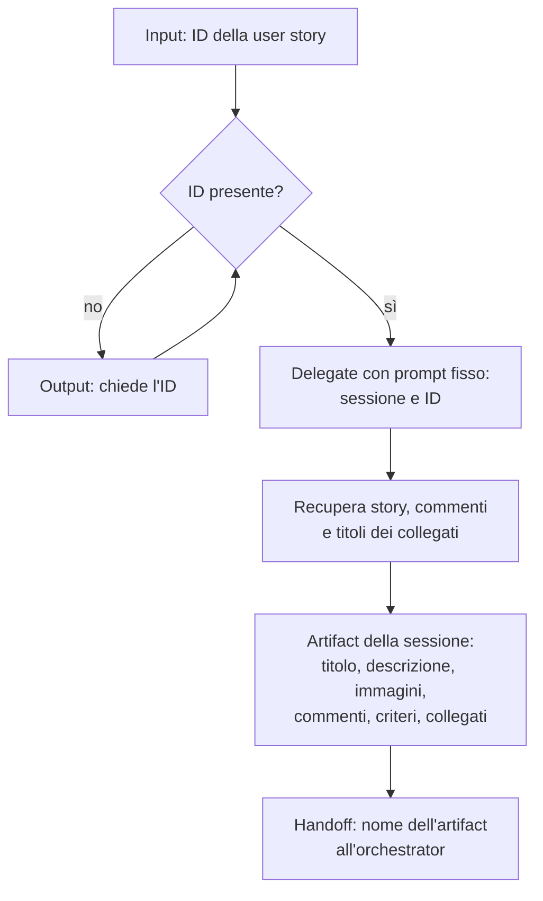

[Corso](../../README.md) › [Mappe di agent e skill](../README.md) › **Plan User Story From Id**

# Plan User Story From Id

**File sorgente:** [skills/plan-user-story-from-id/SKILL.md](../../system/canonical/skills/plan-user-story-from-id/SKILL.md)

## In 30 secondi

**Fa:** parte dall'ID di una user story. Fa recuperare a un delegate titolo, descrizione, immagini, commenti, criteri di accettazione e work item collegati, e li salva in un artifact della sessione che l'[orchestrator](../agents/orchestrator.md) legge per il workflow.

**Non fa:** non analizza la story, non sceglie il workflow e non progetta. Se l'ID manca, lo chiede.

**Consegna:** il nome dell'artifact con il contenuto del ticket, nell'ordine previsto.

## Flusso, controlli e output

## Lettura del diagramma

| Passaggio | Decisione che protegge | Output | Passaggio successivo |
| --- | --- | --- | --- |
| ID | Quale story, esattamente? | ID chiesto se manca | Delegate |
| Recupero | Quali dati definiscono la story? | Dati restituiti dall'integrazione del tracker approvata per il repository | Artifact |
| Artifact | Il contenuto sopravvive alla conversazione del delegate? | Un artifact con sezioni in ordine fisso | Orchestrator |

Le immagini presenti nel ticket non sono ancora osservate: l'orchestrator le acquisisce con la propria procedura durante il workflow.

**Da ricordare:** la skill porta il ticket nella sessione. La scelta del workflow resta allo sviluppatore.

---

**Nei principi:** [1. Autorità delimitata](../../principi/01-autorita-delimitata.md) · [4. Artifact durevoli](../../principi/04-artifact-durevoli.md)

[← Precedente: Documentation Reviewer](../agents/documentation-reviewer.md) · [↑ Mappe di agent e skill](../README.md) · [Successivo: Plan Bug From Id →](plan-bug-from-id.md)
