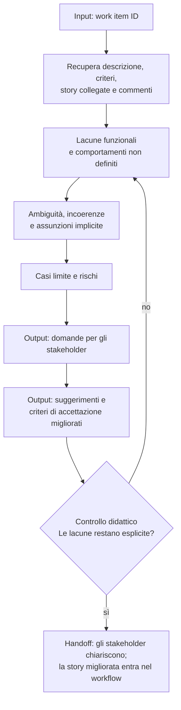

[Corso](../../README.md) › [Mappe di agent e skill](../README.md) › **User Story Analysis**

# User Story Analysis

**File sorgente:** [skills/user-story-analysis/SKILL.md](../../system/canonical/skills/user-story-analysis/SKILL.md)

## In 30 secondi

**Fa:** analizza criticamente una user story ed espone lacune funzionali, ambiguità, incoerenze, assunzioni implicite, casi limite e rischi.

**Non fa:** non inventa requisiti e non avvia un workflow. Quando mancano dettagli, li trasforma in domande per gli stakeholder e in proposte di miglioramento.

**Consegna:** un'analisi strutturata in sette sezioni, con domande per gli stakeholder ed esempi di criteri di accettazione migliori.

## Flusso, controlli e output

## Lettura del diagramma

| Passaggio o controllo | Decisione che protegge | Output | Passaggio successivo |
| --- | --- | --- | --- |
| Recupero | Quale evidenza definisce davvero la story? | Descrizione, criteri, commenti e collegamenti | Analisi |
| Lacune e ambiguità | Che cosa manca, e che cosa ammette più letture? | Lacune, incoerenze e assunzioni esplicite | Casi limite |
| Casi limite e rischi | Quali scenari richiedono una decisione? | Dati mancanti, input non validi, stati estremi, rischi | Domande |
| Domande e miglioramenti | Come si ottiene un requisito più preciso senza inventarlo? | Domande e proposte di criteri | Controllo |
| Controllo dell'output | Le lacune restano esplicite, senza requisiti inventati? | Analisi strutturata | Stakeholder |

**Da ricordare:** nel workflow `DESIGN` l'orchestrator trasforma le lacune in decisioni da far rivedere; questa skill le porta agli stakeholder *prima*, quando il requisito si può ancora migliorare.

---

**Nei principi:** [1. Autorità delimitata](../../principi/01-autorita-delimitata.md)

[← Precedente: Plan Bug From Id](plan-bug-from-id.md) · [↑ Mappe di agent e skill](../README.md) · [Successivo: Manage Work Item →](manage-work-item.md)
