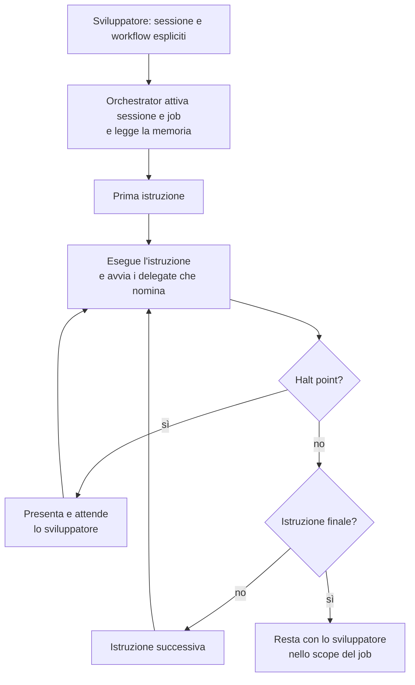
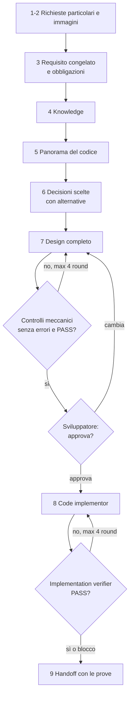

[Corso](../README.md) › [Slide](README.md) › **I tre workflow**

# I tre workflow, istruzione per istruzione

Mappa del ruolo: [Orchestrator](../role-maps/agents/orchestrator.md)

Questa pagina serve quando vuoi seguire **ogni istruzione**. L'elenco dei tipi è in [workflow-types.yaml](../system/canonical/workflows/workflow-types.yaml); il testo di ogni istruzione è nel file collegato in tabella, e il [ciclo del workflow](../system/canonical/contracts/workflow-loop.md) descrive come il runtime le serve. Queste sintesi non sostituiscono i file: durante l'esecuzione nessuna istruzione si salta o si unisce, salvo gli effetti che lo sviluppatore ha chiesto nel primo step e che il workflow accetta.

**Halt point** indica dove il workflow si ferma ad aspettare lo sviluppatore. “Se serve” vuol dire che lo stop scatta solo nella condizione descritta dall'istruzione. Ogni istruzione si ferma anche su un blocco: una scrittura che fallisce dopo un nuovo tentativo, un fatto mancante o contraddittorio.

## Il ciclo comune

Dalla seconda istruzione in poi il runtime allega a ogni istruzione il registro delle richieste particolari dello sviluppatore.

## DESIGN

Per requisiti complessi, con una persona che giudica le decisioni prima del codice.

| N/9 | Istruzione | Che cosa produce | Halt point |
| --- | --- | --- | --- |
| 1 | [User Instruction Space](../system/canonical/workflows/shared/01-user-instruction-space.md) | Registro delle richieste particolari, eseguite o vincolanti | Se serve: richiesta ambigua o in conflitto |
| 2 | [Image intake](../system/canonical/workflows/design/02-image-intake.md) | Immagini osservate e allegate alla sessione | Se serve: screenshot di un link Figma |
| 3 | [Requirement decomposition](../system/canonical/workflows/design/03-requirement-decomposition.md) | `requirement_R_lock`, obbligazioni con i loro elementi, punti aperti | No |
| 4 | [Knowledge enrichment](../system/canonical/workflows/design/04-knowledge-enrichment.md) | Knowledge letta; obbligazioni funzionali aggiunte dalla knowledge, con la fonte | No |
| 5 | [Codebase cold start](../system/canonical/workflows/design/05-codebase-cold-start.md) | Panorama del codice e lacune ancorate agli elementi, riferimenti ai file, nuovi punti aperti | No |
| 6 | [Decision consolidation](../system/canonical/workflows/design/06-decision-consolidation.md) | Una decisione per punto aperto valido: risposta scelta e alternative | No: lo sviluppatore le vede alla review |
| 7 | [Design walkthrough](../system/canonical/workflows/design/07-design-walkthrough.md) | Contratti, API, file, operazioni; controlli meccanici puliti; `VERDICT: PASS` del design verifier; documento di review | **Sì**: review e approvazione; escalation dopo quattro round |
| 8 | [Implementation](../system/canonical/workflows/design/08-implementation.md) | Iterazione aperta, codice e test dal code implementor, verdict dell'implementation verifier, iterazione chiusa | Solo su blocco |
| 9 | [Terminal handoff](../system/canonical/workflows/design/09-terminal-handoff.md) | Messaggio con documento, file, verifiche e blocchi | **Sì**: fine del workflow; le modifiche successive restano nello scope del design |

## FAST_IMPLEMENTATION

Per requisiti semplici o compiti meccanici. Non c'è design né approvazione: il requisito è l'unica autorità.

| N/7 | Istruzione | Che cosa produce | Halt point |
| --- | --- | --- | --- |
| 1 | [User Instruction Space](../system/canonical/workflows/shared/01-user-instruction-space.md) | Registro delle richieste particolari | Se serve |
| 2 | [Intake](../system/canonical/workflows/fast-implementation/02-intake.md) | `requirement_R_lock` e immagini allegate | Se serve: screenshot Figma |
| 3 | [Knowledge](../system/canonical/workflows/fast-implementation/03-knowledge.md) | Knowledge bundle per chi scrive e chi verifica | No; un conflitto con il requisito è un blocco |
| 4 | [Codebase cold start](../system/canonical/workflows/fast-implementation/04-codebase-cold-start.md) | Panorama e lacune nella memoria della sessione | No |
| 5 | [Implementation](../system/canonical/workflows/fast-implementation/05-implementation.md) | Codice e test dal code implementor | Solo su blocco |
| 6 | [Validation](../system/canonical/workflows/fast-implementation/06-validation.md) | Verdict dell'implementation verifier, al massimo quattro round di correzione | No |
| 7 | [Terminal handoff](../system/canonical/workflows/fast-implementation/07-terminal-handoff.md) | Messaggio con file, verdict e blocchi | **Sì**: fine; le richieste successive raffinano il requisito nello stesso job |

## DOCUMENTATION

Per scrivere documentazione tecnica da un template.

| N/8 | Istruzione | Che cosa produce | Halt point |
| --- | --- | --- | --- |
| 1 | [User Instruction Space](../system/canonical/workflows/shared/01-user-instruction-space.md) | Registro delle richieste particolari | Se serve |
| 2 | [Intake](../system/canonical/workflows/documentation/02-intake.md) | Template scelto, modalità `strict` o `flexible`, elenco dei segnaposti | **Sì**: scelta del template e della modalità |
| 3 | [Knowledge discovery](../system/canonical/workflows/documentation/03-knowledge-discovery.md) | Knowledge applicabile e fatti che porta | No |
| 4 | [Codebase exploration](../system/canonical/workflows/documentation/04-codebase-exploration.md) | Evidenza dal codice per ogni segnaposto | No |
| 5 | [Authoring](../system/canonical/workflows/documentation/05-authoring.md) | Documento compilato, senza riferimenti a file | No |
| 6 | [Coverage check](../system/canonical/workflows/documentation/06-coverage-check.md) | Segnaposti risolti e residui | No |
| 7 | [Review](../system/canonical/workflows/documentation/07-review.md) | Documento corretto dal documentation reviewer | No: il reviewer non fa domande |
| 8 | [Wrap-up](../system/canonical/workflows/documentation/08-wrap-up.md) | Documento salvato come artifact della sessione | **Sì**: fine; lo sviluppatore lo rivede |

---

[← Precedente: riferimento rapido](reference-roster.md) · [↑ Slide](README.md) · [Torna al corso →](../README.md)
