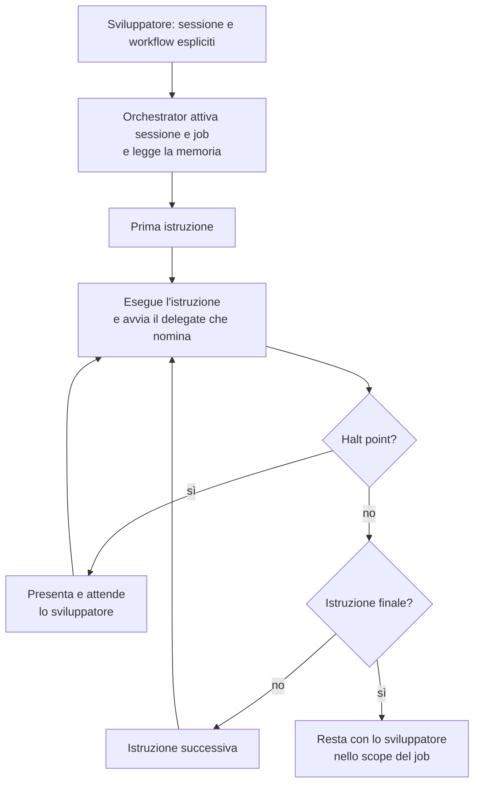
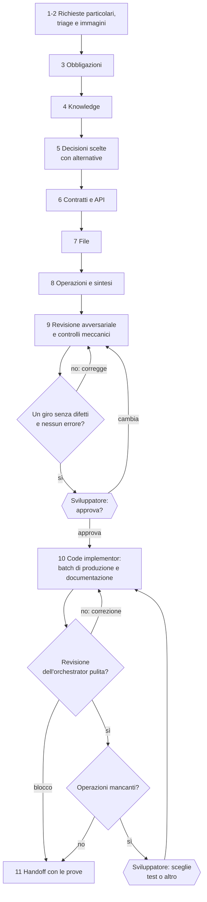

[Corso](../README.md) › [Slide](README.md) › **I tre workflow**

# I tre workflow, istruzione per istruzione

Mappa del ruolo: [Orchestrator](../role-maps/agents/orchestrator.md)

Questa pagina serve quando vuoi seguire **ogni istruzione**. L'elenco dei tipi è in [workflow-types.yaml](../system/canonical/workflows/workflow-types.yaml); il testo di ogni istruzione è nel file collegato in tabella, e il [ciclo del workflow](../system/canonical/contracts/workflow-loop.md) descrive come il runtime le serve. Queste sintesi non sostituiscono i file: durante l'esecuzione nessuna istruzione si salta o si unisce, salvo gli effetti che lo sviluppatore ha chiesto nel primo step e che il workflow accetta.

**Halt point** indica dove il workflow si ferma ad aspettare lo sviluppatore. “Se serve” vuol dire che lo stop scatta solo nella condizione descritta dall'istruzione. Ogni istruzione si ferma anche su un blocco: una scrittura che fallisce dopo un nuovo tentativo, un fatto mancante o contraddittorio.

## Il ciclo comune

Dalla seconda istruzione in poi il runtime allega a ogni istruzione il registro delle richieste particolari dello sviluppatore.

## DESIGN

Per requisiti complessi, con una persona che giudica le decisioni prima del codice.

| N/11 | Istruzione | Che cosa produce | Halt point |
| --- | --- | --- | --- |
| 1 | [User Instruction Space](../system/canonical/workflows/shared/01-user-instruction-space.md) | Registro delle richieste particolari, eseguite o vincolanti | Se serve: richiesta ambigua o in conflitto |
| 2 | [Image intake](../system/canonical/workflows/design/02-image-intake.md) | Triage della richiesta; immagini osservate e allegate alla sessione | Se serve: screenshot di un link Figma; fine del workflow se la richiesta non chiede di cambiare il codice |
| 3 | [Requirement decomposition](../system/canonical/workflows/design/03-requirement-decomposition.md) | Obbligazioni atomiche e verificabili, ricavate solo dal testo del requisito | No |
| 4 | [Knowledge enrichment](../system/canonical/workflows/design/04-knowledge-enrichment.md) | Knowledge letta senza aprire il codice; prescrizioni registrate come riferimenti; obbligazioni funzionali aggiunte dalla knowledge | No |
| 5 | [Decision consolidation](../system/canonical/workflows/design/05-decision-consolidation.md) | Una decisione per ogni scelta reale: risposta scelta e alternative; il codice letto per decidere diventa un riferimento | No: lo sviluppatore le vede alla review |
| 6 | [Contracts](../system/canonical/workflows/design/06-contracts.md) | Intestazione, contratti interni e API pubbliche, completi | No |
| 7 | [Filesystem](../system/canonical/workflows/design/07-filesystem.md) | Ogni file aggiunto, modificato o eliminato, con motivo e modifica | No |
| 8 | [Operations](../system/canonical/workflows/design/08-operations.md) | Operazioni ordinate, eseguibili da un contesto vuoto; poi la sintesi della situazione di partenza | No |
| 9 | [Design review](../system/canonical/workflows/design/09-design-review.md) | Revisione avversariale da quattro punti di vista, controlli meccanici puliti, documento di review | **Sì**: review e approvazione |
| 10 | [Implementation](../system/canonical/workflows/design/10-implementation.md) | Un'iterazione per unità di lavoro: batch di produzione e di documentazione dal code implementor, revisione dell'orchestrator, poi le operazioni `Testing` e distruttive scelte dallo sviluppatore | **Sì**: dopo ogni unità di lavoro chiede quali operazioni eseguire; anche su blocco |
| 11 | [Terminal handoff](../system/canonical/workflows/design/11-terminal-handoff.md) | Messaggio con documento, file, revisioni e blocchi | **Sì**: fine del workflow; le modifiche successive passano dal design e dallo stesso implementor |

Chi chiama quali strumenti in queste istruzioni: [Strumenti di DESIGN](../reference/strumenti-design.md).

## FAST_IMPLEMENTATION

Per requisiti semplici o compiti meccanici. Non c'è un design né un'approvazione, e nessun delegate: il requisito è il testo del prompt e l'orchestrator lo implementa da solo.

| N/5 | Istruzione | Che cosa produce | Halt point |
| --- | --- | --- | --- |
| 1 | [User Instruction Space](../system/canonical/workflows/shared/01-user-instruction-space.md) | Registro delle richieste particolari | Se serve |
| 2 | [Intake](../system/canonical/workflows/fast-implementation/02-intake.md) | Triage della richiesta e immagini allegate | Se serve: screenshot Figma; fine del workflow se la richiesta non chiede di cambiare il codice |
| 3 | [Knowledge](../system/canonical/workflows/fast-implementation/03-knowledge.md) | Knowledge bundle per l'implementazione, senza aprire il codice | No |
| 4 | [Implementation](../system/canonical/workflows/fast-implementation/04-implementation.md) | Codice e test unitari scritti dall'orchestrator; build e test eseguiti finché passano | Solo su blocco: un fatto mancante o un conflitto tra knowledge e requisito |
| 5 | [Terminal handoff](../system/canonical/workflows/fast-implementation/05-terminal-handoff.md) | Messaggio con file e blocchi | **Sì**: fine; ogni nuova richiesta diventa il nuovo requisito, implementato nello stesso job |

Chi chiama quali strumenti in queste istruzioni: [Strumenti di FAST_IMPLEMENTATION](../reference/strumenti-fast-implementation.md).

## DOCUMENTATION

Per scrivere documentazione tecnica da un template.

| N/8 | Istruzione | Che cosa produce | Halt point |
| --- | --- | --- | --- |
| 1 | [User Instruction Space](../system/canonical/workflows/shared/01-user-instruction-space.md) | Registro delle richieste particolari | Se serve |
| 2 | [Intake](../system/canonical/workflows/documentation/02-intake.md) | Template scelto, modalità `strict` o `flexible`, elenco dei segnaposti | **Sì**: scelta del template e della modalità |
| 3 | [Knowledge discovery](../system/canonical/workflows/documentation/03-knowledge-discovery.md) | Knowledge applicabile e fatti che porta | No |
| 4 | [Codebase exploration](../system/canonical/workflows/documentation/04-codebase-exploration.md) | Evidenza dal codice per ogni segnaposto | No |
| 5 | [Authoring](../system/canonical/workflows/documentation/05-authoring.md) | Documento compilato, senza riferimenti a file | No |
| 6 | [Coverage check](../system/canonical/workflows/documentation/06-coverage-check.md) | Segnaposti risolti e residui | No |
| 7 | [Review](../system/canonical/workflows/documentation/07-review.md) | Documento corretto dal documentation reviewer | No: il reviewer non fa domande; se dopo tre round resta una sezione che blocca la guida, il workflow si ferma |
| 8 | [Wrap-up](../system/canonical/workflows/documentation/08-wrap-up.md) | Documento salvato come artifact della sessione | **Sì**: fine; lo sviluppatore lo rivede |

Chi chiama quali strumenti in queste istruzioni: [Strumenti di DOCUMENTATION](../reference/strumenti-documentation.md).

---

[← Precedente: riferimento rapido](reference-roster.md) · [↑ Slide](README.md) · [Torna al corso →](../README.md)
