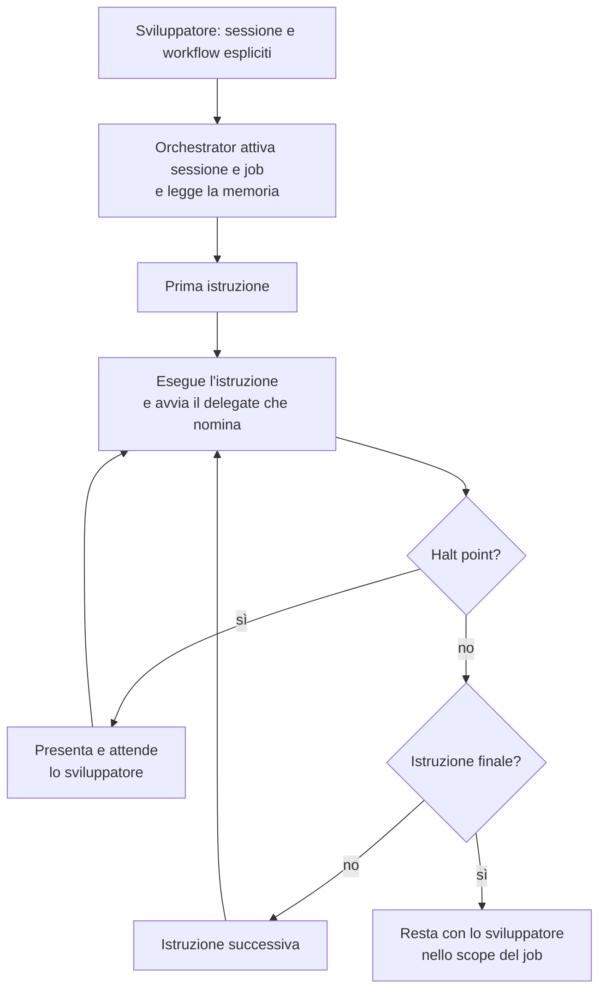
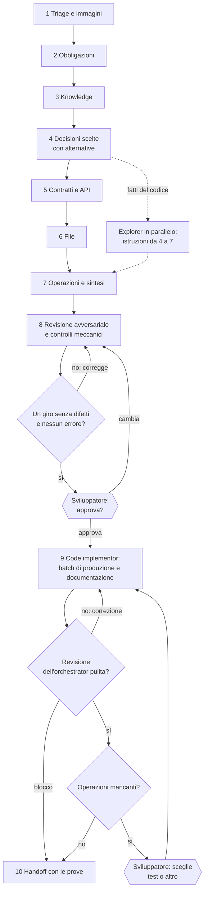

[Corso](../README.md) › [Slide](README.md) › **I tre workflow**

# I tre workflow, istruzione per istruzione

Mappa del ruolo: [Orchestrator](../role-maps/agents/orchestrator.md)

Questa pagina serve quando vuoi seguire **ogni istruzione**. L'elenco dei tipi è in [workflow-types.yaml](../system/canonical/workflows/workflow-types.yaml); il testo di ogni istruzione è nel file collegato in tabella, e il [ciclo del workflow](../system/canonical/contracts/workflow-loop.md) descrive come il runtime le serve. Queste sintesi non sostituiscono i file: durante l'esecuzione nessuna istruzione si salta o si unisce. Ogni workflow comincia dalla propria istruzione di intake.

**Halt point** indica dove il workflow si ferma ad aspettare lo sviluppatore. “Se serve” vuol dire che lo stop scatta solo nella condizione descritta dall'istruzione. Ogni istruzione si ferma anche su un blocco: una scrittura che fallisce dopo un nuovo tentativo, un fatto mancante o contraddittorio.

## Il ciclo comune

In `DESIGN` e in `FAST_IMPLEMENTATION` l'unico delegate che cerca nel codice è l'[Explorer](../role-maps/agents/explorer.md): l'orchestrator legge da sé solo i file di cui conosce già il percorso. Le istruzioni che contengono una discussione con lo sviluppatore (dalla review in poi in `DESIGN`, l'handoff in `FAST_IMPLEMENTATION`) si chiudono con le stesse regole: giudizio indipendente, una domanda alla volta, nessuna azione su ciò che resta aperto senza consenso esplicito.

## DESIGN

Per requisiti complessi, con una persona che giudica le decisioni prima del codice.

| N/10 | Istruzione | Che cosa produce | Halt point |
| --- | --- | --- | --- |
| 1 | [Image intake](../system/canonical/workflows/design/01-image-intake.md) | Triage della richiesta; immagini osservate e allegate alla sessione | Se serve: screenshot di un link Figma; fine del workflow se la richiesta non chiede di cambiare il codice |
| 2 | [Requirement decomposition](../system/canonical/workflows/design/02-requirement-decomposition.md) | Obbligazioni atomiche e verificabili, ricavate solo dal testo del requisito | No |
| 3 | [Knowledge enrichment](../system/canonical/workflows/design/03-knowledge-enrichment.md) | Knowledge letta senza aprire il codice; prescrizioni registrate come riferimenti; obbligazioni funzionali aggiunte dalla knowledge | No |
| 4 | [Decision consolidation](../system/canonical/workflows/design/04-decision-consolidation.md) | Una decisione per ogni scelta reale: risposta scelta e alternative; i fatti del codice arrivano dagli explorer e ogni simbolo usato diventa un riferimento | No: lo sviluppatore le vede alla review |
| 5 | [Contracts](../system/canonical/workflows/design/05-contracts.md) | Intestazione, contratti interni e API pubbliche, completi | No |
| 6 | [Filesystem](../system/canonical/workflows/design/06-filesystem.md) | Ogni file aggiunto, modificato o eliminato, con motivo e modifica | No |
| 7 | [Operations](../system/canonical/workflows/design/07-operations.md) | Operazioni ordinate, eseguibili da un contesto vuoto; poi la sintesi della situazione di partenza | No |
| 8 | [Design review](../system/canonical/workflows/design/08-design-review.md) | Revisione avversariale da quattro punti di vista, controlli meccanici puliti, documento di review | **Sì**: review e approvazione |
| 9 | [Implementation](../system/canonical/workflows/design/09-implementation.md) | Un'iterazione per unità di lavoro: batch di produzione e di documentazione dal code implementor, revisione dell'orchestrator, poi le operazioni `Testing` e distruttive scelte dallo sviluppatore | **Sì**: dopo ogni unità di lavoro chiede quali operazioni eseguire; anche su blocco |
| 10 | [Terminal handoff](../system/canonical/workflows/design/10-terminal-handoff.md) | Messaggio con documento, file, revisioni e blocchi | **Sì**: fine del workflow; le modifiche successive passano dal design e dallo stesso implementor |

Chi chiama quali strumenti in queste istruzioni: [Strumenti di DESIGN](../reference/strumenti-design.md).

## FAST_IMPLEMENTATION

Per requisiti semplici o compiti meccanici. Non c'è un documento di design né un'approvazione, e nessun delegate scrive codice: il requisito è il testo del prompt e l'orchestrator lo implementa da solo. Gli explorer gli localizzano i fatti del codice, e le prescrizioni di knowledge registrate nel job vengono rilette contro il codice prima di chiudere.

| N/4 | Istruzione | Che cosa produce | Halt point |
| --- | --- | --- | --- |
| 1 | [Intake](../system/canonical/workflows/fast-implementation/01-intake.md) | Triage della richiesta e immagini allegate | Se serve: screenshot Figma; fine del workflow se la richiesta non chiede di cambiare il codice |
| 2 | [Knowledge](../system/canonical/workflows/fast-implementation/02-knowledge.md) | Knowledge letta senza aprire il codice; prescrizioni applicabili registrate come riferimenti del job; un knowledge bundle per l'implementazione | No |
| 3 | [Implementation](../system/canonical/workflows/fast-implementation/03-implementation.md) | Fatti del codice dagli explorer; codice e test unitari scritti dall'orchestrator; build e test eseguiti finché passano; gate di conformità alla knowledge superato | Solo su blocco: un fatto mancante, un conflitto tra knowledge e requisito o una prescrizione che non si può applicare |
| 4 | [Terminal handoff](../system/canonical/workflows/fast-implementation/04-terminal-handoff.md) | Messaggio con file e blocchi | **Sì**: fine; ogni nuova richiesta diventa il nuovo requisito, implementato nello stesso job con build, test e gate di conformità |

Chi chiama quali strumenti in queste istruzioni: [Strumenti di FAST_IMPLEMENTATION](../reference/strumenti-fast-implementation.md).

## DOCUMENTATION

Per scrivere documentazione tecnica da un template.

| N/7 | Istruzione | Che cosa produce | Halt point |
| --- | --- | --- | --- |
| 1 | [Intake](../system/canonical/workflows/documentation/01-intake.md) | Template scelto, modalità `strict` o `flexible`, elenco dei segnaposti | **Sì**: scelta del template e della modalità |
| 2 | [Knowledge discovery](../system/canonical/workflows/documentation/02-knowledge-discovery.md) | Knowledge applicabile e fatti che porta | No |
| 3 | [Codebase exploration](../system/canonical/workflows/documentation/03-codebase-exploration.md) | Evidenza dal codice per ogni segnaposto: qui l'orchestrator esplora da sé, partendo dalla mappa dei cluster | No |
| 4 | [Authoring](../system/canonical/workflows/documentation/04-authoring.md) | Documento compilato, senza riferimenti a file | No |
| 5 | [Coverage check](../system/canonical/workflows/documentation/05-coverage-check.md) | Segnaposti risolti e residui | No |
| 6 | [Review](../system/canonical/workflows/documentation/06-review.md) | Documento corretto dal documentation reviewer | No: il reviewer non fa domande; se dopo tre round resta una sezione che blocca la guida, il workflow si ferma |
| 7 | [Wrap-up](../system/canonical/workflows/documentation/07-wrap-up.md) | Documento salvato come artifact della sessione | **Sì**: fine; lo sviluppatore lo rivede |

Chi chiama quali strumenti in queste istruzioni: [Strumenti di DOCUMENTATION](../reference/strumenti-documentation.md).

---

[← Precedente: riferimento rapido](reference-roster.md) · [↑ Slide](README.md) · [Torna al corso →](../README.md)
